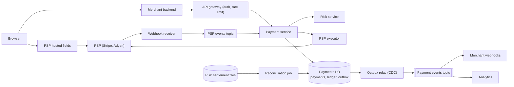
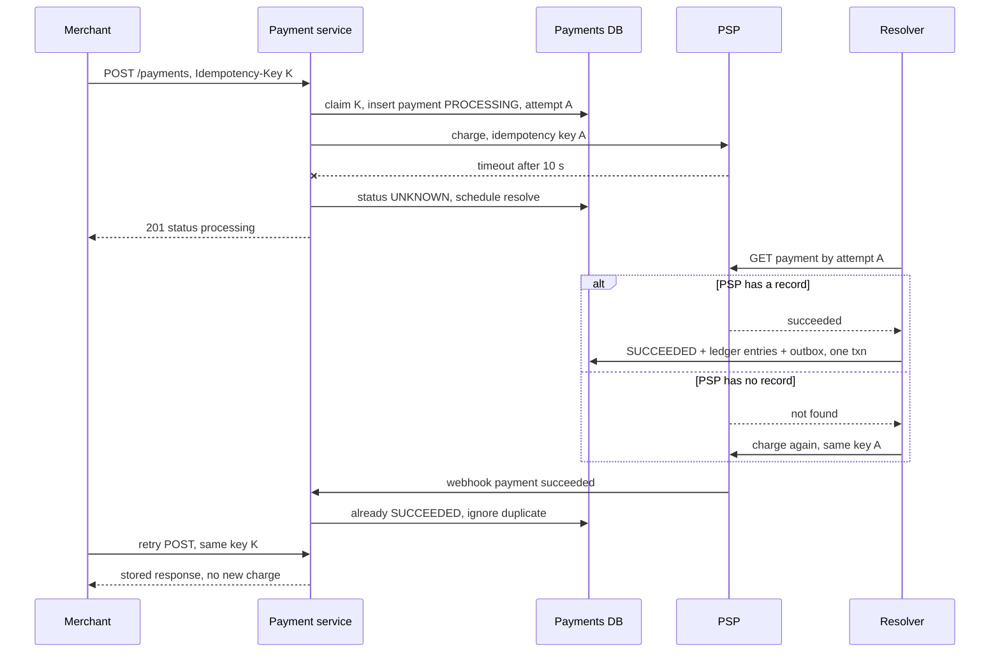

# Design a Payment System (Stripe, PayPal pay-in)

| | |
|---|---|
| **Asked at** | Fintech, commerce and marketplace companies; common at senior level because it tests correctness more than scale |
| **Difficulty** | Hard |
| **Core challenges** | exactly-once charging, unknown PSP outcomes, double-entry ledger, reconciliation |
| **Related building blocks** | [`src/idempotency-store`](../src/idempotency-store/) |

LLD version of the wallet and ledger classes: [digital-wallet](https://github.com/hardyalsinghdeora/low-level-design/blob/main/problems/digital-wallet.md).

## 1. Requirements

### Functional
1. A merchant's checkout creates a payment for an order: amount in integer minor units plus a currency (`4999 USD` means $49.99).
2. The customer enters card details in PSP-hosted fields; our servers only ever see a token.
3. The payment is authorised and captured through an external PSP (Stripe, Adyen, Braintree). The final outcome may arrive synchronously or later through a PSP webhook.
4. Every money movement is recorded in a double-entry ledger; merchant wallet balances are derived from it.
5. Full and partial refunds; chargebacks (disputes) raised by the card network are recorded and debited from the merchant.
6. A fraud/risk check runs before the PSP call and can block, allow or require 3-D Secure.
7. Daily reconciliation of our ledger against each PSP's settlement file.
8. Merchants receive webhooks for payment state changes (see [webhook delivery](./webhook-delivery-system.md)).

### Non-functional
- 10 M payments per day, peaks of 10× average during sales events.
- Correctness first: a customer is never charged twice for one payment, and no captured payment is missing from the ledger. Consistency beats availability on the money path.
- Payment API p99 under 2 s, most of which is the PSP round trip; our own overhead under 100 ms.
- Availability 99.99 % for accepting payments; ledger writes may queue briefly but are never lost.
- Audit: every state change and ledger entry is immutable and kept for at least 7 years.

### Out of scope
- Building a card network or acquiring bank, payouts to merchant bank accounts, currency conversion pricing, the internals of the fraud model.

## 2. Estimation

| Quantity | Estimate | Implication |
|---|---|---|
| Payments | 10 M / 86,400 s ≈ **115/s**, peak ~1,200/s | A sharded relational store handles this easily; the PSP rate limits and latency matter more than our database |
| PSP calls | ~2 per payment (authorise+capture, or one combined call plus a status query on timeout) ≈ **250/s**, peak 2,500/s | Per-PSP connection pools and circuit breakers; negotiate PSP rate limits ahead of sales |
| Concurrent in-flight PSP calls | 1,200/s × 1.5 s ≈ **1,800** | Async I/O workers; a thread per call would need thousands of threads |
| Ledger entries | 10 M × ~4 entries (capture, fee, plus refund/dispute share) ≈ **40 M/day** | Append-only table, partitioned by month |
| Ledger storage | 40 M × 200 B = **8 GB/day**, ~3 TB/year, ~20 TB over 7 years | Hot partitions in Postgres; older months archived to columnar storage for audit queries |
| Payment rows | 10 M × 1 KB = **10 GB/day** | Partition by merchant; keep 13 months hot |
| Idempotency keys | 10 M/day × 24 h retention × ~1 KB (stored response) = **10 GB** | Fits in the payments database itself or a small Redis cluster |
| Webhooks in | ~3 PSP events per payment ≈ **350/s**, peak 3,500/s | Ingest to a queue first, process asynchronously |

## 3. API

```
POST /v1/payments
  headers: Authorization: Bearer <merchant secret key>, Idempotency-Key: <uuid>
  body: { orderId, amount: 4999, currency: "USD", paymentMethodToken: "pm_tok_...",
          captureMethod: "automatic" | "manual", metadata }
  201: { paymentId, status: "succeeded" | "processing" | "requires_action", nextAction? }
  409: same Idempotency-Key reused with a different body
  402: declined { declineCode }

POST /v1/payments/{id}/capture          body: { amount? }   (partial capture of an auth)
POST /v1/payments/{id}/cancel
POST /v1/refunds                        body: { paymentId, amount, reason }  + Idempotency-Key
GET  /v1/payments/{id}
GET  /v1/balance                        { available: [{ amount, currency }], pending: [...] }
GET  /v1/ledger/entries?account=...&cursor=...&limit=100

POST /internal/psp-webhooks/{psp}       (PSP to us; signature verified, 200 returned after durable enqueue)
```

- **Idempotency**: every mutating call requires `Idempotency-Key`. The key is scoped per merchant, stored with a hash of the request body and the final response; a replay returns the stored response byte for byte. See [delivery semantics](../fundamentals/delivery-semantics-and-idempotency.md) and the [`idempotency-store`](../src/idempotency-store/) block.
- **Pagination**: cursor based on `(created_at, id)`; offsets drift on an append-only table.
- **Auth**: merchant secret keys server side, publishable keys in the browser can only create tokens. mTLS between internal services.

## 4. Data model

```
payments (
  id               UUID PRIMARY KEY,
  merchant_id      BIGINT NOT NULL,
  order_id         TEXT NOT NULL,
  amount           BIGINT NOT NULL,           -- minor units
  currency         CHAR(3) NOT NULL,          -- ISO 4217
  amount_captured  BIGINT NOT NULL DEFAULT 0,
  amount_refunded  BIGINT NOT NULL DEFAULT 0,
  status           TEXT NOT NULL,             -- state machine below
  psp              TEXT NOT NULL,
  psp_reference    TEXT NULL,                 -- PSP's payment id once known
  attempt_id       UUID NOT NULL,             -- our id sent to the PSP as its idempotency key
  version          INT NOT NULL,              -- optimistic lock for state transitions
  created_at, updated_at TIMESTAMPTZ
)
UNIQUE (merchant_id, order_id)                -- one payment per order
UNIQUE (psp, psp_reference)                   -- webhook lookup

payment_events (payment_id, seq, from_status, to_status, cause, payload JSONB, at)   -- append-only audit

idempotency_keys (merchant_id, key, request_hash, status, response JSONB, locked_until, created_at,
                  PRIMARY KEY (merchant_id, key))

ledger_transactions (id UUID PK, kind TEXT, payment_id UUID NULL, created_at)
ledger_entries (
  id             BIGSERIAL,
  transaction_id UUID NOT NULL,
  account_id     BIGINT NOT NULL,
  amount         BIGINT NOT NULL,             -- positive = debit, negative = credit
  currency       CHAR(3) NOT NULL,
  created_at     TIMESTAMPTZ NOT NULL
)                                             -- invariant: SUM(amount) per (transaction_id, currency) = 0
INDEX ledger_entries(account_id, created_at)

accounts (id, owner_type, owner_id, type, currency, balance BIGINT, version INT)  -- balance is a cache of SUM(entries)
psp_events (psp, psp_event_id, received_at, payload, processed_at, PRIMARY KEY (psp, psp_event_id))
outbox (id, aggregate_id, event_type, payload, created_at, published_at NULL)
```

Store choice: Postgres. Payments, idempotency keys, ledger entries and the outbox row for one state change must commit in **one ACID transaction**; that requirement outweighs everything else. Shard by `merchant_id` when one primary is not enough, so a payment and its ledger entries stay on one shard. Platform-level accounts (PSP receivable, fees) are touched by every payment, so their balances are not updated row by row; see 6.3.

## 5. High-level design



**Card entry**: the browser loads the PSP's iframe (hosted fields). The card number goes straight to the PSP, which returns a token. Our servers never see a PAN, which keeps us at the lightest PCI DSS self-assessment level instead of a full audit of our infrastructure.

**Create payment**: merchant backend → gateway → payment service. The service claims the idempotency key, inserts the payment in `CREATED`, calls risk, moves to `PROCESSING`, and hands the call to the PSP executor with `attempt_id` as the PSP's idempotency key. On a synchronous success it writes `SUCCEEDED`, the ledger entries and an outbox row in one transaction, stores the response against the idempotency key and returns 201.

**Asynchronous confirmation**: many methods (3-D Secure, bank debits, wallets) finish later. The PSP posts a webhook; the receiver verifies the signature, writes it to `psp_events` (deduplicated on the PSP event id), acks 200 and enqueues. The payment service applies the transition only if it is legal from the current state.

**Downstream**: the outbox relay publishes payment events to Kafka; merchant webhooks, the order service and analytics consume them. See [transactional outbox and CDC](../fundamentals/transactional-outbox-and-cdc.md).

## 6. Deep dives

### 6.1 Payment state machine and idempotency end to end

```
CREATED → PROCESSING → REQUIRES_ACTION → PROCESSING
PROCESSING → AUTHORIZED → CAPTURED (= SUCCEEDED)
PROCESSING → SUCCEEDED | FAILED | UNKNOWN
UNKNOWN → SUCCEEDED | FAILED            (resolved by status query or webhook, never by blind retry)
SUCCEEDED → PARTIALLY_REFUNDED → REFUNDED
SUCCEEDED → DISPUTED → DISPUTE_WON | DISPUTE_LOST
AUTHORIZED → CANCELED                    (auth voided before capture)
```

Every transition is `UPDATE payments SET status = $new, version = version + 1 WHERE id = $id AND version = $v AND status = $expected`; zero rows updated means someone else moved it first and the caller re-reads. Illegal transitions (a late `failed` webhook arriving after `SUCCEEDED`) are logged and dropped. Terminal states never change except through refund or dispute, which are separate child records.

Idempotency has to hold at three hops:

| Hop | Key | Mechanism |
|---|---|---|
| Merchant → us | `Idempotency-Key` header | Row in `idempotency_keys` with request hash; concurrent duplicates wait or get 409 while the first is in flight; completed ones replay the stored response |
| Us → PSP | `attempt_id` (one per payment attempt) | Sent as the PSP's own idempotency key, so a retried HTTP call cannot create a second charge at the PSP |
| PSP → us | PSP event id | Primary key on `psp_events`; transitions guarded by the state machine |

Options for the merchant-facing store: (1) Redis with `SET NX` and a TTL, fast but a failover can lose a key and permit a duplicate charge; (2) a row in the payments database written in the same transaction as the payment. **Choice: (2).** A key that commits atomically with the payment cannot disagree with it. Redis can sit in front as a cache for replays, never as the source of truth.

### 6.2 PSP timeouts and unknown outcomes

The hardest case: we sent the charge and the connection timed out. The PSP may have charged the card or not. Retrying with a new attempt id risks a double charge; marking it failed risks telling the merchant to retry and charging twice anyway.

Options:
1. **Fail the payment** on timeout. Simple and wrong: the card may be charged with no record on our side.
2. **Retry immediately with the same PSP idempotency key.** Safe at PSPs that honour idempotency keys, but the retry can also time out, and not every PSP or payment method supports them.
3. **Mark `UNKNOWN`, query before retry.** Return `processing` to the merchant; a resolver queries the PSP by `attempt_id` (or our reference) with backoff, and the PSP webhook can resolve it first. Only if the PSP confirms the attempt does not exist is a retry with the same key allowed.

**Choice: 3, using 2 inside it.** No path creates a second attempt while the first one's outcome is unknown.



The resolver gives up after a bounded window (say 24 h of query backoff) and raises the payment to manual review; reconciliation (6.4) is the final backstop. Wrap PSP calls in a [circuit breaker](https://github.com/hardyalsinghdeora/design-patterns/tree/main/src/modern/circuit-breaker) per PSP and [retry with backoff](https://github.com/hardyalsinghdeora/design-patterns/tree/main/src/modern/retry-with-backoff) only for errors the PSP documents as safe to retry.

### 6.3 Double-entry ledger and wallet balances

Problem: balances must always be explainable, and a bug must not create or destroy money.

Options:
1. **Mutable balance column** updated per payment. Fast, but no history; one bad update is unrecoverable.
2. **Single-entry log** of amounts per merchant. Has history, but nothing forces the books to balance.
3. **Double-entry ledger**: every transaction is a set of entries across accounts whose amounts sum to zero per currency. Balances are sums of entries.

**Choice: 3.** A $49.99 card payment with a $1.75 fee:

| Account | Debit | Credit |
|---|---|---|
| PSP receivable (platform, USD) | 4999 | |
| Merchant payable (merchant 42, USD) | | 4824 |
| Fee revenue (platform, USD) | | 175 |

A refund reverses the same accounts with new entries; entries are never updated or deleted. A chargeback debits the merchant payable and credits PSP receivable, plus a dispute fee entry.

Balances: reading `SUM(amount)` over millions of entries per request is too slow, so `accounts.balance` is a cached value updated in the same transaction as the entries, guarded by `version`. Merchant accounts are low contention. Platform accounts (PSP receivable, fee revenue) would be a hot row taking every write, so they are not updated per payment: either split them into N sub-accounts chosen at random and summed on read, or compute them asynchronously from entries. A nightly job recomputes every cached balance from entries and alerts on any difference. Multi-currency is handled by one account per currency; there is no implicit conversion.

### 6.4 Reconciliation against PSP settlement files

The PSP is the source of truth for what actually moved. Each PSP publishes a settlement report (typically daily) listing every captured payment, refund, dispute and fee in the payout batch.

Matching, per PSP per day:
1. Load the file into a staging table; key each line by `psp_reference`.
2. Join against our payments and ledger entries for the same window (with a day of slack for cut-off differences).
3. Classify: matched; amount or currency mismatch; present at the PSP but missing in our ledger (often an `UNKNOWN` we never resolved: create the entries and flag); present in our ledger but missing at the PSP (charge we think succeeded but did not settle: investigate before the merchant is paid out).
4. Book the actual payout: debit bank, credit PSP receivable. The receivable for that batch should net to zero; a residue is a reconciliation break.

Breaks go to a finance operations queue with an SLA. Three-way reconciliation (our ledger, PSP report, bank statement) catches problems at the PSP itself.

### 6.5 Refunds, chargebacks and risk

- **Refunds** are their own entity (`refunds` table, own state machine and idempotency key). Validate `amount_refunded + amount <= amount_captured` inside the same transaction that inserts the refund, so two concurrent partial refunds cannot exceed the capture. PSP refund calls follow the same unknown-outcome rule as charges.
- **Chargebacks** arrive only as PSP webhooks. They create a dispute record, move the payment to `DISPUTED`, and post ledger entries immediately (funds withheld). Evidence submission is a merchant workflow with a network deadline.
- **Risk hook**: a synchronous call with a tight timeout (~100 ms) returning allow, block or challenge (3-D Secure). If risk times out, fail open for low amounts and fail closed above a threshold; this is a business decision to state explicitly.

## 7. Scaling and operations

- **Partitioning**: shard Postgres by `merchant_id` (payments, refunds, merchant accounts, merchant-side entries colocated). Platform-side entries for a payment live on the same shard and are aggregated across shards asynchronously. A large merchant can get a dedicated shard.
- **Replication**: synchronous replication to a standby in another availability zone (no committed payment lost on failover); reads for dashboards from async replicas.
- **Caching**: almost none on the money path. Cache merchant config, PSP routing rules and idempotency replays.
- **Failure modes**: PSP down → circuit opens, route to a secondary PSP for new payments only (never re-route an `UNKNOWN`); database failover → API returns 503 briefly, merchants retry with the same key; webhook receiver down → PSPs retry for days, and the resolver polls anyway; outbox relay lag → merchant webhooks are late but not lost.
- **Monitoring**: authorisation rate per PSP and card brand (a sudden drop means a PSP or integration problem), count and age of `UNKNOWN` payments, ledger imbalance (must be zero), reconciliation break count, PSP p99 latency, webhook processing lag.
- **Security**: no PANs stored (tokens only); secrets in a KMS; PSP webhooks verified by signature and source; per-merchant rate limits; every manual ledger adjustment requires two-person approval and is itself a ledger transaction. See [security basics](../fundamentals/security-basics.md).

## 8. Trade-offs summary

| Decision | Chosen | Alternative | Why |
|---|---|---|---|
| Card data | PSP hosted fields and tokens | Collect PAN on our servers | Keeps our systems out of most PCI DSS scope |
| Idempotency store | Postgres row in the payment transaction | Redis `SET NX` | Cannot disagree with the payment after a failover |
| Timeout handling | `UNKNOWN` + query before retry | Fail or blind retry | Both alternatives can double charge or lose a charge |
| Balances | Double-entry ledger, cached balance | Mutable balance column | Auditable, self-checking, recomputable |
| Hot platform accounts | Sub-accounts or async aggregation | Single balance row | One row cannot absorb 1,200 writes/s with locking |
| Event publishing | Transactional outbox | Publish after commit | No lost or phantom events on crash |
| Final truth | Daily reconciliation with PSP files | Trust our own state | Catches every gap the online path missed |

## 9. Follow-up questions interviewers ask

- *"Why not use a distributed transaction across the PSP and our DB?"* The PSP is an external HTTP API with no two-phase commit. We use a local transaction plus idempotent retries, a persisted state machine and reconciliation; see [distributed transactions](../fundamentals/distributed-transactions.md).
- *"How do you switch PSPs during an outage?"* Routing applies only to new attempts. A payment in `UNKNOWN` stays with its PSP until resolved, otherwise both PSPs might charge.
- *"Why integer minor units?"* Floating point cannot represent 0.10 exactly, and sums drift. Store `BIGINT` plus ISO 4217 currency; note that some currencies have 0 decimals (JPY) and some 3 (KWD).
- *"How does the merchant know a `processing` payment finished?"* A `payment.succeeded` or `payment.failed` webhook, plus `GET /payments/{id}`. Orders should be fulfilled on the webhook, not on the browser redirect.
- *"Could a late PSP webhook overwrite a newer state?"* No. Transitions are conditional on the current state and version; out-of-order events either apply legally or are dropped and logged.
- *"How long do you keep idempotency keys?"* At least 24 hours (the common PSP convention) and longer than any client retry window. After expiry, `UNIQUE (merchant_id, order_id)` still blocks a second payment for the same order.
