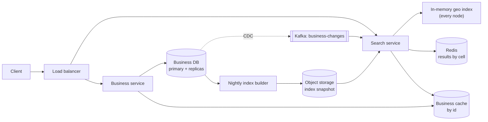
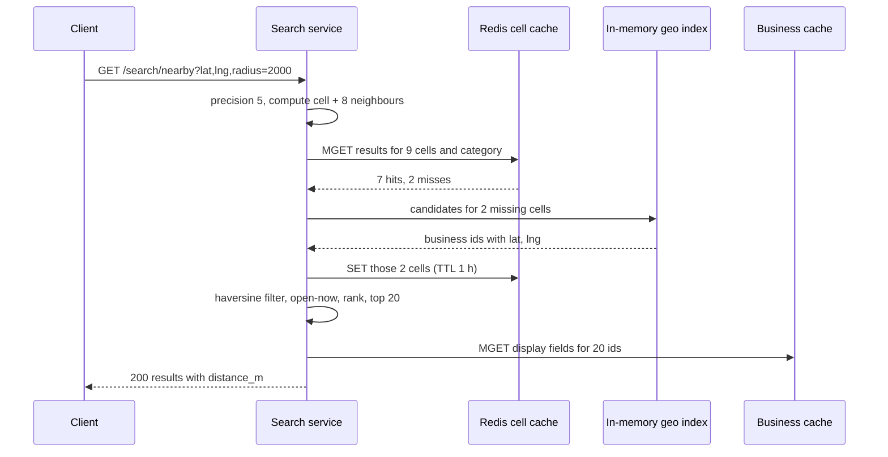

# Design a Proximity Service (Yelp, "restaurants near me")

| | |
|---|---|
| **Asked at** | Common at consumer, local-search and maps companies; often the first geospatial problem |
| **Difficulty** | Medium |
| **Core challenges** | geospatial indexing, boundary cells, read-heavy caching, ranking |
| **Related building blocks** | [`src/geohash`](../src/geohash/), [`src/consistent-hash-ring`](../src/consistent-hash-ring/) |

## 1. Requirements

### Functional
1. Given a location and a radius (500 m to 20 km), return nearby businesses, optionally filtered by category ("cafe") and open now.
2. Show a business page with details, hours and photos.
3. Business owners add, update and remove their business; changes may take effect the next day.
4. Results show the distance to each business and are ordered by a relevance score, not by distance alone.

### Non-functional
- Scale: 200 M businesses worldwide, 100 M daily users, 5 searches per user per day.
- Latency: search p99 under 200 ms.
- Freshness: new businesses and edits visible within 24 h; a permanent closure within an hour, because sending users to a closed shop is the worst failure.
- Read-heavy and mostly static: business locations change rarely, so the index can be rebuilt or updated in batches.
- Availability: 99.99 % for search. Eventual consistency for business updates is fine.

### Out of scope
- Reviews and ratings (they arrive as a precomputed score), moving objects (that is [ride-hailing](./ride-hailing.md)), full-text search on business names beyond a simple prefix, map rendering.
- The photo upload and moderation pipeline; photos are served from a CDN by URL.
- Personalised recommendations beyond a simple reranker.

## 2. Estimation

| Quantity | Estimate | Implication |
|---|---|---|
| Search QPS | 100 M × 5 / 86,400 s ≈ **5.8k/s**, peak ~3× = **17k/s** | Several stateless search replicas; each query must be in-memory work |
| Business writes | ~1 % of businesses change per month → 2 M / 2.6 M s ≈ **1/s** | Writes are negligible; optimise everything for reads |
| Business data | 200 M × 1 KB = **200 GB** | One sharded relational or document store, cached by id |
| Geo index | 200 M × (8 B cell id + 8 B business id) ≈ **3.2 GB** | The whole index fits in memory on every search node; replicate instead of shard |
| Read:write | ~6,000 : 1 | Precompute and cache; rebuild the index nightly plus a small change stream |
| Cell cache | ~1 M populated geohash-5 cells on land × ~10 categories × 500 candidates × 16 B ≈ **80 GB** worst case; hot cells far fewer | Cache only cells that are queried, with LRU eviction; a few Redis nodes hold the hot set |
| Index build | 200 M rows scanned and sorted by geohash, ~minutes on one machine | Nightly full rebuild is cheap, so the incremental path can stay simple |
| Result payload | 20 results × 300 B = **6 KB** | Small; cache whole result pages per cell and filter |

## 3. API

```
GET /v1/search/nearby?lat=37.776&lng=-122.417&radius_m=2000&category=cafe&open_now=true&cursor=..
  200: { businesses: [{ id, name, lat, lng, distance_m, category, rating, isOpen }], nextCursor }

GET /v1/businesses/{id}
  200: { id, name, address, lat, lng, hours, photos[], category, rating }

POST   /v1/businesses                 headers: Idempotency-Key   (owner)
PUT    /v1/businesses/{id}            (owner)
DELETE /v1/businesses/{id}            (owner)
```

Search is public with a per-IP and per-API-key rate limit; owner endpoints need an authenticated owner who has verified the business. The cursor encodes the last returned (score, id) so pages stay stable while the user scrolls. Radius is clamped to 20 km; larger queries go to a different "browse a city" path.

## 4. Data model

```
businesses (
  business_id  BIGINT PRIMARY KEY,
  name         TEXT,
  lat, lng     DOUBLE PRECISION,
  geohash      CHAR(12),               -- full precision, prefix gives coarser cells
  category     TEXT,
  hours        JSONB,
  rating       REAL,                   -- precomputed by the reviews system
  updated_at   TIMESTAMPTZ
)
INDEX businesses(geohash)              -- prefix range scans for the index builder

-- in-memory geo index on each search node
cell (geohash prefix, precision 4..6) → sorted array of (business_id, lat, lng, category, rating)
```

Store choice: the business table is read by id and written about once per second, so a relational database (Postgres or MySQL) with read replicas is enough, sharded by `business_id` if 200 GB per primary becomes uncomfortable. The geo index is a derived structure kept in the memory of each search node, built from the table. Because it is only 3 GB, every node holds all of it and there is no scatter-gather on queries.

## 5. High-level design



**Search**: the search service converts `(lat, lng, radius)` into a set of cells (section 6.2), reads each cell's candidates from the in-memory index, filters by exact distance, category and open hours, ranks, and fetches display fields for the top results from the business cache. No database is touched on the hot path.

**Update**: the owner writes to the business service, which updates the database. CDC publishes the change; each search node applies it to its in-memory index within seconds. A nightly builder also writes a full snapshot so new nodes start quickly and any drift is corrected.

## 6. Deep dives

### 6.1 Choosing the geospatial index

Problem: answer "points within r of (lat, lng)" over 200 M mostly static points, fast. A plain index on `lat` and one on `lng` does not help: each one returns a huge strip and intersecting them is slow.

| Option | How it works | Strengths | Weaknesses |
|---|---|---|---|
| **Geohash** | Interleave lat and lng bits, base-32 encode. Shared prefix means nearby (usually). Precision 6 ≈ 1.2 km × 0.6 km | Cells are strings: works in any store with a B-tree or a key-value map; easy to cache by cell | Fixed grid ignores density: one cell in Manhattan holds thousands, one in a desert holds none; neighbours across a cell edge can have unrelated prefixes |
| **Quadtree** | Recursively split a square into four until each leaf holds at most ~100 points | Adapts to density: leaves are small in cities and large in rural areas | In-memory tree, harder to update concurrently and to store in a database; build takes minutes for 200 M points |
| **S2 (or H3)** | Project the sphere onto a cube (S2) and number cells along a Hilbert curve; a region is covered by a set of cells at mixed levels | Accurate on the sphere, good covering of circles with few cells, used in production map systems | More complex library; harder to explain and debug in an interview |

**Choice:** geohash for this problem. The data is static, the query is a circle, and geohash cells can be cached and stored anywhere. The density problem is handled in section 6.3 by choosing precision per query rather than by changing the structure. A quadtree is a good answer when the interviewer pushes on density; S2 is the answer when accuracy over large areas matters. See [geospatial indexing](../fundamentals/geospatial-indexing.md) and [`src/geohash`](../src/geohash/) for encoding and neighbour calculation.

### 6.2 Radius search with neighbour cells

Problem: a point near the edge of its cell has close neighbours in the next cell, whose geohash prefix can differ completely (cells either side of the equator or the prime meridian share no prefix at all). Searching only the user's cell misses them.

Options:

1. **Query the user's cell only.** Fast, wrong at the edges.
2. **Query the cell plus its 8 neighbours**, at a precision whose cell size is at least the radius, then filter by exact haversine distance.
3. **Compute an exact covering** of the circle with cells (S2 `RegionCoverer` style). Fewest wasted candidates, more complex.

**Choice:** option 2. Pick the finest precision whose cell's shorter side is at least the radius, compute the 9 cells, union their candidates, filter by true distance. The 3×3 block always contains the full circle under that rule, because the circle can extend at most one cell in any direction.

| Geohash precision | Cell size (approx., at the equator) | Use for radius up to |
|---|---|---|
| 4 | 39 km × 19.5 km | 19.5 km (20 km cap rounds here) |
| 5 | 4.9 km × 4.9 km | 4.9 km |
| 6 | 1.2 km × 0.6 km | 0.6 km |
| 7 | 153 m × 153 m | 150 m (too fine for this product) |

Cells shrink in east-west extent away from the equator, so the service computes neighbours from the actual cell bounds rather than assuming fixed sizes. Nine lookups in memory cost microseconds; the distance filter on a few thousand candidates is the larger cost and still well under a millisecond.



### 6.3 Too few or too many results: radius expansion

Problem: in a suburb, 2 km may contain 3 cafes; in central Tokyo it may contain 3,000.

- **Too few**: if the filtered count is under the page size, drop one precision level (each level is 32× the area) and search again, up to the 20 km cap. Show the actual distance so users see that results are farther away.
- **Expansion cost**: each retry is another 9-cell lookup in memory, so even three expansions stay within a few milliseconds. Cache the "empty" outcome per cell too, so rural areas do not repeat the expansion for every user.
- **Too many**: cap candidates per cell (store each cell's list pre-sorted by rating, so the cap keeps the best), or move to a finer precision for the ranking pass. This is where a quadtree's adaptive leaves would help; with geohash we accept the cap.

### 6.4 Ranking

Rank by a score combining distance, rating, popularity and open-now, for example `score = w1 · rating + w2 · log(review_count) - w3 · distance_km`. Ranking runs on at most a few thousand candidates per query, which is microseconds of CPU. Personalisation (past visits, preferences) can be a second-pass reranker on the top 100 if the product needs it. Ads or promoted listings are merged into fixed slots after ranking.

### 6.5 Caching by cell

Cells are a natural cache key: everyone in the same geohash-5 cell asking for "cafes" gets the same candidate list. Cache `cell:{geohash}:{category} → top 500 candidates` in Redis with a TTL of an hour; per-user filtering (exact distance, open now) happens after the cache read, so one entry serves many users. Business detail pages are cached by id with invalidation on update. With ~17k queries/s and 9 cells per query, the cell cache absorbs most index lookups, and a CDN can cache the business detail JSON for anonymous users.

## 7. Scaling and operations

- **Replication over partitioning**: the 3 GB index fits on every node, so search nodes are identical replicas behind a load balancer. Add nodes for QPS; no cross-node queries. If the index grew past memory, shard by geohash prefix (region) and route queries to the shard owning the cells, with consistent hashing on the prefix.
- **Index freshness**: nightly snapshot plus CDC updates within seconds. A node that falls behind on CDC still serves yesterday's index, which the requirements allow.
- **Business DB**: primary plus read replicas; reads mostly come from the cache. Multi-region read replicas place data near users.
- **Failure modes**: Redis down → queries go straight to the in-memory index, p99 rises but stays well under 200 ms; business DB down → search still works from the index and caches, owner edits fail; bad snapshot → nodes validate counts and checksums before swapping and keep the previous one.
- **Multi-region**: deploy search nodes in every region with a local copy of the global index (3 GB is cheap to copy), so a query never leaves its region. Business writes go to a single primary region; CDC fans changes out to all regions.
- **Load spikes**: a city-wide event (a festival, a stadium) concentrates queries on a few cells; those cells are exactly the ones in the cache, so the spike lands on Redis, which scales with replicas.
- **Monitoring**: search p99, cell cache hit ratio, average candidates per query (detects density hot spots), empty-result rate by region, CDC lag.
- **Abuse**: rate limits per IP and API key to prevent scraping the entire business database; verification for owner edits so competitors cannot move or close a business.

## 8. Trade-offs summary

| Decision | Chosen | Alternative | Why |
|---|---|---|---|
| Spatial index | Geohash cells | Quadtree, S2 | Static data, string keys work in any cache and store; simplest correct answer |
| Edge handling | 3×3 neighbour cells + exact distance filter | Exact circle covering | Simple, always correct when cell ≥ radius |
| Index placement | Full copy in memory on every node | Sharded index service | 3 GB fits; no scatter-gather |
| Freshness | Nightly snapshot + CDC | Synchronous index update | Writes are 1/s and next-day freshness is acceptable |
| Cache key | Cell + category | Exact query | Many users share a cell; per-user filtering is cheap |

## 9. Follow-up questions interviewers ask

- *"Why not just use PostGIS or Redis GEO?"* Both are fine at this size; PostGIS `ST_DWithin` with a GiST index answers the query directly. The in-memory design shows the mechanics and removes the database from the read path; in practice starting with PostGIS is a sound choice.
- *"How do you handle the equator and the 180° meridian?"* Geohash neighbour calculation handles prefix discontinuities by computing neighbours arithmetically, not by prefix. At ±180° longitude, wrap around; distances use haversine, not flat geometry.
- *"How would you support 'open now' correctly across time zones?"* Store hours in the business's local time zone and evaluate against the business's local time at query time; precompute an `open_until` field each night for speed.
- *"How do you make the quadtree work across many servers?"* Build it on each node from the snapshot (minutes), keep it read-only, and swap in a new one atomically; updates between builds go into a small side index.
- *"How would you rebuild the index without downtime?"* The builder writes a versioned snapshot to object storage; each node loads it into a second structure, checks counts, then swaps a pointer. Old and new versions coexist for one request cycle, and CDC events since the snapshot's timestamp are replayed on top.
- *"What changes if businesses move, like food trucks?"* The write rate rises and staleness matters; move those to a Redis GEO set updated in real time, as in [ride-hailing](./ride-hailing.md), and merge results.
