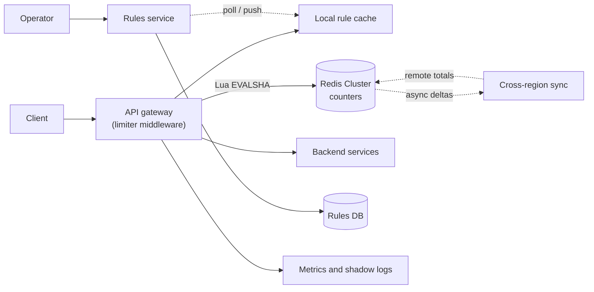
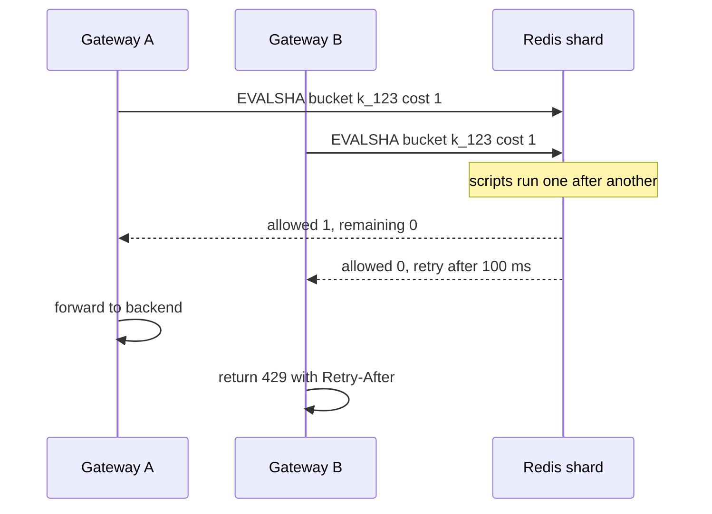

# Design a Distributed Rate Limiter

| | |
|---|---|
| **Asked at** | Very common at API platform, infrastructure and payments teams; often a standalone round or a deep dive inside another design |
| **Difficulty** | Medium |
| **Core challenges** | atomic counters, sub-5 ms overhead, fail-open policy, multi-region limits |
| **Related building blocks** | [`src/rate-limiter-algorithms`](../src/rate-limiter-algorithms/), [`src/consistent-hash-ring`](../src/consistent-hash-ring/) |

LLD version: [rate-limiter](https://github.com/hardyalsinghdeora/low-level-design/blob/main/problems/rate-limiter.md). Concept: [rate limiting](../fundamentals/rate-limiting.md).

## 1. Requirements

### Functional
1. Limit requests per key, where a key is a user id, an API key, a client IP, or a combination with the endpoint (e.g. `api_key + POST /v1/payments`).
2. Limits depend on the tier (free, pro, enterprise) and can be overridden per customer.
3. Rejected requests get HTTP 429 with `Retry-After` and rate-limit headers that tell the client its budget.
4. Operators change rules without a deploy; changes apply within 30 seconds.
5. Support a "shadow" mode that logs what would be rejected without rejecting it.

### Non-functional
- 1 M requests/s at peak across all API gateways, every request checked.
- Added latency: p99 under 5 ms, p50 under 1 ms.
- Availability 99.99 %: the limiter must never be the reason the API is down.
- Accuracy: within a few percent of the configured limit is acceptable; exact global counting is not required.
- Multi-region: three regions, limits are global per customer unless the rule says otherwise.

### Out of scope
- Billing and quota metering (monthly usage sold to customers needs exact, durable counts and a different store).
- DDoS protection at the network layer (L3/L4 scrubbing happens before traffic reaches us).

## 2. Estimation

| Quantity | Estimate | Implication |
|---|---|---|
| Checks/s | 1 M req/s peak, 1 check each (some requests match 2 rules) ≈ **1.5 M counter ops/s** | A single Redis node handles ~100-200k Lua calls/s, so ~10-15 shards plus headroom |
| Active keys | 20 M API keys and users + 30 M IPs seen per hour ≈ **50 M keys** | Keys must expire (TTL = window length) or memory grows without bound |
| Memory per key | key name ~60 B + value ~20 B + Redis overhead ~50 B ≈ **130 B** | 50 M × 130 B ≈ **6.5 GB**, small; shard count is driven by ops/s, not memory |
| Rules | ~10k rules (tiers × endpoints + customer overrides) × ~200 B ≈ **2 MB** | Every gateway holds all rules in memory; no rule lookup on the hot path |
| Latency budget | 5 ms p99 total; in-region Redis round trip ~0.3-1 ms | One round trip per request is fine; a cross-region round trip (30-100 ms) is not |
| Cross-region sync | 3 regions, sync every 500 ms | Global counts are at most ~0.5 s stale; overshoot bounded by 3 × local rate × 0.5 s |

## 3. API

The limiter is an internal service called by gateways, plus a rules admin API.

```
POST /v1/check                        (gRPC in practice; shown as HTTP)
  body: { descriptors: [{ key: "api_key", value: "k_123" }, { key: "route", value: "POST /v1/payments" }],
          cost: 1 }
  200: { allowed: true, limit: 100, remaining: 37, resetAfterMs: 1200, ruleId: "pro-payments" }
  200: { allowed: false, limit: 100, remaining: 0, retryAfterMs: 800, ruleId: "pro-payments" }

PUT /v1/rules/{ruleId}                 (admin, requires operator role)
  body: { match: { tier: "pro", route: "POST /v1/payments" }, algorithm: "token_bucket",
          capacity: 100, refillPerSec: 10, scope: "global", mode: "enforce" | "shadow", failMode: "open" }
  headers: If-Match: <version>         (optimistic concurrency between two operators)
GET /v1/rules?cursor=...&limit=100     (cursor pagination)
```

Response to the end client when rejected:

```
HTTP/1.1 429 Too Many Requests
Retry-After: 1                          (seconds, RFC 9110)
RateLimit-Limit: 100
RateLimit-Remaining: 0
RateLimit-Reset: 1                      (IETF httpapi draft; later drafts merge these into RateLimit and RateLimit-Policy)
```

Notes: `/check` is not idempotent by design (each call consumes budget); the gateway calls it once per request. Rules carry a version so gateways can tell whether their copy is current. The check API trusts its callers (mTLS between gateway and limiter); end clients never reach it.

## 4. Data model

```
-- Rules service (PostgreSQL, source of truth)
rules (
  rule_id        TEXT PRIMARY KEY,
  match          JSONB NOT NULL,        -- { tier, route, api_key?, ip_cidr? }
  algorithm      TEXT NOT NULL,         -- token_bucket | sliding_window
  capacity       INT NOT NULL,
  refill_per_sec NUMERIC NOT NULL,
  scope          TEXT NOT NULL,         -- local | global
  mode           TEXT NOT NULL,         -- enforce | shadow
  fail_mode      TEXT NOT NULL,         -- open | closed
  priority       INT NOT NULL,          -- most specific rule wins
  version        BIGINT NOT NULL,
  updated_at     TIMESTAMPTZ NOT NULL
)

-- Counters (Redis Cluster, ephemeral)
rl:{pro-payments:k_123}   HASH { tokens: 37.5, ts_ms: 1730960000123 }   TTL = capacity / refill + 1 s
rl:{login:ip:203.0.113.7}:28849333   STRING counter                      TTL = 2 × window
```

Keys: the hash tag `{rule:value}` keeps all fields for one limit on one Redis slot so a Lua script can touch them atomically. Indexes: none needed in Redis; the rules table has an index on `updated_at` so gateways can poll "rules changed since version X".

Store choice: counters are small, short-lived and hit 1.5 M times a second, which is exactly what in-memory Redis is for; losing them on a crash costs a brief window of extra allowance, not data. Rules change rarely, need history and validation, and are read by polling, so a relational table with an audit log fits.

## 5. High-level design



**Allowed request**: client → gateway → middleware extracts descriptors (API key, IP, route) → finds matching rules in the local rule cache (in-memory, no network) → one `EVALSHA` per matching rule to the Redis shard that owns the key → script returns allowed and remaining → gateway forwards to the backend and adds `RateLimit-*` headers to the response.

**Rejected request**: same path, script returns `allowed = 0` and the time until a token is available → gateway returns 429 with `Retry-After` without touching the backend. In shadow mode the gateway forwards anyway and logs a `would_reject` event.

**Rule change**: operator updates a rule → rules service validates it, bumps the version, writes the audit row → gateways poll every 10 s (or receive a push) and swap their in-memory rule set atomically.

## 6. Deep dives

### 6.1 Where the limiter runs

| Option | Latency | Consistency | Operational cost |
|---|---|---|---|
| Middleware in the API gateway (Envoy, Kong, NGINX) | One Redis hop | Shared counters, consistent per region | One place to configure; gateway team owns it |
| Sidecar next to each service | One Redis hop | Same | Every service runs it; good for service-to-service limits |
| Library inside each service | Lowest (local counters possible) | Per-instance unless it also calls Redis | Every language needs a client; rule rollouts depend on service deploys |

**Choice:** gateway middleware for external traffic, because that is where the client identity is known and abuse should be stopped before it costs backend capacity. Use a sidecar or library only for internal service-to-service limits. A separate central "limiter service" that the gateway calls over the network adds a hop; the gateway talking to Redis directly keeps the budget at one round trip.

### 6.2 Algorithm choice

| Algorithm | State per key | Bursts | Accuracy |
|---|---|---|---|
| Fixed window counter | 1 integer | Up to 2× limit at window boundaries | Low at edges |
| Sliding window log | 1 timestamp per request | Exact | Exact but memory grows with the limit |
| Sliding window counter | 2 integers (current, previous window) | Smoothed | Approximate (assumes even spread in the previous window) |
| Token bucket | tokens + last refill time | Allows bursts up to capacity, then a steady rate | Exact for its model |
| Leaky bucket (as a queue) | queue | No bursts, smooths output | Adds delay instead of rejecting |

**Choice:** token bucket as the default because product limits are usually phrased as "10 per second, bursts up to 100", which maps directly to `refill_per_sec` and `capacity`. Use the sliding window counter for long windows such as "1,000 login attempts per hour", where a bucket would need a fractional refill and the boundary burst of a fixed window would matter. Both need only two numbers per key. The building block in [`src/rate-limiter-algorithms`](../src/rate-limiter-algorithms/) implements each one with an injectable clock.

### 6.3 Atomic counters: the read-modify-write race

Problem: a token bucket check is "read tokens and timestamp, compute refill, subtract one if allowed, write back". Two gateways doing this concurrently both read `tokens = 1`, both decide "allowed", both write `0`. Two requests got through on one token. Under load this race lets bursts far past the limit.

Options:
1. **`INCR` + `EXPIRE` only** (fixed window). `INCR` is atomic, so no race, but it only supports the fixed-window algorithm.
2. **`WATCH`/`MULTI`/`EXEC` optimistic transaction.** Correct, but under contention on a hot key transactions abort and retry, which multiplies round trips and blows the latency budget.
3. **Lua script via `EVALSHA`.** Redis runs a script to completion without interleaving other commands, so the read, the computation and the write are one atomic step and one round trip.

**Choice:** Lua. The script for a token bucket:

```
-- KEYS[1] = bucket key, ARGV = capacity, refill_per_ms, now_ms, cost
local b = redis.call('HMGET', KEYS[1], 'tokens', 'ts')
local tokens = tonumber(b[1]) or tonumber(ARGV[1])
local ts     = tonumber(b[2]) or tonumber(ARGV[3])
tokens = math.min(tonumber(ARGV[1]), tokens + (tonumber(ARGV[3]) - ts) * tonumber(ARGV[2]))
local allowed = tokens >= tonumber(ARGV[4])
if allowed then tokens = tokens - tonumber(ARGV[4]) end
redis.call('HSET', KEYS[1], 'tokens', tokens, 'ts', ARGV[3])
redis.call('PEXPIRE', KEYS[1], math.ceil(tonumber(ARGV[1]) / tonumber(ARGV[2])) + 1000)
return { allowed and 1 or 0, math.floor(tokens) }
```

Pass `now_ms` from the caller, or call `redis.call('TIME')` inside the script so clock skew between gateways does not matter. Keep scripts short: a slow script blocks the whole shard.



### 6.4 Fail-open vs fail-closed

Problem: Redis shard down or slow. Every request now waits on a timeout or fails.

Options:
1. **Fail closed**: reject when the limiter cannot answer. Safe for brute-force-sensitive endpoints, but a Redis outage becomes a full API outage.
2. **Fail open**: allow when the limiter cannot answer. The API stays up; abuse is briefly unlimited.
3. **Fail to local**: each gateway falls back to an in-memory bucket sized `limit / gateway_count`. Approximate, but still bounded.

**Choice:** per-rule `fail_mode`, defaulting to open with local fallback. A 2 ms client timeout on the Redis call and a [circuit breaker](https://github.com/hardyalsinghdeora/design-patterns/tree/main/src/modern/circuit-breaker) per shard stop a slow shard from adding latency to every request. Rules protecting login, password reset and OTP endpoints are `closed`, because there an attacker benefits from an outage. Alert on any fail-open period.

### 6.5 Multi-region limits

Problem: a customer with a global limit of 1,000/s sends traffic to three regions. A synchronous global counter costs a cross-region round trip (30-100 ms) per request.

Options:
1. **Single global Redis.** Exact, but violates the 5 ms budget for two of three regions.
2. **Static local budgets.** Each region gets `limit / 3`. Zero coordination, but a customer whose traffic is all in one region gets only a third of their limit.
3. **Local counters plus async sync.** Each region enforces against `local count + last known remote counts`; a sync process ships deltas every few hundred milliseconds.

**Choice:** option 3 for global rules, option 2 as the fallback if sync lags past a threshold. The overshoot is bounded: at most each region's rate times the sync interval. For 1,000/s and 500 ms sync that is a few hundred extra requests in the worst case, which fits "within a few percent" over a minute. Rules with `scope: local` skip sync entirely, which suits per-IP limits since an IP rarely spans regions.

## 7. Scaling and operations

- **Partitioning**: Redis Cluster shards by hash slot of the key; the `{rule:value}` hash tag keeps one limit on one shard. A single very hot key (one big customer) is one shard's problem: give it a local pre-check (gateway-side bucket that rejects obviously over-limit traffic) or split the limit into N sub-keys `{k_123:0..N-1}` each with `limit / N`.
- **Replication**: one replica per shard for failover. Replication is async, so a failover can lose the last few hundred milliseconds of counts; the effect is a brief extra allowance, which is acceptable.
- **Rule caching**: gateways keep the full rule set in memory and load the last good snapshot from local disk at startup, so a rules-service outage changes nothing for traffic.
- **Failure modes**: Redis shard down → circuit opens, fail mode per rule; rules service down → gateways keep last rules; sync down → regions fall back to static local budgets; gateway restart → counters live in Redis, nothing lost.
- **Monitoring**: limiter p99 latency, Redis CPU and ops/s per shard, 429 rate per rule and per tier, fail-open seconds, shadow-mode `would_reject` counts before enforcing a new rule, top-N keys by request rate (hot-key detection).
- **Abuse and security**: the client IP comes from the trusted proxy header set by our own load balancer, never from a raw `X-Forwarded-For` the client controls. Limit unauthenticated traffic by IP and authenticated traffic by API key so one NAT does not block an office.

## 8. Trade-offs summary

| Decision | Chosen | Alternative | Why |
|---|---|---|---|
| Placement | Gateway middleware | Central limiter service | One network hop; identity known at the edge |
| Algorithm | Token bucket (sliding window for long windows) | Fixed window | No 2× boundary bursts; maps to product wording |
| Atomicity | Lua script | `WATCH`/`MULTI` | One round trip, no retries under contention |
| Failure policy | Fail open with local fallback, closed for auth endpoints | Always closed | Limiter outage must not become an API outage |
| Multi-region | Local enforcement + async sync | Single global counter | 5 ms budget rules out cross-region calls |
| Counter durability | In-memory, async replica | Persistent store | Losing counts only grants a brief extra allowance |

## 9. Follow-up questions interviewers ask

- *"How do you handle a client that ignores 429 and keeps hammering?"* The rejection path is cheap (no backend call), but repeated violators get escalated to a longer block rule (e.g. 10 minutes) cached at the gateway, then to the WAF or edge IP block list.
- *"How do you roll out a new, stricter limit safely?"* Ship it in shadow mode, compare `would_reject` counts per customer for a few days, notify affected customers, then flip to enforce.
- *"How do you limit by cost instead of by count?"* Pass `cost` to the script (e.g. tokens per LLM call or rows per export); the bucket subtracts the cost. If the cost is only known after the response, charge an estimate up front and settle the difference afterwards.
- *"Why not just use the load balancer's built-in limiting?"* It works for per-IP local limits, but it does not know tiers, API keys or global budgets. It is a good first layer in front of ours.
- *"What happens to clock skew between gateways?"* Take time from Redis inside the script (`TIME`), so all decisions on a key use one clock.
- *"Can the limiter queue requests instead of rejecting them?"* A leaky bucket can delay requests, but holding connections costs gateway memory and makes latency unpredictable; for public APIs reject with `Retry-After` and let the client back off.
