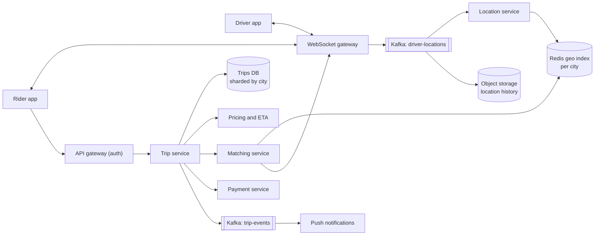
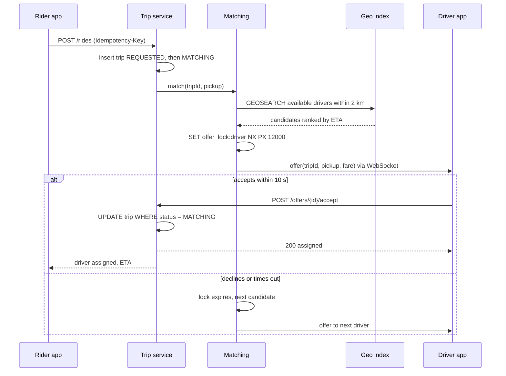

# Design a Ride-Hailing Service (Uber, Ola, Lyft)

| | |
|---|---|
| **Asked at** | Very common at large product companies and marketplace startups; a standard geospatial problem |
| **Difficulty** | Hard |
| **Core challenges** | high-rate location writes, nearest-driver search, one driver per trip, real-time push |
| **Related building blocks** | [`src/geohash`](../src/geohash/), [`src/consistent-hash-ring`](../src/consistent-hash-ring/), [`src/lease-lock`](../src/lease-lock/) |

The object-oriented version of this problem (classes, state pattern, pricing strategies) is in the [LLD ride-sharing write-up](https://github.com/hardyalsinghdeora/low-level-design/blob/main/problems/ride-sharing.md). This file is about the distributed system.

## 1. Requirements

### Functional
1. Drivers go online and send their location every 4 seconds while online.
2. A rider requests a ride from a pickup to a drop-off and sees a fare estimate first.
3. The system finds nearby available drivers and offers the trip to one driver at a time; the driver has 10 seconds to accept.
4. A trip is assigned to exactly one driver; a driver holds at most one trip at a time.
5. Rider and driver see each other's live position and ETA until the trip ends.
6. At trip end the fare is computed and the rider is charged.

### Non-functional
- Scale: 1 M drivers online at peak, 20 M trips per day, 300 cities.
- Latency: match a rider to a driver who accepted in under 30 s in most cases; the nearest-driver query itself under 50 ms; location fan-out to the rider within 2 s.
- Consistency: trip assignment and payment are strongly consistent (no double assignment, no double charge). Driver locations are allowed to be a few seconds stale.
- Availability: 99.99 % for ride requests. One city's outage must not spread to others.

### Out of scope
- Ride pooling, scheduled rides, driver onboarding and documents, the ML models behind ETA and surge (treated as services), ratings.

## 2. Estimation

| Quantity | Estimate | Implication |
|---|---|---|
| Location writes | 1 M drivers / 4 s = **250k/s** at peak | Too many for a disk database; keep the live index in memory and only append history to a log |
| Ingest bandwidth | 250k/s × ~100 B = **25 MB/s** | A modest Kafka cluster; partition by city so each consumer owns its cities |
| Live index size | 1 M × ~100 B (id, lat/lng, cell, status, ts) = **100 MB** | Fits in one Redis node; we shard by city for isolation, not for size |
| Trip requests | 20 M / 86,400 s ≈ **230/s**, peak ~3× = **700/s** | A small write rate; a relational store handles trips easily |
| Nearest-driver queries | 700 requests/s × ~3 retries ≈ **2k/s** | Cheap; each query touches a few cells in memory |
| Location history | avg 500k online × 100 B / 4 s × 86,400 ≈ **1 TB/day** | Write to a log and object storage for ETA training and disputes, never to the trip DB |
| Trip rows | 20 M × 2 KB = **40 GB/day**, ~15 TB/year | Partition trips by city and time; archive older months |
| Push connections | 1 M drivers + ~2 M riders with app open | ~50k WebSocket connections per gateway node, so ~60 nodes |

## 3. API

```
POST /v1/drivers/me/status            body: { status: ONLINE | OFFLINE }
WS   /v1/drivers/me/stream            driver → server: { lat, lng, heading, speed, ts } every 4 s
                                      server → driver: offers, trip updates

POST /v1/rides/estimate               body: { pickup, dropoff, product }
  200: { fareRange, surgeMultiplier, quoteId, quoteExpiresAt }

POST /v1/rides                        headers: Idempotency-Key
  body: { quoteId, pickup, dropoff, paymentMethodId }
  201: { tripId, status: REQUESTED }

POST /v1/offers/{offerId}/accept      (driver)  200 assigned | 409 offer expired or taken
POST /v1/offers/{offerId}/decline     (driver)
POST /v1/trips/{tripId}/arrived | /start | /complete | /cancel
GET  /v1/trips/{tripId}               current state, driver, ETA
GET  /v1/riders/me/trips?cursor=...   history, cursor-paginated by created_at
```

Auth is a bearer token per user; drivers and riders have separate scopes. `POST /v1/rides` takes an `Idempotency-Key` because mobile clients retry on flaky networks; a retry returns the same `tripId`. The quote is signed and expires after a few minutes so the price the rider accepted is the price used. State transitions carry the expected current state so a stale client cannot move a trip backwards.

## 4. Data model

```
-- live state, in memory (Redis per city shard)
driver_loc:{city}            GEO set: member = driver_id, score = 52-bit geohash
driver:{driver_id}           HASH { status: AVAILABLE|OFFERED|ON_TRIP, lat, lng, ts, trip_id }
offer_lock:{driver_id}       STRING trip_id, SET NX PX 12000

-- durable state (relational, partitioned by city)
trips (
  trip_id      BIGINT PRIMARY KEY,       -- Snowflake id
  city_id      INT NOT NULL,
  rider_id     BIGINT NOT NULL,
  driver_id    BIGINT NULL,
  status       TEXT NOT NULL,            -- REQUESTED, MATCHING, ACCEPTED, ARRIVED, IN_PROGRESS, COMPLETED, CANCELLED
  quote_id     TEXT NOT NULL,
  pickup, dropoff GEOGRAPHY,
  fare_cents   BIGINT NULL,
  version      INT NOT NULL,             -- optimistic concurrency
  created_at, updated_at TIMESTAMPTZ
)
INDEX trips(rider_id, created_at DESC)
INDEX trips(driver_id, created_at DESC)
UNIQUE INDEX one_active_trip_per_driver ON trips(driver_id)
  WHERE status IN ('ACCEPTED','ARRIVED','IN_PROGRESS')

trip_events (trip_id, seq, type, payload, ts)   -- append-only audit of the state machine
```

Store choice: live locations are overwritten every 4 s and only the latest value matters, so they live in memory with a TTL (a driver with no update for 30 s drops out). Trips need transactions, a uniqueness guarantee on the active driver and joins for support tooling, so they go to a relational database sharded by `city_id`. Location history goes to Kafka and then to object storage in a columnar format.

## 5. High-level design



**Location update**: the driver app sends a frame over its WebSocket every 4 s. The gateway publishes it to Kafka keyed by city. The location service consumes it, runs `GEOADD driver_loc:{city}` and updates `driver:{id}`. If the driver is on a trip, it also forwards the position to the rider's gateway connection.

**Ride request**: rider gets a quote from pricing (route distance, ETA, surge for the pickup cell), then posts the ride. The trip service writes a `REQUESTED` row and hands the trip to matching. Matching queries the geo index for available drivers near the pickup, ranks them by ETA, and offers the trip to the best one through the gateway. On accept the trip moves to `ACCEPTED` and both apps get the driver's position stream.

**Trip end**: the driver marks complete; the trip service computes the final fare from the recorded route, writes `COMPLETED` and an outbox event, and payment charges the stored card asynchronously.

## 6. Deep dives

### 6.1 Ingesting and indexing 250k location updates per second

Problem: the write rate is high, each value is short-lived, and the main query is "available drivers within 2 km of this point".

Options:

1. **Database with a spatial index** (PostGIS, R-tree). Good queries, but 250k updates/s of index churn on disk is far beyond one primary, and the durability is wasted on data that is stale in 4 s.
2. **Redis GEO per city.** `GEOADD` stores the point as a 52-bit geohash score in a sorted set; `GEOSEARCH ... BYRADIUS 2 km ASC COUNT 20` returns the nearest members. Each update is O(log n). Simple and well understood.
3. **In-process grid of cells** (geohash or H3 hexagons) in a stateful location service, sharded by city. Each cell holds a set of driver ids; a query reads the pickup cell and its ring of neighbours. Hexagons have uniform neighbour distance, which makes "k rings away" a clean proxy for distance. Uber built and open-sourced H3 for this kind of work.

**Choice:** option 2 to start, keyed per city so one node owns one or a few cities. It needs no custom code and 100 MB total fits easily. Move to option 3 when matching needs richer per-cell data (supply and demand counts for surge, filtering by vehicle type) that is awkward to express in Redis. Either way, availability status is stored next to the position so a query can skip drivers already on a trip. Drivers with no update in 30 s are evicted by a sweeper so dead phones are not offered trips. See [geospatial indexing](../fundamentals/geospatial-indexing.md) and the [`src/geohash`](../src/geohash/) building block for the cell math.

### 6.2 Matching and guaranteeing one driver per trip

Problem: two riders near each other can both pick the same nearest driver, and a driver can tap accept just as the offer times out. We must never assign one driver to two trips or two drivers to one trip.

Options:

1. **Broadcast to the nearest 5 drivers, first to accept wins.** Fast, but drivers see trips vanish, and the race still has to be resolved somewhere.
2. **Sequential offers with a per-driver lock.** Matching takes the best candidate, acquires `SET offer_lock:{driver} trip_id NX PX 12000`, and sends the offer. If the lock is taken, it moves to the next candidate. If the driver declines or 10 s pass, the lock expires and matching tries the next one.
3. **Single matcher per city cell, in-memory.** One process per region owns all decisions and batches requests every few seconds to optimise globally (assign the set of riders to the set of drivers). Better total ETA, but a single owner per region needs failover.

**Choice:** option 2, with the final write guarded by the database. The Redis lock prevents two concurrent offers to one driver; it is a lease, so a crashed matcher does not hold a driver forever. The authoritative step is the accept: `UPDATE trips SET driver_id = ?, status = 'ACCEPTED', version = version + 1 WHERE trip_id = ? AND status = 'MATCHING'`, inside a transaction that the partial unique index `one_active_trip_per_driver` also protects. If zero rows update, the trip was already taken or cancelled and the driver gets a 409. Batched matching (option 3) is a later optimisation for dense cities.



### 6.3 Trip state machine

Problem: many actors move a trip (rider, driver, matcher, timeouts, support) and messages arrive late or twice.

The states are `REQUESTED → MATCHING → ACCEPTED → ARRIVED → IN_PROGRESS → COMPLETED`, with `CANCELLED` reachable from every state before `IN_PROGRESS` (and `NO_DRIVERS` from `MATCHING`). Every transition is a conditional update on the expected current state plus `version`, and appends a row to `trip_events` in the same transaction. A duplicate "start trip" tap becomes a no-op because the trip is no longer in `ARRIVED`. Events go out through a [transactional outbox](https://github.com/hardyalsinghdeora/design-patterns/tree/main/src/modern/transactional-outbox) so notifications, payment and analytics see exactly the transitions that committed.

Options for where the state lives: a workflow engine (Temporal, Step Functions) or the trip service with database-guarded transitions. **Choice:** the trip service; the machine has seven states and short timers, and timers (offer timeout, rider no-show) are handled by a delay queue that re-checks state before acting.

### 6.4 ETA and surge pricing

- **ETA**: the routing service computes a road-network route from driver to pickup and adjusts it with live speeds aggregated from driver pings (see [maps and navigation](./maps-and-navigation.md)). Matching ranks candidates by ETA, not straight-line distance, because a driver 500 m away across a river can be 10 minutes out.
- **Surge**: every 1-2 minutes a stream job counts open requests and available drivers per cell (H3 or geohash, roughly neighbourhood-sized). When demand over supply crosses a threshold, the cell gets a multiplier, smoothed over time so prices do not jump. The multiplier is baked into the signed quote, so the rider pays what they saw.

Choice: both are separate services with their own models; the trip service only consumes their outputs. This keeps the hot matching path free of ML dependencies and lets pricing fall back to a flat multiplier of 1.0 if it is down.

### 6.5 Payment at trip end

The card is authorised (a hold for the estimated fare) when the trip is accepted, and captured for the final fare after `COMPLETED`. Capture runs asynchronously from the outbox event with the `trip_id` as the idempotency key at the payment provider, so a retried capture never charges twice. A failed capture leaves the trip completed and the rider in debt; the next ride request is blocked until it is settled. Details are in the [payment system](./payment-system.md) design.

## 7. Scaling and operations

- **Partitioning by city.** Each city (large cities split into a few zones) maps to a cell: its own Redis geo shard, matching workers, Kafka partitions and trips DB shard. Requests are routed by the pickup's city. This bounds blast radius: a bad deploy or hot shard in one city leaves the others running. Cross-city trips belong to the pickup city.
- **Replication**: trips DB has a synchronous standby per shard. The geo index is replicated but can also be rebuilt in under a minute, because every online driver resends position within 4 s.
- **Gateways**: WebSocket gateways are stateless apart from connections; a registry (`user_id → gateway node`) in Redis lets any service push to a user. On gateway loss, apps reconnect to another node and re-register. See [realtime communication](../fundamentals/realtime-communication.md).
- **Failure modes**: geo shard down → matching for that city pauses about 30 s while a replica is promoted, then refills from live pings; Kafka lag → locations stale, so matching filters out entries older than 15 s; payment provider down → trips still complete and captures queue up; push down → apps fall back to polling `GET /trips/{id}` every 5 s.
- **Monitoring**: time to match (p50, p95) per city, offer acceptance rate, share of requests ending in `NO_DRIVERS`, location ingest lag, stale-driver count, double-assignment count (must be zero), capture failure rate.
- **Abuse and security**: GPS spoofing detection (impossible speeds, emulator signals), rate limits on ride requests per rider, masked phone numbers for rider-driver calls, location history access restricted and audited.

## 8. Trade-offs summary

| Decision | Chosen | Alternative | Why |
|---|---|---|---|
| Live location store | Redis GEO per city, in memory | Spatial index in a SQL database | 250k writes/s of short-lived data; durability not needed |
| Spatial cells | Geohash via Redis, H3 later | Quadtree | Fixed cells are cheap to update; H3 gives uniform neighbours for surge |
| Offer strategy | One driver at a time, 10 s timeout | Broadcast, first accept wins | No vanishing offers for drivers; simpler race handling |
| Assignment guard | Redis lease plus conditional DB update | Redis lock only | The lease can expire mid-accept; the DB is the source of truth |
| Isolation | Cells per city | One global cluster | Bounded blast radius, data locality, simple sharding key |
| Payment | Authorise at accept, capture at end | Charge at end only | Reduces unpaid trips; capture is idempotent on trip_id |

## 9. Follow-up questions interviewers ask

- *"Why not store every location update in the database?"* Only the latest position matters for matching. History goes to Kafka and object storage for ETA training and disputes, at about 1 TB/day, which a transactional store would struggle to absorb.
- *"What if a driver is near a cell boundary?"* The query covers the pickup cell plus all neighbours (or uses `GEOSEARCH` by radius, which does this internally), then filters by true distance.
- *"How do you handle a driver's phone going offline mid-offer?"* The offer lock is a 12 s lease; when it expires matching moves on. A driver with no ping for 30 s is removed from the index.
- *"How would you do batched matching?"* Collect requests and available drivers in a cell for 2-5 s, compute pickup ETAs for all pairs, and solve an assignment problem that minimises total wait. It trades a few seconds of delay for better global matches.
- *"How does the rider see the car moving smoothly with 4 s updates?"* The client interpolates along the route between pings; the server only sends real positions.
- *"What happens when a city's traffic doubles on New Year's Eve?"* Scale matching workers and gateways for that cell ahead of time, raise surge to balance supply, and shed non-critical work (history writes, analytics) before ride requests.
