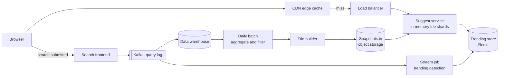
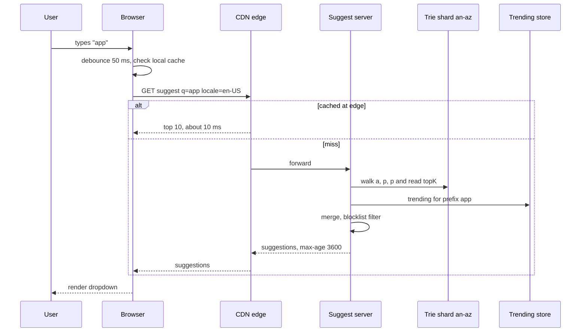

# Design Search Autocomplete (typeahead)

| | |
|---|---|
| **Asked at** | Common at search, e-commerce and consumer companies |
| **Difficulty** | Medium |
| **Core challenges** | sub-100 ms latency, top-k per prefix, data pipeline freshness, filtering |
| **Related building blocks** | [`src/trie-autocomplete`](../src/trie-autocomplete/), [`src/count-min-sketch`](../src/count-min-sketch/), [`src/bloom-filter`](../src/bloom-filter/) |

Related: [top-k-trending](./top-k-trending.md), [search and indexing](../fundamentals/search-and-indexing.md), [batch and stream processing](../fundamentals/batch-and-stream-processing.md), [caching strategies](../fundamentals/caching-strategies.md).

## 1. Requirements

### Functional
1. As the user types, return up to 10 suggested completions for the current prefix, ordered by popularity.
2. Suggestions reflect the user's language and region.
3. Trending queries (a breaking news event) appear within minutes.
4. Offensive, dangerous or personal suggestions are never shown; a reported suggestion can be removed within minutes.

### Non-functional
- Scale: 200 M DAU, 10 searches per user per day.
- Latency: suggestions visible within 100 ms of the keystroke end to end; server time p99 under 10 ms.
- Availability: 99.99 %; if autocomplete fails, search still works, so degrade silently.
- Freshness: popularity data rebuilt daily (hourly is fine); trending within ~5 minutes.

### Out of scope
- Spelling correction, the search results page, full personalisation models (covered briefly).

## 2. Estimation

| Quantity | Estimate | Implication |
|---|---|---|
| Searches | 200 M × 10 = 2 B/day | |
| Suggest requests | 2 B × ~6 requests per query (debounced keystrokes) = 12 B/day ≈ **140k/s**, peak ~400k/s | Caching at browser and CDN must absorb most of it |
| After caching | assume ~60 % served by browser or CDN → ~160k/s peak at origin | Tens of servers, each doing in-memory lookups |
| Distinct queries kept | top 100 M queries per day by count (long tail dropped) | Tail queries are rare and often contain personal data |
| Trie size | 100 M queries × 20 chars, with prefix sharing ~500 M nodes × ~80 B (children plus top-10 ids) ≈ **40 GB** | Fits in RAM on one large machine; shard by prefix to scale and to update independently |
| Query log | 2 B × 100 B = 200 GB/day | Batch aggregation in a data warehouse or Spark job |
| Latency budget | 100 ms total, ~40-60 ms is network | Server must answer in single-digit milliseconds |

## 3. API

```
GET /v1/suggest?q=<prefix>&locale=en-US&limit=10
  200: { prefix: "app", suggestions: [ { text: "apple", type: "query" }, ... ] }
  headers: Cache-Control: public, max-age=3600     (non-personalised)

GET /v1/suggest/personal?q=<prefix>               (signed-in, private, not CDN-cached)
  200: { suggestions: [ { text, source: "history" } ] }

POST /v1/suggest/reports    body: { prefix, text, reason }    202
```

The public endpoint is anonymous, idempotent and cacheable by URL, which is what lets browsers and CDNs serve repeated prefixes. The prefix is normalised (lower case, trimmed, Unicode-normalised) before it forms the cache key so `Apple` and `apple ` share one entry. Personal history is a separate call so it never pollutes shared caches. Pagination is not needed; `limit` caps the response.

## 4. Data model

```
Offline (warehouse):
  query_log     (ts, query, locale, region, user_hash, session_id)    -- raw, 30-day retention
  query_counts  (query, locale, day, count)                           -- aggregated daily

Trie snapshot (built offline, one file per shard):
  node: { char, children: [childOffset], topK: [queryId x 10] }
  queries: [ { id, text, score } ]

Online:
  trending:{locale}   Redis sorted set   query -> trending score (TTL 6 h)
  blocklist           set of normalised terms and patterns, versioned
  user_history:{uid}  last 100 queries (personal suggestions)
```

Store choices: the serving structure is a read-only, in-memory trie loaded from a snapshot in object storage. Nothing on the hot path touches a database. Aggregation runs on a batch engine over the query log. Trending state is small and volatile, so Redis sorted sets suffice.

## 5. High-level design



**Read path**: the browser debounces keystrokes (~50 ms), checks its own cache, then calls `/v1/suggest`. The CDN serves popular prefixes from the edge. A miss reaches a suggest server, which routes the prefix to the right shard, walks the trie to the prefix node (O(length of prefix)), reads the precomputed top 10, merges trending entries for that prefix, applies the live blocklist and returns.

**Write path**: submitted searches (not keystrokes) are logged to Kafka. A daily batch aggregates counts with time decay, removes blocked and rare queries, builds new trie snapshots and publishes them; servers load the new version alongside the old and switch atomically. A stream job detects trending queries and updates Redis within minutes.

## 6. Deep dives

### 6.1 Trie with top-k per node

Problem: for the prefix "a", there are millions of matching queries. Finding the top 10 at request time by walking the subtree is far too slow.

| Option | Lookup | Memory | Update |
|---|---|---|---|
| Trie, compute top-k at query time | Walk whole subtree | Small | Easy |
| **Trie with top-k cached at every node** | Walk prefix, read list: O(prefix length) | ~10 ids per node | Rebuilt offline |
| Prefix → top-k key-value map (every prefix up to N chars) | One hash lookup | Larger (no sharing) | Rebuilt offline |
| Search engine prefix queries (Elasticsearch completion suggester) | Fast, built in | Managed by the engine | Near real time |

**Choice: trie with top-k per node**, built offline. Each node stores ids of its 10 best completions, so a lookup is a walk of a few characters plus a list read: microseconds. Storing ids rather than strings keeps nodes small. The builder computes top-k bottom-up: each node's list is the best 10 among its own query (if it is a complete query) and its children's lists. A flat prefix map is a fine alternative and is what the CDN effectively becomes for short prefixes. A search engine suggester is a reasonable choice at smaller scale; at 140k/s the custom in-memory structure is cheaper and more predictable. The [`src/trie-autocomplete`](../src/trie-autocomplete/) building block implements the core structure.

Scores are not raw counts: `score = Σ count(day) × decay^(age in days)` so a query popular last year does not outrank one popular this week.

### 6.2 Data pipeline and periodic rebuild

Options:
1. **Update the trie in place on every search.** Fresh, but every update must propagate top-k changes up the path under concurrent reads, across all replicas.
2. **Periodic offline rebuild** from aggregated logs, shipped as immutable snapshots.
3. **Periodic rebuild plus a small real-time layer** for what changed since the last build.

**Choice: option 3.** Immutable snapshots are simple to reason about: build, validate (size, sanity queries, blocklist check), publish, load, swap. Rollback is loading the previous snapshot. The pipeline:
1. Search frontends log submitted queries with locale and a hashed user id.
2. A daily job counts queries per locale, drops queries seen from fewer than N distinct users (this removes personal data such as names and phone numbers, which are typed by few people), applies the blocklist, and computes decayed scores.
3. The builder produces one snapshot per (locale, shard) and writes it to object storage.
4. Servers download the new snapshot, load it into memory beside the old one, and switch a pointer. Memory must allow two copies briefly.

### 6.3 Serving tries sharded by prefix

A 40 GB trie fits on one machine, but sharding lets each locale and shard be rebuilt and deployed independently and leaves headroom for growth.

- **Shard by first letter** is simple and badly skewed: far more queries start with "s" than "x".
- **Shard by prefix ranges balanced on traffic**: the builder computes split points from the query distribution, for example `a-am`, `an-az`, `b`, `c-ce`. A small routing table (prefix range → shard) is loaded by every suggest server.
- **Replicate each shard** 3+ times across zones for availability and to spread load.

**Choice: traffic-balanced prefix ranges per locale, each replicated.** The routing table ships with each snapshot so router and data always agree.



### 6.4 Browser and CDN caching

- **Browser**: responses are cached with `max-age` of about an hour; typing "app", deleting and typing again costs nothing. The client also cancels in-flight requests when a newer keystroke arrives, so responses never render out of order.
- **CDN**: the URL (normalised prefix plus locale) is the key. Short prefixes are shared by everyone, so 1-3 character prefixes have very high hit ratios; long prefixes are mostly misses and go to origin, which is fine because each origin lookup is cheap.
- **Freshness trade-off**: an hour-long TTL means a trending term appears in the CDN only when the entry expires. Use a shorter TTL (a few minutes) for short prefixes, where trending terms matter most, and longer for long prefixes.
- **Personalisation** breaks shared caching, so the client merges the user's own history (from the private endpoint or local storage) with the public list.

### 6.5 Trending terms and filtering

**Trending**: the stream job counts queries per locale in sliding 5-minute windows using a [count-min sketch](../src/count-min-sketch/) with a heap of heavy hitters, and compares each to its baseline from the daily data. A query whose recent rate is many times its baseline gets a trending score in Redis with a TTL. The suggest server, for a prefix, takes the trending entries that start with it (stored per short prefix for direct lookup) and merges them into the top 10 with a boost. See [top-k-trending](./top-k-trending.md) for the full pipeline.

**Filtering** happens in three places:
1. Build time: blocklist terms and patterns, a classifier for hate, sexual and violent content, a minimum distinct-user threshold for privacy, and policy rules (no suggestions that pair a person's name with a crime).
2. Trending admission: new trending queries go through the classifier before they can be suggested, because trending is exactly where coordinated manipulation appears.
3. Serve time: a versioned blocklist pushed to all servers within minutes, so a reported suggestion disappears without waiting for the next build. It is a set lookup per suggestion.

## 7. Scaling and operations

- **Partitioning**: per locale, then traffic-balanced prefix ranges; routing table versioned with the snapshot.
- **Replication**: every shard on 3+ servers across zones; snapshots stored in object storage, so a new server is ready after a download and load.
- **Latency budget**:

| Step | Budget |
|---|---|
| Keystroke debounce | ~50 ms (deliberate, does not count against server) |
| Network to CDN edge | 10-30 ms |
| Edge miss to origin and back | 20-40 ms |
| Server lookup, merge, filter | under 5 ms |
| Render | ~10 ms |

- **Failure modes**: suggest service down → the search box works without suggestions; trending store down → serve the trie only; bad snapshot → validation blocks it, or roll back to the previous version; pipeline delayed → yesterday's snapshot keeps serving.
- **Monitoring**: server p99, CDN hit ratio, suggestion click-through rate (a drop after a deploy signals a bad snapshot), snapshot age, blocklist propagation delay, report volume.
- **Abuse and security**: bot traffic trying to push a term into trending is filtered by distinct-user counts and rate limits per IP; logs store hashed user ids; no personal history in shared caches.

## 8. Trade-offs summary

| Decision | Chosen | Alternative | Why |
|---|---|---|---|
| Index | Trie with top-k per node | Compute top-k on read | O(prefix) lookup in microseconds |
| Updates | Immutable daily snapshots plus trending layer | In-place updates | Simple, verifiable, easy rollback |
| Sharding | Traffic-balanced prefix ranges | First letter | Even load across shards |
| Caching | Browser plus CDN, TTL by prefix length | No edge caching | Absorbs most of the traffic within the budget |
| Personalisation | Separate private call, merged client-side | Personalise the main response | Keeps the public response cacheable |
| Filtering | Build-time, trending admission and serve-time blocklist | Build-time only | Removals take minutes, not a day |

## 9. Follow-up questions interviewers ask

- *"How do you support typo tolerance ('appel' → 'apple')?"* Add fuzzy matching within edit distance 1 for prefixes longer than a few characters, or index common misspellings as aliases at build time.
- *"How would you handle multiple languages?"* One trie per locale, Unicode normalisation, and language-specific tokenisation (for scripts without spaces, suggestions are built over characters, not words).
- *"Why not compute suggestions from the search engine's index?"* Suggestions reflect what people search for, not what documents contain; query logs are the right source, documents are a fallback for rare prefixes.
- *"How do you stop a name plus a slur becoming a suggestion?"* Build-time classifier and policy rules, trending admission checks, and the live blocklist for anything that slips through.
- *"How much does the 'minimum distinct users' threshold matter?"* A lot: it removes most personal data and spam from the tail, at the cost of slightly worse coverage for rare queries.
- *"What changes for an e-commerce site?"* Suggestions can include product and category entities, scores mix query popularity with sales, and the catalogue is smaller, so a search engine suggester may be enough.
