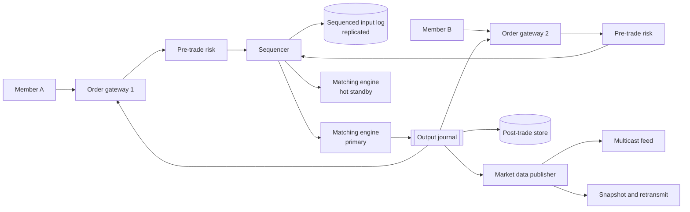
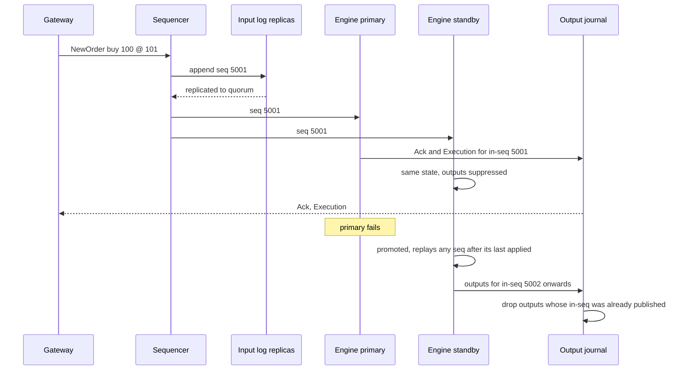

# Design a Stock Exchange (matching engine)

| | |
|---|---|
| **Asked at** | Trading firms, exchanges, brokerages and fintech; also asked elsewhere as a test of deterministic, low-latency design |
| **Difficulty** | Hard |
| **Core challenges** | deterministic matching, sequencing, replay and failover, latency |
| **Related building blocks** | [`src/snowflake-id`](../src/snowflake-id/) |

LLD version of the order book and broker classes: [stock-brokerage](https://github.com/hardyalsinghdeora/low-level-design/blob/main/problems/stock-brokerage.md).

## 1. Requirements

### Functional
1. Members (brokers, market makers) connect through an order entry gateway and submit limit and market orders, cancels and replaces, with time-in-force (day, IOC).
2. Pre-trade risk checks reject orders that break member limits or price collars.
3. A matching engine per symbol matches orders by **price-time priority** and produces executions.
4. Members receive acknowledgements, rejects and execution reports on their session.
5. Market data: top of book, depth by price level and trades, published to all subscribers.
6. The full day can be replayed deterministically for audit and recovery; a hot standby takes over without losing or duplicating a trade.

### Non-functional
- 10,000 symbols, 1 B order messages per day, peak 1 M messages/s across the exchange, ~100k/s on the busiest symbol.
- Latency: gateway in to acknowledgement out p99 under 1 ms, with the matching step itself in the tens of microseconds; low jitter matters as much as the mean.
- Fairness: orders are processed in the order the exchange received them; every participant sees market data at the same time.
- Correctness and durability: no acknowledged order or execution is lost; failover within seconds; the same input always produces the same output.

### Out of scope
- Clearing and settlement, margin, the broker's customer-facing app, regulatory reporting formats, auctions (opening and closing crosses) except as a follow-up.

## 2. Estimation

| Quantity | Estimate | Implication |
|---|---|---|
| Order messages | 1 B/day over a 6.5 h session ≈ **43k/s** avg, peak **1 M/s** | Must be processed in memory; no database on the matching path |
| Busiest symbol | **~100k msgs/s** = 10 µs per message on one thread | A single-threaded engine per symbol is feasible only with no locks, allocations or syscalls in the loop |
| Message size | ~64-100 B binary | 1 M/s × 100 B = **100 MB/s** into the sequencer; one 10 Gbps link has headroom |
| Sequenced input log | 1 B × 100 B = **100 GB/day** | Written sequentially to local NVMe and replicated; trivial for sequential I/O |
| Resting orders | typical book ~10k orders/symbol × 10k symbols × 100 B ≈ **10 GB** | Fits in memory across a few engine hosts; partition symbols across hosts |
| Executions | ~5 % of messages ≈ **50 M trades/day** | Execution reports and trade data drive downstream clearing |
| Market data out | 1 M updates/s × 1,000 subscribers | Unicast TCP fan-out would be 1 B msgs/s; use multicast (one send, the network replicates) |

## 3. API

Members use a session protocol, not REST: FIX for broad compatibility, or a compact binary protocol (Nasdaq's OUCH for order entry and ITCH for market data are well known examples) for latency.

```
Logon(memberId, sessionId, nextExpectedSeq)            authenticated session over TCP, sequence numbers per session
NewOrder(clOrdId, symbol, side, type, price, qty, tif)  price as an integer number of ticks
Cancel(clOrdId, origClOrdId)
Replace(clOrdId, origClOrdId, newPrice, newQty)         loses time priority if price changes or qty increases

← Ack(clOrdId, orderId, seq)        ← Reject(clOrdId, reason)
← Execution(orderId, execId, price, qty, leavesQty, seq)
← CancelAck(orderId, seq)

Market data (multicast, per channel of symbols):
  AddOrder / ModifyOrder / DeleteOrder / Trade / BookTop, each with a channel sequence number
  Gap recovery: retransmission service (TCP) and periodic snapshots
```

- **Idempotency**: `clOrdId` is unique per member per day; a resent `NewOrder` with a seen `clOrdId` is rejected as a duplicate. Session sequence numbers let either side detect gaps and request resends after a reconnect.
- **Prices** are integer ticks (no floating point); quantities are integers.
- **Auth**: per-member credentials, sessions bound to connections in the colocation network, kill switch per member.

## 4. Data model

```
In memory, per symbol (matching engine):
  OrderBook {
    bids: price level array or tree, best price first, each level = FIFO doubly linked list of orders
    asks: same
    ordersById: hash map orderId → node                 O(1) cancel
  }
  Order { orderId, memberId, side, price (ticks), qty, leavesQty, seqReceived }

Sequenced input log (append-only, the source of truth):
  { seq: uint64, receivedAtNs, gatewayId, memberId, message }

Output journal:
  { outSeq, inSeq, type: Ack | Execution | Cancel | Reject, payload }

Reference data (loaded at start of day): symbols, tick sizes, lot sizes, price collars, member limits
Post-trade store (Postgres or columnar, off the hot path): trades, orders for audit and queries
```

Store choice: the authoritative state is the **in-memory order book** plus the **sequenced input log**, written sequentially to local NVMe on several machines. Any database sits downstream, fed from the output journal, because even a single synchronous round trip to a database (~0.5 ms) exceeds the whole latency budget.

## 5. High-level design



**Order in**: member → gateway (session handling, decode, validate format, `clOrdId` dedup) → risk (member limits, collars) → sequencer, which stamps a global, gap-free sequence number and appends to the replicated input log → matching engine for that symbol.

**Matching**: the engine processes messages strictly in sequence order. A buy limit at 101 against asks at 100 and 101 fills at 100 first, then 101 in time order, and any remainder rests on the bid side. Each output (ack, executions) carries the input sequence number that caused it.

**Out**: outputs go to the output journal; gateways send acks and executions to the right member sessions; the market data publisher turns book changes and trades into feed messages on multicast channels.

## 6. Deep dives

### 6.1 The matching engine and order book

Problem: match 100k messages per second on one symbol with microsecond latency and strict price-time priority.

Options:
1. **Multi-threaded engine with locks on the book.** Uses more cores, but lock contention and non-deterministic interleaving make latency jittery and replay impossible.
2. **Single thread per symbol (or per group of symbols).** No locks; the order of processing is exactly the sequence order; easy to reason about and replay.
3. **Database-backed book.** Durable but orders of magnitude too slow.

**Choice: 2.** Symbols are independent, so parallelism comes from partitioning symbols across threads and hosts, not from sharing one book. Data structures:

| Structure | Use | Cost |
|---|---|---|
| Price levels in an array indexed by tick offset from a reference price (or a balanced tree for wide ranges) | Find best bid/ask, walk levels while matching | O(1) per level with an array |
| FIFO doubly linked list per price level | Time priority within a price | O(1) append and remove |
| Hash map `orderId → node` | Cancel and replace | O(1) |
| Pre-allocated object pools | No allocation or GC in the loop | Fixed memory |

The engine is a pure function of its input: `state' = apply(state, message)`, with no wall-clock reads (time comes from the sequencer's stamp) and no randomness. That property is what makes 6.2 work.

### 6.2 Sequencer, event sourcing and hot standby

Problem: the engine holds the book only in memory. If it crashes, the book must be rebuilt exactly, and the replacement must not emit a trade twice.

Options:
1. **Periodic snapshots of the book** to disk. Loses everything since the last snapshot.
2. **Replicate engine state** (primary pushes book changes to a standby). Complex, and the standby state is only as correct as the replication code.
3. **[Event sourcing](https://github.com/hardyalsinghdeora/design-patterns/tree/main/src/modern/event-sourcing) of the sequenced input.** The sequencer's log is the source of truth. Because the engine is deterministic, any engine that applies the same log from the same start state reaches the same book and emits the same outputs.

**Choice: 3.** The primary and a hot standby both consume the sequenced stream and both compute outputs; only the primary's outputs are published. On primary failure the standby is promoted; it already has the book in memory. Consumers of the output journal deduplicate by `inSeq`/`outSeq`, so if the new primary re-emits outputs the old one may already have sent, they are dropped. Snapshots at intervals bound the replay time for a cold start (load snapshot at seq N, replay from N+1).



The sequencer is itself a single point of failure; it is replicated with a consensus protocol or a primary/backup pair with fencing so that two sequencers never assign the same number. See [consensus and coordination](../fundamentals/consensus-and-coordination.md). An order is acknowledged only after its sequenced message is durable on a quorum of log replicas, so an ack is never lost.

### 6.3 Pre-trade risk checks

Checks: order size and notional limits, price collars (reject a buy far above the last trade), member credit or position limits, throttles per session, and a kill switch.

Options: (1) inside the matching engine, (2) a separate risk stage before the sequencer, (3) in the gateway per session.

**Choice: stateless checks in the gateway, stateful member limits in a risk stage before the sequencer.** Per-message checks (format, collars, max size) need no shared state and are cheapest at the edge. Credit limits need the member's open exposure across all gateways, so they live in one risk process per member that tracks open orders from the output journal. Keeping risk out of the engine keeps the engine minimal and its latency flat.

### 6.4 Market data distribution

Problem: 1,000 subscribers must see every book change, in order, at the same time.

Options:
1. **TCP per subscriber.** Reliable, but the publisher sends each message 1,000 times and slower subscribers get it later, which is unfair.
2. **UDP multicast** per channel (a group of symbols), with sequence numbers. One send; the switch replicates it; everyone receives it at nearly the same instant. Lost packets are detected by sequence gaps.
3. **A message broker** (Kafka). Durable and convenient, but adds milliseconds.

**Choice: 2 for the real-time feed**, with a TCP retransmission service for gaps and periodic snapshots for late joiners, typically run as two redundant multicast feeds (A and B) on separate networks. Option 3 is fine for downstream non-latency consumers (surveillance, post-trade). Levels of data: top of book (best bid/ask), depth by price level, and order by order; the last lets a subscriber rebuild the full book.

### 6.5 Low-latency techniques, at the right level

In an interview, name these as the reasons the design is fast rather than as implementation detail:

- **No I/O on the hot path except sequential appends**; the book is in memory, the log is append-only.
- **Single writer per data structure** removes locks; threads communicate through lock-free ring buffers (the LMAX Disruptor pattern).
- **Avoid allocation and garbage collection** in the loop (object pools, pre-sized arrays), or use a language without a GC pause.
- **Pin threads to cores, busy-spin** instead of sleeping, keep data cache friendly.
- **Kernel-bypass networking** and colocation for the last microseconds; members colocated with equal cable lengths for fairness.
- **Measure tail latency** (p99, p99.9) and jitter, not averages.

## 7. Scaling and operations

- **Partitioning**: symbols are partitioned across engine threads and hosts; each symbol belongs to exactly one engine. Rebalance only between sessions (overnight), never intraday. The sequencer can also be partitioned per symbol group if one sequencer becomes the bottleneck, since cross-symbol ordering is not needed for matching.
- **Replication**: input log replicated synchronously to a quorum before ack; hot standby engine in the same site; a warm disaster recovery site replaying the log asynchronously.
- **Caching**: none needed; everything hot is already in memory. Reference data is loaded at start of day.
- **Failure modes**: engine primary fails → standby promoted in seconds, outputs deduplicated; gateway fails → member reconnects to another gateway and resends from its last acknowledged session sequence; market data packet loss → subscriber requests retransmission or snapshot; sequencer fails → fenced failover, trading halts briefly if needed rather than risk two orderings.
- **Market protections**: circuit breakers that halt a symbol on extreme price moves; the halt is itself a sequenced message so every replica agrees on when it started.
- **Monitoring**: gateway-to-ack latency percentiles, engine queue depth, log replication lag, standby divergence (compare output hashes per sequence range between primary and standby), feed gap requests, reject rates by reason.
- **Security**: colocation network only for order entry, per-member throttles, kill switches, full audit of the input log for surveillance.

## 8. Trade-offs summary

| Decision | Chosen | Alternative | Why |
|---|---|---|---|
| Engine threading | Single thread per symbol | Locked shared book | Deterministic, no lock contention, flat latency |
| Durability | Event-sourced sequenced input log | DB writes or state snapshots only | Replay gives exact state; appends are fast |
| Failover | Hot standby consuming the same log | Cold restart from snapshot | Takes over in seconds with the book already built |
| Ack timing | After quorum log replication | After matching only | An acknowledged order can never be lost |
| Risk checks | Gateway + pre-sequencer risk stage | Inside the engine | Keeps the engine minimal and fast |
| Market data | UDP multicast + retransmit + snapshots | TCP per subscriber, Kafka | Fair, simultaneous delivery at low cost |
| Prices | Integer ticks | Floating point | Exact comparisons and deterministic replay |

## 9. Follow-up questions interviewers ask

- *"Why can't you just scale the matching engine horizontally?"* You do, by symbol. Within one symbol the book is inherently sequential: every order may interact with the best price, so splitting it would break price-time priority.
- *"How do you guarantee the standby makes the same decisions?"* Determinism: same start state, same ordered input, no wall clock or randomness in the engine. Hashing outputs per sequence range on both and comparing detects any divergence.
- *"What happens to orders in flight when the primary dies?"* Every acknowledged order is in the replicated log, so the standby has it. Orders not yet sequenced were never acknowledged; the member's session resend logic retransmits them.
- *"How are market orders handled when the book is thin?"* They match against available levels, usually within a price collar; any unfilled remainder is cancelled rather than resting (market orders have no price to rest at).
- *"How would you add an opening auction?"* Collect orders without matching, compute the single price that maximises executed volume, then uncross at that price. It is another deterministic step in the sequenced stream.
- *"Where does a database fit?"* Downstream: a post-trade store fed from the output journal for member queries, surveillance and clearing, never on the matching path.
