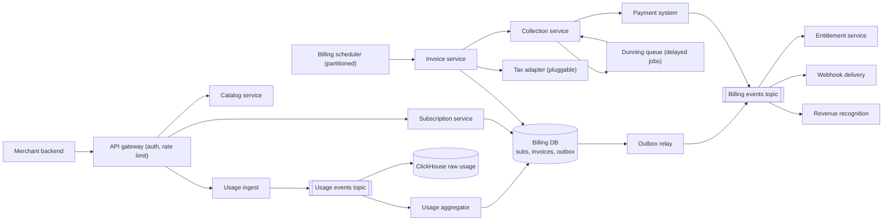
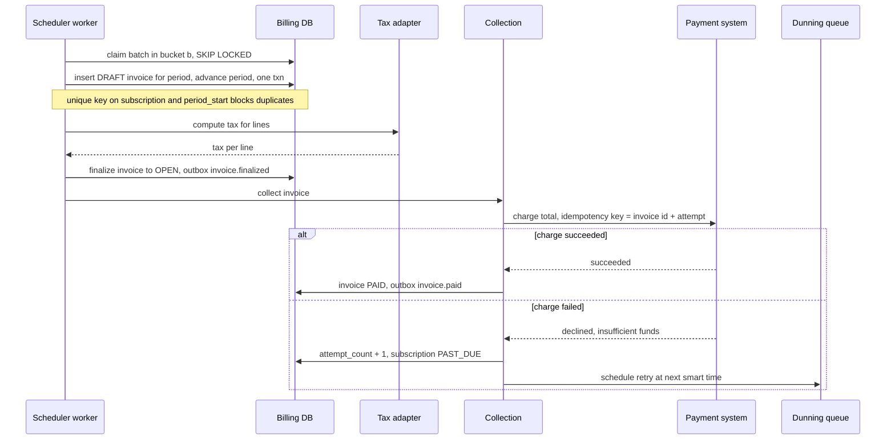

# Design a Subscription Billing Platform (Stripe Billing, Chargebee)

| | |
|---|---|
| **Asked at** | SaaS, fintech and commerce platform teams; a common senior and staff problem because it mixes scheduling, money and state machines |
| **Difficulty** | Hard |
| **Core challenges** | renewal storms, idempotent invoicing, proration, usage metering, dunning |
| **Related building blocks** | [`src/idempotency-store`](../src/idempotency-store/), [`src/timing-wheel`](../src/timing-wheel/) |

LLD version of the subscription, plan and invoice classes: [subscription-billing](https://github.com/hardyalsinghdeora/low-level-design/blob/main/problems/subscription-billing.md). Card charging itself is delegated to the [payment system](./payment-system.md).

## 1. Requirements

### Functional
1. Merchants define **products** and **prices**: flat recurring (`2900 USD / month`), per seat, tiered, or metered usage. A price has a currency, an interval (day, week, month, year) and an interval count.
2. Customers subscribe to one or more prices. Lifecycle: trial, active, past due, unpaid, paused, canceled.
3. At each period boundary (the **billing cycle anchor**) the platform generates exactly one invoice per subscription per period, adds tax, finalises it and collects payment.
4. Plan changes mid-period are **prorated**: credit for unused time on the old price, charge for remaining time on the new one.
5. **Usage-based billing**: merchants report usage events at high volume; usage is aggregated per subscription item per period and billed in arrears.
6. **Collection and dunning**: failed payments are retried on a schedule; the subscription becomes `PAST_DUE`, then `UNPAID` or `CANCELED` per merchant policy.
7. **Entitlements**: features are granted on activation and restricted on non-payment; merchants query "can customer X use feature Y".
8. Outgoing webhooks to merchants for every lifecycle event (`invoice.finalized`, `invoice.payment_failed`, `customer.subscription.updated`).
9. Revenue recognition schedules, multi-currency prices, customer time zones, and reconciliation of invoices against payments and the ledger.

### Non-functional
- 20,000 merchants, 50 M active subscriptions, 2 B usage events per day.
- Renewals cluster: about 30 % of subscriptions anchor on the 1st of the month, so ~15 M invoices fall due within a few hours.
- Correctness: never two invoices for the same subscription and period; never charge an invoice twice; totals reproducible from line items.
- Invoices for a boundary are finalised within 1 hour of the boundary; usage visible to merchants within 1 minute.
- Usage ingestion 99.99 % available (merchants call it from their hot path); invoicing may lag but must not be lost.

### Out of scope
- The card processing stack (see [payment system](./payment-system.md)), tax rule content (bought from a tax provider), the merchant's own product UI, full general ledger accounting.

## 2. Estimation

| Quantity | Estimate | Implication |
|---|---|---|
| Active subscriptions | **50 M** × ~2 KB (items, anchor, state) = 100 GB | Fits in a sharded Postgres cluster; shard by merchant |
| Invoices per month | ~55 M (renewals plus mid-cycle changes) × ~3 KB with lines = **165 GB/month**, ~2 TB/year | Partition invoices by month; archive after the audit window |
| Renewal storm on the 1st | 15 M invoices in a 1 h target = **~4,200 invoices/s** | The scheduler must be partitioned and horizontally parallel; one cron loop cannot do it |
| Charges during the storm | 4,200/s × ~85 % with auto-collection ≈ **3,500 charges/s** | Rate limit per PSP and smooth over the hour; spread anchors by time zone helps |
| Usage events | 2 B / 86,400 s ≈ **23k/s**, peak ~100k/s | A partitioned log (Kafka) absorbs bursts; never write raw events synchronously to Postgres |
| Raw usage storage | 2 B × 150 B = **300 GB/day** | Keep raw events 90 days in object storage / columnar store; keep only aggregates long term |
| Aggregates | 50 M subs × ~1.5 metered items × 1 counter per period ≈ **75 M rows/month** | Small; one row per (subscription item, period) in the billing DB |
| Dunning retries | ~5 % of charges fail first time = **2.75 M/month** in retry | A durable delayed-job queue; most retries succeed on day 1-7 |
| Outgoing webhooks | ~6 per invoice ≈ **330 M/month**, storm peak ~25k/s | Separate [webhook delivery](./webhook-delivery-system.md) pipeline with its own back-pressure |

## 3. API

```
POST /v1/products                 { name }
POST /v1/prices                   { productId, currency: "USD", unitAmount: 2900, recurring: { interval: "month", intervalCount: 1 },
                                    billingScheme: "per_unit" | "tiered", usageType: "licensed" | "metered", tiers? }
POST /v1/customers                { email, timeZone: "Asia/Kolkata", taxIds?, address }
POST /v1/subscriptions            { customerId, items: [{ priceId, quantity }], trialDays?, billingCycleAnchor?,
                                    collectionMethod: "charge_automatically" | "send_invoice", paymentMethodToken }
  headers: Idempotency-Key
PATCH /v1/subscriptions/{id}      { items: [...], prorationBehavior: "create_prorations" | "none" | "always_invoice" }
  headers: Idempotency-Key, If-Match: <version>
POST /v1/subscriptions/{id}/cancel   { atPeriodEnd: true }
POST /v1/usage-events             { eventId, customerId, meter: "api_calls", value: 1, timestamp }
  202 Accepted (async)
POST /v1/usage-events/batch       up to 1,000 events
GET  /v1/invoices?subscription=...&cursor=...&limit=50
GET  /v1/invoices/upcoming?subscription=...   preview of the next invoice including prorations
GET  /v1/entitlements?customer=...            { features: ["sso", "api_access"], refreshedAt }
```

- **Idempotency**: all mutating calls take `Idempotency-Key`; usage events carry a merchant-supplied `eventId` that is deduplicated for the whole period (6.4). Internally, invoice creation is idempotent on `(subscription_id, period_start)`.
- **Concurrency**: `PATCH` uses `If-Match` with the subscription version so two admins changing a plan at once do not both apply.
- **Pagination**: cursors on `(created_at, id)`.
- **Auth**: merchant API keys scoped by permission; usage ingestion accepts restricted keys that can only write usage.

## 4. Data model

```
products (id, merchant_id, name, active)
prices (id, merchant_id, product_id, currency CHAR(3), unit_amount BIGINT NULL,   -- minor units
        interval TEXT, interval_count INT, billing_scheme TEXT, usage_type TEXT,
        tiers JSONB NULL, active BOOL)                     -- immutable once used; new price instead of edit

subscriptions (
  id UUID PK, merchant_id BIGINT, customer_id UUID,
  status TEXT,                                -- TRIALING | ACTIVE | PAST_DUE | UNPAID | PAUSED | CANCELED | INCOMPLETE
  currency CHAR(3),                           -- fixed for the life of the subscription
  billing_anchor TIMESTAMPTZ,                 -- UTC instant of the first boundary
  billing_tz TEXT,                            -- IANA zone used for calendar arithmetic
  current_period_start TIMESTAMPTZ, current_period_end TIMESTAMPTZ,
  next_billing_at TIMESTAMPTZ,                -- = current_period_end while active
  shard_bucket SMALLINT,                      -- hash(id) mod 1024, for scheduler partitioning
  cancel_at_period_end BOOL, version INT
)
INDEX subscriptions(shard_bucket, next_billing_at) WHERE status IN ('ACTIVE','TRIALING','PAST_DUE')

subscription_items (id, subscription_id, price_id, quantity INT)

invoices (
  id UUID PK, merchant_id, subscription_id, customer_id,
  kind TEXT,                                  -- renewal | proration | one_off
  period_start TIMESTAMPTZ, period_end TIMESTAMPTZ,
  status TEXT,                                -- DRAFT | OPEN | PAID | VOID | UNCOLLECTIBLE
  currency CHAR(3), subtotal BIGINT, tax BIGINT, total BIGINT, amount_paid BIGINT,
  attempt_count INT, next_payment_attempt_at TIMESTAMPTZ NULL,
  finalized_at, created_at
)
UNIQUE (subscription_id, period_start, kind)  -- kind = 'renewal'; exactly one renewal invoice per period

invoice_lines (invoice_id, line_no, kind, price_id, quantity, amount BIGINT, period_start, period_end,
               proration BOOL, tax_amount BIGINT, description)
pending_items (id, subscription_id, amount BIGINT, currency, reason, invoiced_in UUID NULL)  -- prorations waiting for the next invoice
usage_aggregates (subscription_item_id, period_start, meter, quantity BIGINT, last_event_at,
                  PRIMARY KEY (subscription_item_id, period_start, meter))
entitlements (customer_id, feature, source_subscription_id, active BOOL, updated_at)
rev_rec_schedules (invoice_line_id, recognize_on DATE, amount BIGINT, currency, recognized BOOL)
outbox (id, aggregate_id, event_type, payload JSONB, created_at, published_at NULL)
```

Store choice: Postgres sharded by `merchant_id` (Citus or application-level shards). Subscription changes, invoice creation, pending items and the outbox row must commit together; joins between subscriptions, items, prices and invoices are constant. Raw usage events go to Kafka and then a columnar store (ClickHouse) for per-event queries and audit; only aggregates live in Postgres.

## 5. High-level design



**Subscribe**: subscription service validates prices share one currency, creates the subscription and items, computes the first period from the anchor and creates the first invoice (unless trialing). On payment success the subscription becomes `ACTIVE`; the outbox emits `subscription.activated`, and the entitlement service grants features.

**Renewal**: the scheduler finds subscriptions with `next_billing_at <= now()`, and for each one calls the invoice service, which creates a `DRAFT` invoice with recurring lines, pending prorations and usage for the closing period, calls the tax adapter, finalises to `OPEN`, and hands it to collection. The subscription's period advances in the same transaction as invoice creation.

**Usage**: merchant posts events → ingest validates and appends to Kafka keyed by `subscription_item_id` → returns 202. The aggregator consumes, deduplicates and updates per-period counters.

**Collection**: the collection service charges the default payment method through the payment system with the invoice id as the idempotency key. Success marks the invoice `PAID`; failure schedules a dunning retry and moves the subscription to `PAST_DUE`.

## 6. Deep dives

### 6.1 Generating invoices at scale, exactly once per period

Problem: 15 M subscriptions renew within the same hour; workers crash and retry; nothing may be invoiced twice or skipped.

Options:
1. **One cron job** running `SELECT ... WHERE next_billing_at <= now()` in a loop. Simple; cannot reach 4,000 invoices/s, and a crash mid-run needs careful resumption.
2. **A delayed message per subscription** (schedule a message at `next_billing_at`). Fine-grained, but tens of millions of far-future timers is awkward in most queues (SQS caps delays at 15 minutes), and the timer and the database can disagree after a plan change.
3. **Partitioned scanner over the database.** Subscriptions carry `shard_bucket = hash(id) mod 1024`. Workers lease buckets (lease in a coordination table with expiry, as in [consensus and coordination](../fundamentals/consensus-and-coordination.md)); each worker repeatedly claims a batch with `SELECT ... WHERE shard_bucket = $b AND next_billing_at <= now() ORDER BY next_billing_at LIMIT 200 FOR UPDATE SKIP LOCKED`.

**Choice: 3.** The database stays the single source of truth for when a subscription is due, so a plan change that moves `next_billing_at` is automatically respected. Throughput scales with workers up to the bucket count. Exactly-once comes from the data, not the scheduler:

- The invoice insert has `UNIQUE (subscription_id, period_start, kind)`. A retried worker gets a conflict and moves on.
- The same transaction advances `current_period_start/end` and `next_billing_at`, so a crash either did both or neither.
- The heavy work (tax call, charge) happens after commit, driven from the invoice's own state (`DRAFT` → `OPEN` → `PAID`), each step idempotent.

Merchants in many time zones naturally spread the storm, because "the 1st at 00:00" is a different UTC instant in Kolkata and in New York.



### 6.2 Proration on plan changes

Problem: a customer upgrades from a 3000 USD-cent monthly plan to a 9000 plan halfway through a 30-day period. Charge fairly, reproducibly, and without rounding drift.

Options:
1. **No proration**: new price applies next period. Simplest, but upgrades get the feature free for the rest of the period.
2. **Immediate prorated invoice**: credit unused old time and charge remaining new time now.
3. **Pending proration items** added to the next renewal invoice.

**Choice: let the merchant choose per change** (`prorationBehavior`), defaulting to 3 for downgrades and 2 for upgrades. The computation is the same:

```
fraction  = remaining_seconds / period_seconds          = 15 days / 30 days = 0.5
credit    = -round(3000 × 0.5) = -1500                   (unused old plan)
charge    = +round(9000 × 0.5) = +4500                   (remaining new plan)
net       = +3000 cents, invoiced now or at renewal
```

Rules: compute with exact integer arithmetic (`amount × remaining / period`, rounded once per line, half-even or as the merchant configures), store each proration as its own line with its period so it can be explained and recognised as revenue correctly, and preview it through `GET /invoices/upcoming` before the customer confirms. Quantity changes (seats) are the same calculation on `unit_amount × Δquantity`. Several changes in one period produce several pairs of lines; they are never netted in place.

### 6.3 Billing cycle anchors, time zones and currencies

- The anchor is stored as a UTC instant plus the IANA `billing_tz`. The next boundary is computed with calendar arithmetic in that zone (add one month, keep local midnight), so the 1st stays the 1st across DST changes.
- Anchors on the 29th to 31st clamp to the last day of shorter months and return to the original day afterwards; store the anchor day separately, not just the last boundary, or a February clamp becomes permanent.
- A subscription has one currency; all its prices must have that currency. Prices are defined per currency rather than converted at billing time, so invoices never depend on an FX rate. Currency exponents differ (JPY has 0 decimals), so amounts are always minor units with the currency beside them.

### 6.4 Usage metering at high volume

Problem: 23k events/s average with bursts, merchants retry on timeouts, events arrive late, and the invoice must use a final number.

Options:
1. **Write every event to Postgres** and `SUM` at invoice time. Correct but the write volume (100k/s peak) overwhelms the billing DB.
2. **Redis `INCRBY` per item per period.** Fast, but retries double count and a Redis failover can lose increments, which is lost revenue.
3. **Append to Kafka, aggregate in a stream processor with deduplication, persist aggregates.**

**Choice: 3.** Ingest validates the payload and appends to Kafka partitioned by `subscription_item_id`, so one consumer owns each item's counter. The aggregator deduplicates on `(merchant_id, eventId)` with a keyed state store (a Bloom filter in front of a store of exact ids for the open period; see [bloom filters](../fundamentals/bloom-filters-and-probabilistic.md)), assigns each event to a period by its `timestamp` (not arrival time), and flushes counters to `usage_aggregates` every few seconds with `quantity = quantity + Δ` in the same transaction that records the consumer offset, giving effectively-once updates. See [batch and stream processing](../fundamentals/batch-and-stream-processing.md).

Late events: the renewal invoice stays `DRAFT` for a grace window (for example one hour) so in-flight usage lands; events for a period that is already finalised are added to the next invoice as an adjustment line rather than reopening the old one. Raw events also land in ClickHouse, so a merchant can audit the total and a nightly job compares the sum of raw events with the aggregate.

### 6.5 Collection, dunning and entitlements

Dunning options:
1. **Fixed schedule** (retry on days 1, 3, 5, 7). Predictable, easy to explain.
2. **Smart retries**: choose the retry time from decline code and history (retrying an `insufficient_funds` decline near a typical payday; never retrying a `stolen_card` hard decline).
3. **Retry only when the customer updates their card.**

**Choice: 2 with 1 as the floor**, and 3 always triggers an immediate attempt. Retries are delayed jobs in a durable queue (a timing wheel over a jobs table, see [`src/timing-wheel`](../src/timing-wheel/)), each charge keyed `invoice_id:attempt_n` so a duplicated job cannot charge twice. Customers get email and in-app notices before each retry.

State machine for the subscription during dunning:

| Event | Subscription | Entitlements |
|---|---|---|
| First failure | `ACTIVE` → `PAST_DUE` | Kept (grace period) |
| Retry succeeds | `PAST_DUE` → `ACTIVE` | Kept |
| Retries exhausted, policy "cancel" | → `CANCELED` | Revoked |
| Retries exhausted, policy "mark unpaid" | → `UNPAID`, invoices still accrue | Restricted to read-only / downgraded |
| Customer pays manually later | `UNPAID` → `ACTIVE` | Restored |

The entitlement service consumes billing events and maintains `entitlements` per customer, served from a cache with a short TTL. Merchants check entitlements on their hot path, so it must stay up when the billing DB is degraded: it serves the last known state, and a stale "granted" for a few minutes is preferred over locking out a paying customer.

### 6.6 Tax, webhooks, revenue recognition and reconciliation

- **Tax** is a pluggable step between `DRAFT` and `OPEN`: an interface `calculate(invoice, customerAddress, taxIds) → tax lines`, with adapters for an external tax engine or a merchant-managed rate table. The returned rates are stored on the lines, so the invoice is reproducible even if rates change. If the provider is down the invoice waits in `DRAFT` and is retried; it is never finalised without tax.
- **Outgoing webhooks** are produced from the outbox to the [webhook delivery system](./webhook-delivery-system.md): signed, retried for days, at-least-once with event ids for receiver deduplication.
- **Revenue recognition**: cash collected is not revenue earned. An annual plan of 120000 cents paid upfront creates a schedule of twelve 10000 recognitions; the unrecognised part sits in deferred revenue. Proration lines carry their own service periods. This follows the principle in ASC 606 / IFRS 15 that revenue is recognised as the service is delivered; the accounting team owns the policy, the platform provides the schedules.
- **Reconciliation**, nightly: every `PAID` invoice has a matching succeeded payment of the same amount and currency; every succeeded payment for a billing charge points to exactly one invoice; sum of invoice totals per day equals the receivable posted to the ledger; usage aggregates equal raw event sums. Breaks go to an operations queue.

## 7. Scaling and operations

- **Partitioning**: Postgres sharded by `merchant_id`, with very large merchants on dedicated shards; scheduler buckets are global across shards (`bucket` → shard lookup). Kafka usage topic partitioned by `subscription_item_id`, hundreds of partitions for headroom.
- **Replication**: synchronous standby per shard; read replicas for invoice listing and dashboards; the entitlement cache is replicated per region.
- **Caching**: catalog (prices are immutable once used, so they cache forever), entitlements, upcoming-invoice previews for a minute.
- **Back-pressure in the storm**: the scheduler throttles charge calls to the payment system's agreed rate; invoices can be finalised faster than they are charged, and charges drain from a queue over the hour.
- **Failure modes**: scheduler worker dies → its bucket lease expires and another worker resumes, the unique key prevents duplicates; tax provider down → invoices wait in `DRAFT`, alert if older than the SLA; payment system down → invoices stay `OPEN` and collection retries, subscriptions are not moved to `PAST_DUE` for our own outage; usage aggregator lag → invoice grace window extended automatically while lag exceeds a threshold.
- **Monitoring**: subscriptions overdue for invoicing (`next_billing_at < now() - 15 min`, should be zero), invoices in `DRAFT` past the grace window, first-attempt payment success rate, dunning recovery rate, usage consumer lag, reconciliation break count, webhook backlog per merchant.
- **Security and abuse**: usage-only API keys, per-merchant ingest rate limits, validation that a usage event's customer belongs to the merchant, audit log for every manual invoice edit (edits are credit notes, never in-place changes to a finalised invoice).

## 8. Trade-offs summary

| Decision | Chosen | Alternative | Why |
|---|---|---|---|
| Renewal scheduling | Partitioned DB scan with `SKIP LOCKED` | Delayed message per subscription | DB stays the single truth for due dates; scales by bucket count |
| Exactly-once invoicing | Unique `(subscription_id, period_start)` | Scheduler-level dedup | Correct even when the scheduler misbehaves |
| Proration | Explicit credit and charge lines | Net single adjustment | Explainable, auditable, correct for revenue recognition |
| Usage counting | Kafka + dedup + offset-in-transaction | Redis `INCRBY` | No double counting on retries, no loss on failover |
| Late usage | Grace window, then next-invoice adjustment | Reopen finalised invoices | Finalised invoices are immutable documents |
| Dunning | Smart retries over a fixed floor | Fixed schedule only | Higher recovery, never retries hard declines |
| Entitlements on failure | Grace period, then restrict | Revoke at first failure | Most first failures recover within days |
| Tax | Pluggable adapter, rates stored on lines | Inline rate table | Rules change by jurisdiction; invoices must be reproducible |

## 9. Follow-up questions interviewers ask

- *"A customer upgrades and downgrades three times in one day. What does the invoice look like?"* Three pairs of proration lines, each with its own period fraction, netting to the actual time on each plan. Consider debouncing to the last change within a few minutes as a product choice.
- *"How do you change the price of a plan for existing customers?"* Prices are immutable. Create a new price, then migrate subscriptions with a scheduled change at their next boundary, with notice to customers as required by the merchant's terms.
- *"What happens if the scheduler is down for six hours?"* Nothing is lost: due subscriptions stay due. On recovery workers drain the backlog oldest first; invoices are dated by the period, not by when they were generated.
- *"How do you bill usage when the meter has billions of events per customer?"* Pre-aggregate in the stream; the invoice reads one aggregate row per item per period. Raw events stay in the columnar store for disputes.
- *"How do you handle a customer in a different currency from the merchant?"* The subscription is created in the customer's currency with prices defined in that currency; settlement conversion to the merchant's currency happens in the payment system at payout, not in billing.
- *"How is a refund for a prorated downgrade handled?"* Issue a credit note against the paid invoice; apply it to the customer balance for the next invoice or refund it through the payment system. The original invoice stays unchanged.
