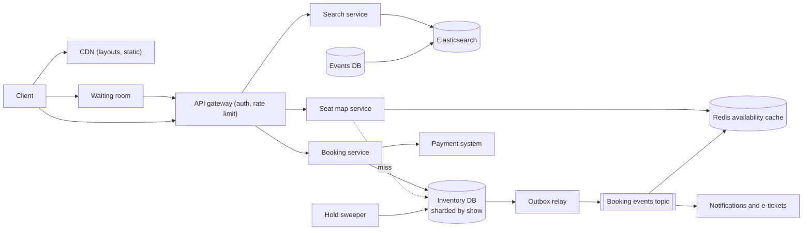
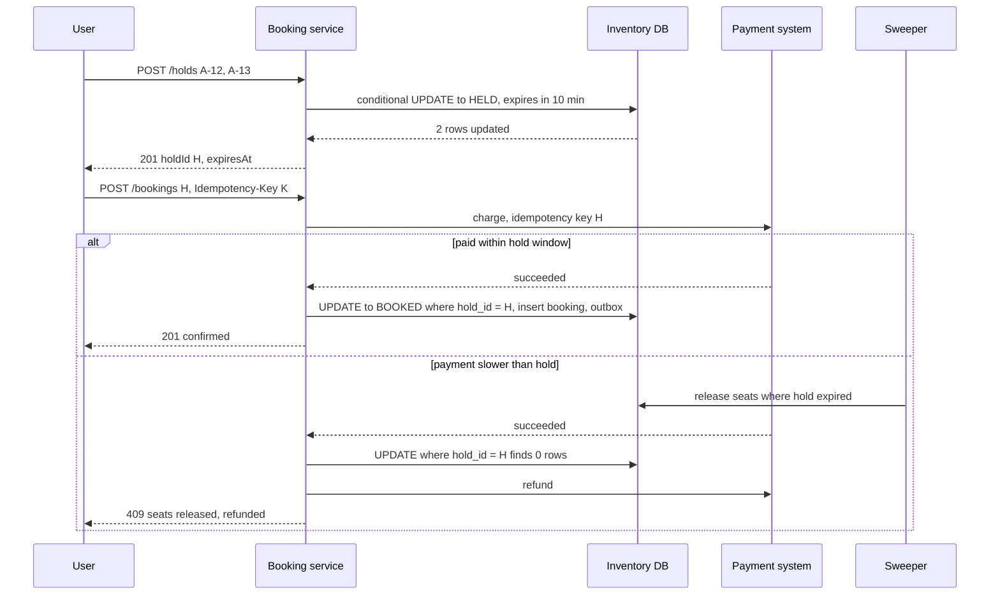

# Design a Ticket Booking System (Ticketmaster, BookMyShow)

| | |
|---|---|
| **Asked at** | Very common at product companies of every size; the standard "contention on a scarce resource" problem |
| **Difficulty** | Medium-Hard |
| **Core challenges** | seat contention, holds with expiry, hot on-sales, bots |
| **Related building blocks** | [`src/lease-lock`](../src/lease-lock/), [`src/idempotency-store`](../src/idempotency-store/), [`src/rate-limiter-algorithms`](../src/rate-limiter-algorithms/) |

LLD versions: [movie-ticket-booking](https://github.com/hardyalsinghdeora/low-level-design/blob/main/problems/movie-ticket-booking.md) and [concert-ticket-booking](https://github.com/hardyalsinghdeora/low-level-design/blob/main/problems/concert-ticket-booking.md).

## 1. Requirements

### Functional
1. Search events (movies, concerts, matches) by city, date, venue, artist and genre.
2. View a seat map with live availability for a show; general-admission events sell by quantity instead.
3. Select seats and hold them for a fixed time (e.g. 10 minutes) while the user pays.
4. Confirm the booking after payment; release the hold on timeout, cancel or payment failure.
5. Hot on-sales: a virtual waiting room in front of high-demand events.
6. Booking history, e-tickets, cancellations and refunds per event policy.

### Non-functional
- 50 M monthly users, ~1 M tickets sold per day normally; a hot on-sale brings 2 M users for a 60,000-seat stadium within minutes.
- No seat is ever sold twice. Booking is strongly consistent; browsing and search can be seconds stale.
- Seat map loads in under 500 ms p99; hold or confirm p99 under 300 ms (excluding payment).
- 99.99 % availability for search and browsing; booking can shed load to the waiting room rather than fail.

### Out of scope
- Dynamic pricing algorithms, secondary resale marketplace, venue management tools, physical entry scanning.

## 2. Estimation

| Quantity | Estimate | Implication |
|---|---|---|
| Normal bookings | 1 M/day ≈ **12/s**, evening peak ~100/s | A single relational primary would cope; shard by event for isolation and hot on-sales |
| Seat map views | ~20 views per booking = 20 M/day ≈ **230/s**, peak 2k/s | Cache seat maps per show; layout is static, only the availability bitmap changes |
| Hot on-sale arrival | 2 M users in ~5 min ≈ **6,700/s** joining the queue | The waiting room must absorb this at the edge; the booking DB never sees it |
| Hot on-sale bookings | 60,000 seats sold in ~20 min ≈ **50 holds/s** avg, 500/s bursts | Easily handled by one DB shard once admission is throttled |
| Seats per show | up to **~100,000** rows (large stadium) | All seats for a show fit on one shard; availability bitmap ~12 KB |
| Seat rows | 200 k shows/day × 300 seats ≈ **60 M rows/day** | Partition seat inventory by show date; drop or archive after the show |
| Hold expiry events | ~30 % of holds abandoned ≈ **300 k/day** normally | A sweeper or a TTL-driven release; no per-hold timer thread |

## 3. API

```
GET  /v1/events?city=BLR&date=2026-11-20&q=coldplay&cursor=...&limit=20
GET  /v1/shows/{showId}/seatmap        { layoutVersion, sections, seats: [{ id, row, number, priceTier, status }] }
GET  /v1/shows/{showId}/availability   compact bitmap + version, for polling or SSE refresh

POST /v1/shows/{showId}/holds          { seatIds: ["A-12", "A-13"] }   or  { tier: "GA", quantity: 2 }
  headers: Idempotency-Key, Admission-Token (only for queued events)
  201: { holdId, seatIds, expiresAt, amount, currency }
  409: { unavailable: ["A-13"] }
DELETE /v1/holds/{holdId}

POST /v1/bookings                      { holdId, paymentMethodToken }
  headers: Idempotency-Key
  201: { bookingId, status: "confirmed" | "payment_pending" }
GET  /v1/bookings/{id}
POST /v1/events/{id}/queue             join waiting room → { ticket, position, estimatedWait }
```

- **Idempotency**: hold and booking creation require `Idempotency-Key`; a retried `POST /bookings` returns the same booking. A hold id can back at most one booking (unique constraint).
- **Pagination**: cursor-based for search and booking history.
- **Auth**: logged-in users only for holds and bookings; per-user limits on seats per event.

## 4. Data model

```
events (id, title, performer, category, city, venue_id, starts_at, on_sale_at, queue_enabled BOOL)
shows (id, event_id, venue_id, starts_at, layout_version)
venue_layouts (venue_id, layout_version, layout JSONB)              -- static, cacheable forever

show_seats (
  show_id     BIGINT,
  seat_id     TEXT,                    -- "A-12"
  price_tier  TEXT,
  status      TEXT,                    -- AVAILABLE | HELD | BOOKED
  hold_id     UUID NULL,
  hold_expires_at TIMESTAMPTZ NULL,
  booking_id  UUID NULL,
  version     INT,
  PRIMARY KEY (show_id, seat_id)
)
INDEX show_seats(show_id, status)
INDEX show_seats(hold_expires_at) WHERE status = 'HELD'               -- sweeper

holds (id UUID PK, show_id, user_id, seat_ids TEXT[], amount BIGINT, currency CHAR(3),
       expires_at, status)            -- ACTIVE | CONSUMED | EXPIRED | RELEASED
bookings (id UUID PK, hold_id UUID UNIQUE, user_id, show_id, amount BIGINT, currency CHAR(3),
          payment_id UUID, status, idempotency_key TEXT, created_at,
          UNIQUE (user_id, idempotency_key))
ga_inventory (show_id, tier, capacity INT, held INT, sold INT,
              CHECK (held + sold <= capacity))                         -- general admission
```

Store choice: Postgres, sharded by `show_id`. All contention is within one show, so every hold and confirm is a single-shard transaction, and the row-level guarantees of a relational database are exactly what prevents double selling. Search uses Elasticsearch fed by CDC from `events`. Seat layouts are static JSON on the CDN.

## 5. High-level design



**Browse**: search hits Elasticsearch; the seat map page loads the static layout from the CDN and the availability bitmap from Redis. Booking events update the bitmap within a second; clients refresh every few seconds or over SSE.

**Hold**: client → booking service → one transaction on the show's shard that flips the requested seats from available to held (6.1). Success returns `holdId` and `expiresAt`; partial availability returns 409 with the seats that are gone, so the user can pick others.

**Book**: client → booking service → payment system with the hold id as idempotency key → on success, one transaction moves seats to `BOOKED`, consumes the hold and inserts the booking and an outbox row. E-ticket generation and notifications run off the event.

**Expiry**: the sweeper releases holds whose `hold_expires_at` has passed. Holds are also treated as expired at read time, so a slow sweeper never blocks a new buyer.

## 6. Deep dives

### 6.1 Holding seats with a TTL

Options:

| Option | How | Pros | Cons |
|---|---|---|---|
| Redis `SET seat:{show}:{seat} {holdId} NX PX 600000` per seat | First writer wins, key expires by itself | Very fast, expiry is free | Multi-seat holds need a Lua script for all-or-nothing; Redis and the DB can disagree; an async-replica failover can lose a hold and allow a double hold |
| DB row with `hold_expires_at` | Conditional `UPDATE` in one transaction | One source of truth, all-or-nothing across seats is native, durable | Expiry needs a sweeper or read-time check; more load on the DB |
| Distributed lock service per seat | Lease per seat | Generic | Extra system, still needs the DB write |

**Choice: DB row.** The hold is the moment of contention and must be correct and durable; a held seat that silently becomes available after a cache failover is a double sale waiting to happen. With admission control in front (6.3) the DB sees hundreds of holds per second per show at most, which one shard handles. The hold statement:

```
UPDATE show_seats
SET status = 'HELD', hold_id = :hold, hold_expires_at = now() + interval '10 minutes', version = version + 1
WHERE show_id = :show AND seat_id = ANY(:seats)
  AND (status = 'AVAILABLE' OR (status = 'HELD' AND hold_expires_at < now()));
-- if rows updated < cardinality(:seats): ROLLBACK and report which seats are taken
```

The `WHERE` clause makes the check and the write one atomic step per row, so two users requesting overlapping seats cannot both succeed. Locking seats in a consistent order (sort `seat_id`) avoids deadlocks between two multi-seat holds. Redis remains useful as the read-side availability cache, never as the authority.

### 6.2 Confirming: optimistic vs pessimistic locking

Problem: between hold and confirm the user pays, which takes seconds to minutes. The hold might expire in the meantime and the seat be re-held by someone else.

Options:
1. **Pessimistic**: `SELECT ... FOR UPDATE` on the seats at confirm time, check `hold_id` matches, update to `BOOKED`. Simple; the lock is held only for the confirm transaction, never across the payment.
2. **Optimistic**: read the seats' `version` when the hold is made; confirm with `UPDATE ... WHERE hold_id = :hold AND version = :v`. No lock waits; a mismatch means the hold was lost.

**Choice: optimistic, keyed on `hold_id`.** `UPDATE show_seats SET status = 'BOOKED', booking_id = :b WHERE show_id = :s AND hold_id = :hold AND status = 'HELD'` must update every seat in the hold; it succeeds even slightly after `hold_expires_at` if nobody has re-held the seat, which is the friendly outcome. If any seat was taken, the transaction rolls back and the payment is refunded automatically. Never hold a database lock across a payment call. See [transactions and isolation](../fundamentals/transactions-and-isolation.md).



To make the second branch rare: set the payment timeout well below the hold TTL, extend the hold once when the user enters the payment step (`hold_expires_at = greatest(hold_expires_at, now() + 5 min)`), and show a countdown.

### 6.3 Virtual waiting room for hot on-sales

Problem: 2 M users arrive for 60,000 seats. Without control, every one of them hammers seat maps and holds, the DB shard melts, and the fastest bots win.

Options:
1. **Autoscale everything.** The bottleneck is the single show's data and the seats themselves, which do not scale out.
2. **Rate limit and reject.** Users retry in a loop, which makes load worse and feels random.
3. **Waiting room**: users join a queue before the sale; at on-sale time, positions are assigned (randomised among early arrivals, then first come first served); an admission controller lets N users per second into the booking flow with a signed, short-lived admission token.

**Choice: 3.** The waiting room page and its position polling are served from the edge and a Redis sorted set (`ZADD queue:{event} position ticket`, `ZRANK` for position). N is tuned so active shoppers stay within what the shard handles, and it adapts to observed hold latency. Admitted users have a fixed session (for example 15 minutes) to complete a purchase; the session counts against admission capacity until it ends. When inventory sells out, everyone still queued is told immediately instead of waiting.

### 6.4 Bots, limits and idempotent booking

- **Bots**: CAPTCHA or proof-of-work at queue entry, device fingerprinting and IP reputation at the edge, verified accounts (phone, purchase history) for high-demand events, admission tokens bound to user id and event, per-user and per-payment-instrument ticket limits enforced in the hold transaction (`SELECT count(*)` of the user's active holds and bookings for the event under the same transaction). See [rate limiting](../fundamentals/rate-limiting.md).
- **Idempotent booking**: `bookings.hold_id UNIQUE` means one hold yields at most one booking even if the client, the gateway and the service all retry. The payment call uses the hold id as its idempotency key, so the card is charged at most once per hold. See [delivery semantics](../fundamentals/delivery-semantics-and-idempotency.md).
- **General admission**: no seat rows; `UPDATE ga_inventory SET held = held + :q WHERE show_id = :s AND tier = :t AND held + sold + :q <= capacity`. A hot GA tier is one row, so for very large GA on-sales use the Redis Lua counter pattern from [e-commerce flash sales](./ecommerce-platform.md) as the gate, with this row as the final guard.

### 6.5 Search and seat-map freshness

- Search over events uses Elasticsearch fed by CDC; event metadata changes rarely, so seconds of lag are fine.
- Seat availability is cached as a bitmap per show in Redis (one bit per seat, ~12 KB for 100,000 seats), updated from booking events. Clients see a seat as available up to a second after it was taken; the hold call is the authority and returns 409 for stale picks.
- For a hot show, push availability diffs over SSE to admitted users only; everyone else sees a static "on sale" page.

## 7. Scaling and operations

- **Partitioning**: inventory sharded by `show_id`. A hot event is spread across its shows (each match or screening is its own show); a single stadium show stays on one shard, protected by the waiting room. Bookings indexed by `user_id` in a CDC-fed read store for "my bookings".
- **Replication**: synchronous standby per shard; read replicas for seat-map cache misses (stale by milliseconds, acceptable because holds re-check on the primary).
- **Caching**: layouts on the CDN forever (versioned), availability bitmaps in Redis, search results for popular queries for seconds.
- **Failure modes**: Redis down → seat maps read from replicas at higher latency; booking shard primary down → holds for those shows fail for the failover window and the waiting room pauses admission; payment system down → holds are extended automatically for the outage, then released; sweeper down → read-time expiry check still frees seats.
- **Monitoring**: hold success rate and 409 rate per show, hold-to-booking conversion, expired-hold rate, waiting-room admission rate vs DB p99, refunds caused by expired holds (should be near zero), double-booking check (count of seats with two bookings, must be zero).
- **Security**: signed admission tokens, ticket QR codes signed and rotating to make screenshots useless for resale fraud, per-user limits.

## 8. Trade-offs summary

| Decision | Chosen | Alternative | Why |
|---|---|---|---|
| Hold storage | DB row with `hold_expires_at` | Redis `SET NX PX` | One durable authority; atomic multi-seat holds |
| Confirm | Optimistic on `hold_id` | `SELECT FOR UPDATE` across payment | Never holds a lock across an external call |
| Expiry | Read-time check + sweeper | Timer per hold | No timers to lose; correctness does not depend on the sweeper |
| Hot on-sale | Waiting room with admission tokens | Autoscale, rate-limit rejects | The scarce resource cannot be scaled; fairness and stability |
| Shard key | `show_id` | `user_id` | All contention is within one show, so transactions stay single-shard |
| Availability view | Cached bitmap, seconds stale | Read the primary | Seat maps are read-heavy; the hold call is authoritative |

## 9. Follow-up questions interviewers ask

- *"Two users click the same seat in the same millisecond. What happens?"* Both run the conditional `UPDATE`; row locking serialises them; the first changes the status, the second's `WHERE` no longer matches and it gets 409.
- *"Why not Redis for holds if it has TTLs built in?"* It is a good fit if Redis is the only authority and multi-seat holds use a Lua script. The risk is two sources of truth and losing holds on async failover; a DB row avoids both at a load we can afford.
- *"How do you stop a user from holding all the seats?"* A per-user cap on seats held and bought per event, checked inside the hold transaction, plus admission control on hot events.
- *"What if the user pays but the confirm request is lost?"* The payment system emits `payment.succeeded`; the booking service consumes it and confirms by hold id. The idempotent `POST /bookings` retry returns the same result.
- *"How would you support 'best available' seat selection?"* A service computes contiguous available seats from the bitmap, then attempts a hold on them; on 409 it recomputes, at most a few times.
- *"How do you handle a show being canceled?"* Mark the show canceled, stop sales, and run a batch job that refunds every booking idempotently through the payment system, emitting notifications per booking.
