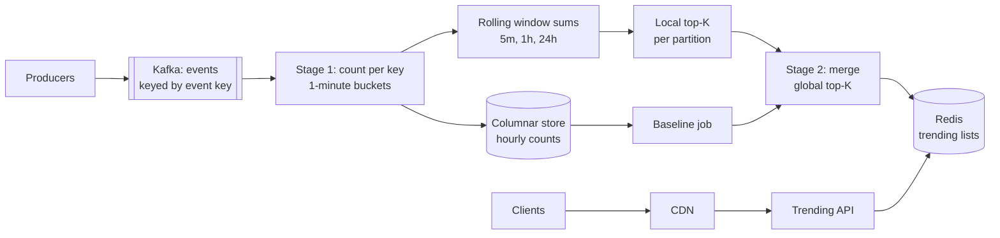
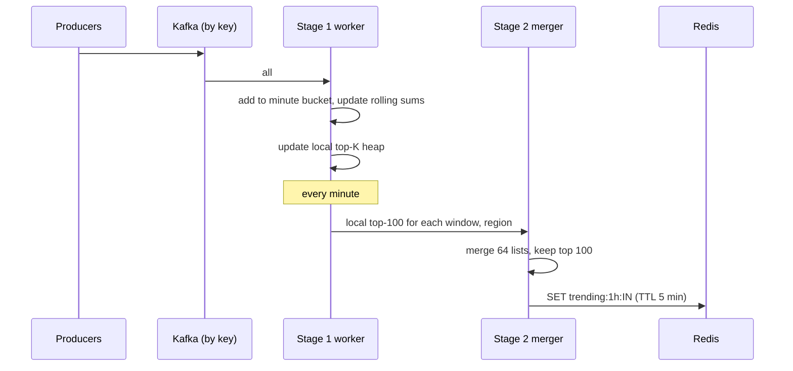

# Design Top-K Trending (hashtags, songs, searches)

| | |
|---|---|
| **Asked at** | Common at social media, music and search companies; often phrased as "top K heavy hitters" |
| **Difficulty** | Medium to Hard |
| **Core challenges** | high-cardinality counting, sliding windows, merging partial results, serving precomputed lists |
| **Related building blocks** | [`src/count-min-sketch`](../src/count-min-sketch/), [`src/hyperloglog`](../src/hyperloglog/) |

## 1. Requirements

### Functional
1. Ingest events: a hashtag used in a post, a song played, a search query typed. Each event has a key, a timestamp and a region.
2. Return the top K (K up to 100) keys by count for a window: last 5 minutes, last hour, last 24 hours.
3. Per region (country) and global lists.
4. "Trending" means rising, not just big: optionally rank by growth over a baseline.
5. Operators can block a key (offensive or spam) and it disappears from every list within a minute.

### Non-functional
- Scale: 2 B events per day, peaks around 5× average, 50 M distinct keys per hour.
- Freshness: lists updated at least every minute.
- Latency: reading a top-K list under 50 ms; it is read on every home page load.
- Durability: losing a minute of events on a crash is tolerable (lists recover from Kafka); losing the whole pipeline for more than a few minutes is not, because trends go stale on the home page.
- Accuracy: the top 10 must be right; positions 50-100 may be approximate if that saves a lot of cost. Exact counts are not shown to users.

### Out of scope
- Spam and bot filtering models (we consume a verdict), personalised trends, the search ranking that uses these lists.

## 2. Estimation

| Quantity | Estimate | Implication |
|---|---|---|
| Events | 2 B / 86,400 s ≈ **23k/s** average, peak ~**115k/s** | Kafka with tens of partitions; processing must be in-memory increments |
| Events per hour | 23k × 3,600 ≈ **83 M** | The count of the 100th key in an hour is often a few thousand; that sets the error we can tolerate |
| Distinct keys | **50 M per hour**, long tail of keys seen once | Exact counting: 50 M × ~64 B (key, count, map overhead) ≈ **3.2 GB** per hour of state, spread over workers |
| 24 h exact | 24 hourly buckets, keys overlap, say 300 M distinct × 64 B ≈ **19 GB** | Still fits across a few workers; the cost is real but not prohibitive |
| Count-Min Sketch | ε = 10^-4, δ = 10^-3 → width e/ε ≈ 27k, depth ln(1/δ) ≈ 7 → 190k counters × 4 B ≈ **760 KB** | Overcount at most ε × 83 M ≈ 8.3k per hour with probability 99.9 % |
| Read QPS | 100 M users opening the app ~5 times/day → **6k/s**, peak 30k/s | Serve precomputed lists from a cache; never compute on read |
| Stage 2 input | 64 partitions × 600 lists × 100 entries per minute ≈ **3.8 M entries/min** | One merger process handles it; shard it by region if it grows |
| Result size | 100 keys × 50 B = **5 KB** per (window, region) | 200 regions × 3 windows = 600 lists ≈ 3 MB; trivially cacheable |

## 3. API

```
-- ingestion (internal)
Kafka topic events, key = event key (hashtag, song id, normalised query), value = { key, ts, region, userId }

-- read
GET /v1/trending?window=1h&region=IN&limit=20
  200: { window: "1h", region: "IN", asOf: "2026-11-07T10:42:00Z", items: [{ key, rank, score }] }
```

The read API is public and cacheable (`Cache-Control: max-age=30`), so a CDN can absorb it. There is no pagination beyond `limit ≤ 100`. Ingestion is internal; producers normalise keys (case-fold hashtags, trim and lower-case queries) before publishing, so `#WorldCup` and `#worldcup` count together.

## 4. Data model

```
-- stream processor state (checkpointed)
minute_counts: (window_minute, region, key) → count            -- tumbling 1-minute buckets
rolling:       (window_size, region, key) → count              -- running sums over the last N buckets
topk:          (window_size, region) → min-heap of (count, key), size K

-- serving store (Redis)
trending:{window}:{region}   → JSON list of top 100, written every minute, TTL 5 min

-- history (columnar store, for baselines and analysis)
key_counts_hourly (hour, region, key, count)
```

Store choice: counting state lives inside the stream processor because it changes 100k times a second and only the processor needs it. The output is a few hundred small lists that are read constantly and replaced every minute, which is a perfect fit for a key-value cache. Hourly counts go to a columnar store so the trending baseline ("how much did this key get last week at this hour") can be read efficiently.

## 5. High-level design



**Write path**: producers publish to Kafka keyed by the event key, so every event for `#worldcup` lands in the same partition. Stage 1 counts per key in one-minute buckets and maintains rolling sums for each window. Each partition keeps its own top-K. Once a minute, stage 2 merges the partition top-Ks into the global list per window and region and writes it to Redis.

**Read path**: the client asks the CDN; on a miss the trending API reads one Redis key and returns it. No computation happens on read.

## 6. Deep dives

### 6.1 Exact counting vs approximate (Count-Min Sketch plus heap)

Problem: 50 M distinct keys per hour. Exact counts cost gigabytes of state; do we need them?

Options:

1. **Exact counts per key** in the stream processor's keyed state (RocksDB backed), with a heap of the top K updated as counts change. Exact, about 3 GB per hour of state spread over workers.
2. **Count-Min Sketch plus a heap.** The sketch is a d × w array of counters; each event increments one counter per row (one hash function per row), and the estimate is the minimum over the rows. It never undercounts and overcounts by at most εN with probability 1 - δ. A min-heap of size K holds the current leaders: after each increment, if the key's estimate exceeds the heap's minimum, it enters or updates the heap. 760 KB instead of gigabytes.
3. **Lossy counting / Space-Saving.** Keep a fixed number of counters for the most frequent keys, evicting the smallest. Bounded memory with error guarantees, deterministic.

**Choice:** exact counting (option 1) for the 5-minute and 1-hour windows, where state is a few GB and the top 10 must be right; Count-Min Sketch plus heap (option 2) for the 24 h window and for very high-cardinality inputs such as raw search queries, where exact state would be large and positions 50-100 may be approximate. With 83 M events per hour, an overcount of up to 8.3k matters only for keys near the cutoff, and the heap re-ranks them by estimate. A practical refinement: use the sketch to find candidates, then keep exact counters only for keys whose estimate passes a threshold. See [`src/count-min-sketch`](../src/count-min-sketch/) and [probabilistic data structures](../fundamentals/bloom-filters-and-probabilistic.md).

### 6.2 Sliding windows from bucketed counts

Problem: "last hour" should move every minute, not jump once an hour. Keeping every event's timestamp to evict it later is far too expensive.

Options:

1. **Tumbling windows only** (10:00-11:00). Cheap, but the list is stale for up to an hour and resets abruptly.
2. **True sliding window** (event-by-event eviction). Exact but needs every event stored for the window length.
3. **Hopping window from buckets.** Count in one-minute buckets. The 1-hour window is the sum of the last 60 buckets. Each minute, add the newest bucket to a running total and subtract the bucket that fell out.

**Choice:** option 3. Memory is one bucket per minute per key that was active in that minute, plus the running totals. The window advances once a minute, which matches the freshness requirement. For the 24 h window, use hourly buckets (24 of them) rather than 1,440 minute buckets. Count-Min Sketches support this too: sketches with the same dimensions and hash functions add element-wise, so the 24 h sketch is the sum of 24 hourly sketches, and subtracting an expired one works because counts are never negative. Keys whose running total drops to zero are removed. See [batch and stream processing](../fundamentals/batch-and-stream-processing.md).

### 6.3 Why merging per-partition top-K is lossy, and the fix

Problem: if events are spread across partitions at random (round-robin), each partition sees a slice of every key's count. Merging the per-partition top-K lists then misses keys.

Example with K = 2 and three partitions:

| Key | Partition 1 | Partition 2 | Partition 3 | Total |
|---|---|---|---|---|
| A | 10 | 10 | 0 | 20 |
| B | 0 | 9 | 10 | 19 |
| C | 8 | 8 | 8 | **24** |

Partition top-2 lists are {A, C}, {A, B} and {B, C}. Summing the reported counts gives A = 20, B = 19, C = 16, so the merged top 2 is {A, B}. The true leader C (24) loses because partition 2 cut it from its list. With a less even split, a key can rank K+1 in every partition and appear in no list at all, however large its total.

Options:

1. **Report more than K per partition** (say 10K). Reduces the error, does not remove it.
2. **Partition by key.** Hash the event key to choose the Kafka partition. Every event for a key lands in one partition, so that partition holds the key's complete count. The global top K is then guaranteed to be within the union of the local top Ks, and merging them is exact.
3. **Two-stage aggregation**: random partitioning with local pre-aggregation, then a shuffle by key to a second stage that holds complete counts.

**Choice:** option 2, with option 3's local pre-aggregation in front of it for hot keys. A viral hashtag sends all of its events to one partition; the producer side combines counts for a second ("#worldcup +3,000") before publishing, which removes the hot-key bottleneck without breaking the guarantee.



### 6.4 From "most counted" to "trending"

Raw counts make the same evergreen keys (`#love`, the top pop song) lead every day. Trending is better scored as growth over a baseline: `score = (count_now - expected) / sqrt(expected + 1)`, where `expected` is the key's count for the same hour last week from the columnar store, smoothed. Keys with no history get a minimum baseline so a brand-new hashtag with 50 uses does not outrank a real event. Stage 2 applies this score to the candidate set (the top few hundred by raw count plus the top risers), so the expensive baseline lookup runs on hundreds of keys, not millions.

### 6.5 Serving precomputed results

The read side is deliberately boring. Each (window, region) list is written to Redis once a minute as a single value, and the API serves it as is. With 600 lists of 5 KB, the entire output is 3 MB, so every API node can also cache it in process for 30 s. A CDN in front absorbs page-load traffic. If the pipeline stops, Redis entries expire after 5 minutes, and the API falls back to the last list persisted in the columnar store, marked with its `asOf` time, rather than showing nothing.

## 7. Scaling and operations

- **Partitioning**: Kafka partitioned by event key (64 partitions to start); stage 1 parallelism equals partition count. Region is a dimension inside each worker, not a partition key, so a key's global count is still complete in one place.
- **State and recovery**: stage 1 checkpoints its keyed state every 30 s; after a failure it replays Kafka from the checkpoint. Because results are recomputed every minute from full state, a replay cannot double-count in the served list.
- **Failure modes**: stage 2 down → Redis lists age and expire, API serves the last persisted list; one slow partition → stage 2 merges with that partition's previous list and flags staleness; Kafka lag → lists lag, monitored against wall clock.
- **Multi-region**: run the pipeline in one region per continent for regional lists; the global list merges the regional top-Ks, which is exact only if each key is counted in one place, so global counts come from a separate job that receives pre-aggregated per-key counts from every region.
- **Blocklist**: stage 2 filters keys against a blocklist held in memory and refreshed every 30 s, so a blocked key leaves the served lists at the next minute without touching stage 1 state.
- **Monitoring**: end-to-end lag (event time to list `asOf`), Kafka consumer lag, state size per worker, number of distinct keys per window, CMS estimate vs exact count for a sampled set of keys.
- **Abuse**: bot farms pushing a hashtag; count distinct users per key (HyperLogLog, [`src/hyperloglog`](../src/hyperloglog/)) and rank by unique users rather than raw events, cap counts per user per key per hour, and keep a blocklist for offensive keys.

## 8. Trade-offs summary

| Decision | Chosen | Alternative | Why |
|---|---|---|---|
| Counting | Exact for 5 m and 1 h; CMS + heap for 24 h | Exact everywhere | State for 24 h at high cardinality is large; long-tail precision is not needed |
| Windows | Hopping, from 1-minute buckets | True sliding window | Bounded memory; one-minute freshness is enough |
| Partitioning | By event key, plus pre-aggregation | Round-robin | Merging per-partition top-K is exact only when each key lives in one partition |
| Ranking | Growth over baseline | Raw counts | Surfaces new events instead of evergreen keys |
| Serving | Precomputed lists in Redis + CDN | Compute on read | Reads are 30k/s and identical for every user in a region |

## 9. Follow-up questions interviewers ask

- *"Why can't you just use a Redis sorted set with ZINCRBY?"* It works at small scale and for one window. At 100k events/s with 50 M keys and several sliding windows, the sorted sets grow large and every window needs its own eviction logic; the stream processor handles that better.
- *"How do you get top K for 'last 7 days'?"* Daily buckets, summed; or compute from the hourly table in the columnar store as a batch every 10 minutes, because 7-day trends do not need minute freshness.
- *"A key is in partition 3 and that worker dies. What do users see?"* The list for the next minute or two uses partition 3's last local top-K; after recovery from checkpoint, the counts catch up from Kafka.
- *"How do you test that the approximate path is good enough?"* Run exact and sketch-based counting side by side on a sample of traffic for a week and measure top-10 and top-100 overlap; ship the sketch only if top-10 overlap is 100 % and top-100 overlap is above an agreed bar such as 95 %.
- *"How is this different from ad click aggregation?"* That needs exact, billable counts per key and stores all of them; here only the top of the distribution matters and nothing is billed, so approximation is acceptable. See [ad click aggregation](./ad-click-aggregation.md).
