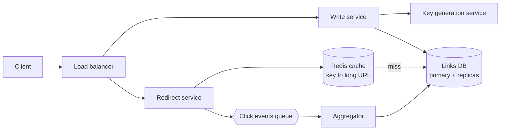

# Design a URL Shortener (TinyURL, bit.ly)

| | |
|---|---|
| **Asked at** | Nearly everywhere; the standard warm-up problem |
| **Difficulty** | Easy |
| **Core challenges** | unique key generation, read-heavy caching, redirect latency, abuse |
| **Related building blocks** | [`src/snowflake-id`](../src/snowflake-id/), [`src/consistent-hash-ring`](../src/consistent-hash-ring/), [`src/bloom-filter`](../src/bloom-filter/) |

## 1. Requirements

### Functional
1. Given a long URL, return a short URL (7 characters after the domain).
2. Visiting the short URL redirects to the long URL.
3. Optional custom alias and optional expiry.
4. Basic click counting (total clicks per link).

### Non-functional
- 100 M new links per month, 10 B redirects per month (read:write ≈ 100:1).
- Redirect p99 under 50 ms; availability 99.99 % for redirects (writes can be degraded briefly).
- Short links must be unpredictable enough that they cannot be enumerated.
- Links live for years; storage must be durable.

### Out of scope
- Analytics dashboards beyond a counter, user accounts, link editing.

## 2. Estimation

| Quantity | Estimate | Implication |
|---|---|---|
| Writes | 100 M / 2.6 M s ≈ **40/s** | One relational primary is plenty |
| Reads | 10 B / 2.6 M s ≈ **4,000/s**, peak ~10k/s | Cache in front of the DB; CDN-like edge for redirects |
| Row size | ~500 B (short key, long URL up to 2 KB, timestamps, owner) | |
| Storage | 100 M × 500 B = **50 GB/month**, ~3 TB over 5 years | Partition by key; cold data can move to cheaper storage |
| Cache | hot 20 % of a month's links ≈ 20 M × 500 B = **10 GB** | Fits a single Redis node; replicate for availability |
| Key space | 62^7 ≈ **3.5 trillion** | Enough for 100 M/month for ~2,900 years |

## 3. API

```
POST /v1/links
  body: { longUrl, customAlias?, expiresAt? }
  headers: Idempotency-Key (so a retried request does not mint two keys)
  201: { shortUrl: "https://sho.rt/aZ3k9Qp", key: "aZ3k9Qp", expiresAt }
  409: alias already taken

GET /{key}
  302 Found, Location: <longUrl>        (302 so clicks hit us and are counted; 301 would be cached by browsers)
  404 if unknown, 410 if expired

GET /v1/links/{key}/stats
  200: { clicks, createdAt, expiresAt }
```

Rate-limit `POST` per API key and per IP. Validate and normalise the long URL; reject our own domain to prevent redirect loops.

## 4. Data model

```
links (
  key         CHAR(7) PRIMARY KEY,
  long_url    TEXT NOT NULL,
  owner_id    BIGINT NULL,
  created_at  TIMESTAMPTZ NOT NULL,
  expires_at  TIMESTAMPTZ NULL,
  click_count BIGINT NOT NULL DEFAULT 0
)
INDEX links(owner_id, created_at)   -- "my links" listing
```

Store choice: the access pattern is lookup by primary key. A relational database works at this scale and gives us uniqueness for free (`PRIMARY KEY`, and a unique constraint on custom aliases). At 10× the scale, a key-value store (DynamoDB, Cassandra) partitioned by `key` is the natural move because there are no joins.

## 5. High-level design



**Create**: client → write service → get a key (section 6.1) → insert row → return. The write service is stateless, so it scales horizontally.

**Redirect**: client → redirect service → Redis `GET key` → hit: 302 immediately; miss: read replica, populate cache, 302. The click is published to a queue and counted asynchronously so the redirect path never waits on a write.

## 6. Deep dives

### 6.1 Generating unique short keys

Options:

1. **Hash the long URL** (MD5/SHA, take 7 chars). Simple, but collisions must be detected and resolved by appending a salt and retrying; the same URL always maps to the same key, which may or may not be wanted (two users shortening the same URL share click stats).
2. **Auto-increment id, base-62 encoded.** Guaranteed unique, trivially short, but sequential: anyone can enumerate every link. A single counter is also a write bottleneck and a single point of failure.
3. **Pre-generated key pool (Key Generation Service).** A background job generates random 7-char keys, stores them in an `unused_keys` table, and the write service claims a batch (e.g. 1,000) into memory. Keys are random (not enumerable), uniqueness is enforced once at generation time, and the hot path does no coordination.
4. **Distributed id (Snowflake) + base-62.** Unique without coordination, time-ordered, 11 chars after encoding; shorter only if you truncate, which brings collisions back.

**Choice:** option 3, with option 4 as the fallback when the pool is empty. Keys claimed by a service instance that crashes are simply lost, which is fine with 3.5 trillion available.

### 6.2 Keeping redirects fast

- Cache-aside in Redis with an LRU eviction policy; TTL of a day, refreshed on hit. 10 GB covers the hot set.
- Replicate the cache (one primary, replicas per region); a cache outage degrades to the DB replicas, which can serve ~50k reads/s, so the system stays up.
- Put the redirect service behind a CDN / edge workers for the hottest links if p99 across regions matters.
- Negative caching: cache "unknown key" for a minute so a scan of random keys does not hammer the database. A Bloom filter of known keys in front of the DB achieves the same with far less memory.

### 6.3 Counting clicks without slowing redirects

Incrementing `click_count` on every redirect turns a read-heavy system into a write-heavy one. Instead the redirect service emits `{key, timestamp}` to a queue (Kafka / SQS); an aggregator batches counts per key per minute and writes one `UPDATE ... SET click_count = click_count + N`. Counts are eventually consistent by a minute, which the requirements allow. For per-day analytics, write the batches to a column store instead.

### 6.4 Custom aliases and expiry

- Aliases share the `links` table; the write path is `INSERT ... ON CONFLICT DO NOTHING` and a 409 if no row was inserted. Reserve a blocklist of offensive words and system paths.
- Expiry: store `expires_at`; the redirect service checks it (410) and the cache entry's TTL is capped at the expiry. A nightly job deletes or archives expired rows.

## 7. Scaling and operations

- **Partitioning** when one database no longer suffices: hash-partition on `key` (consistent hashing in a KV store, or Postgres partitions). No cross-partition queries exist on the hot path.
- **Replication**: one write primary per region is enough at 40 writes/s; read replicas in every region serve misses.
- **Failure modes**: cache down → DB handles it at reduced p99; DB primary down → reads continue from replicas, writes fail until failover (acceptable per requirements); key pool empty → fall back to Snowflake keys.
- **Monitoring**: redirect p99, cache hit ratio (alert under 90 %), 404/410 rate (abuse scanning), key pool size, queue lag for clicks.
- **Abuse**: rate limits on creation, malware/phishing URL scanning before activation, preview page for suspicious links.

## 8. Trade-offs summary

| Decision | Chosen | Alternative | Why |
|---|---|---|---|
| Key generation | Pre-generated random pool | Base-62 of auto-increment | Not enumerable, no coordination on the hot path |
| Redirect status | 302 | 301 | 301 is cached by browsers, so clicks would never reach us |
| Click counting | Async via queue, batched | Synchronous increment | Keeps redirects read-only and fast |
| Store | Relational now, KV at 10× | KV from day one | Uniqueness constraints and simplicity at this scale |

## 9. Follow-up questions interviewers ask

- *"How would you make the same long URL always produce the same short key?"* Hash-based keys, or a unique index on `(owner_id, long_url)` with a lookup before insert.
- *"How do you prevent someone enumerating all links?"* Random keys from the pool, rate limiting, and 404s that are indistinguishable from expired links.
- *"What if the key-generation service is down?"* Instances hold a local batch; fall back to Snowflake-derived keys; alert on pool size well before it empties.
- *"How would you support link analytics by country and device?"* Enrich the click event at the edge, stream it to a columnar store (ClickHouse, BigQuery), keep the links table untouched.
- *"Why not Cassandra from the start?"* Forty writes per second does not justify giving up constraints and transactions; design for 10× and migrate when the numbers demand it.
