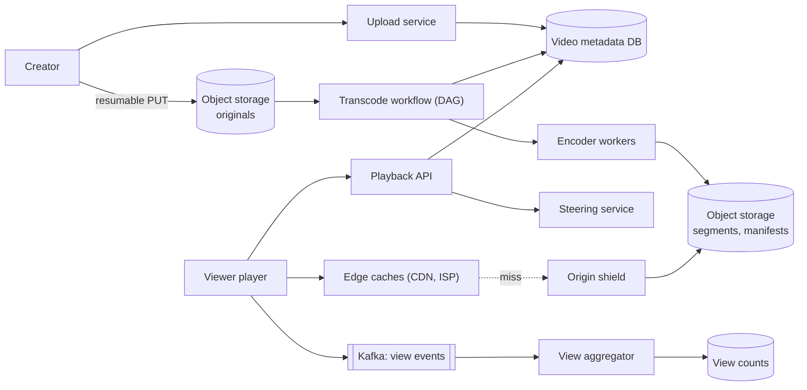
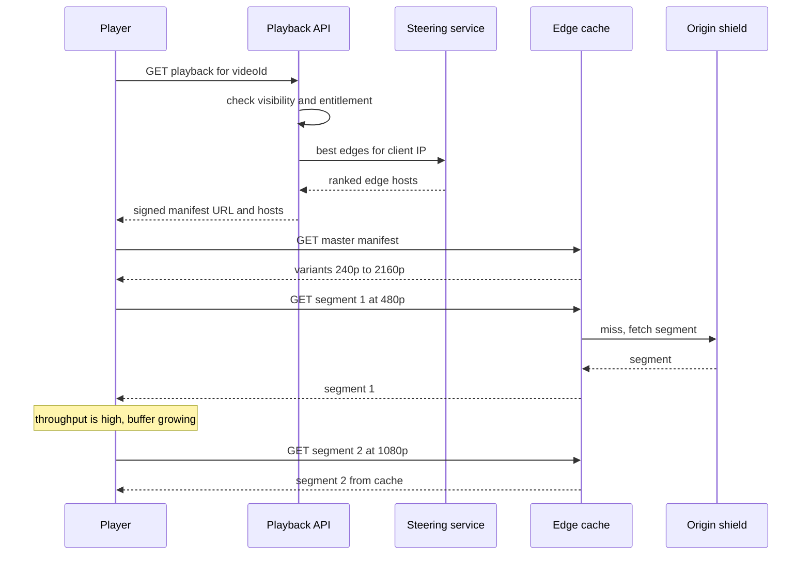

# Design a Video Streaming Platform (YouTube / Netflix)

| | |
|---|---|
| **Asked at** | Common at media, streaming and large consumer companies |
| **Difficulty** | Hard |
| **Core challenges** | transcoding throughput, adaptive bitrate, egress cost, edge caching |
| **Related building blocks** | [`src/hyperloglog`](../src/hyperloglog/), [`src/count-min-sketch`](../src/count-min-sketch/), [`src/consistent-hash-ring`](../src/consistent-hash-ring/) |

Related: [CDN and blob storage](../fundamentals/cdn-and-blob-storage.md), [batch and stream processing](../fundamentals/batch-and-stream-processing.md), [instagram](./instagram.md), [distributed-counter](./distributed-counter.md), [distributed-job-scheduler](./distributed-job-scheduler.md).

## 1. Requirements

### Functional
1. Creators upload videos (up to several GB); uploads survive network drops.
2. Uploaded videos are transcoded into multiple resolutions and bitrates and become playable.
3. Viewers stream with adaptive quality that follows their bandwidth, on phones, browsers and TVs.
4. View counts per video, shown publicly.
5. Search and recommendations exist (recommendations covered briefly).

### Non-functional
- Scale (assumptions): 500 hours of video uploaded per minute; 1 B hours watched per day.
- Startup latency: playback starts in under 2 s on a typical connection; rebuffering under 0.5 % of watch time.
- Upload to playable: under 10 minutes for a 10-minute video at common resolutions; higher resolutions may follow later.
- Durability: originals are never lost. Availability of playback 99.99 %.
- Cost: egress and storage dominate; the design must minimise both.

### Out of scope
- Live streaming, DRM licence servers in detail, comments, monetisation, the recommendation model.

## 2. Estimation

| Quantity | Estimate | Implication |
|---|---|---|
| Upload volume | 500 h/min × 1,440 = **720k hours/day** | Transcoding is a large, always-on compute fleet |
| Upload bytes | 720k h × ~2 GB/h ≈ **1.4 PB/day** in | Uploads go straight to object storage, resumable |
| Renditions | ~6 resolutions × 2 codecs ≈ 2× original bytes ≈ 2.9 PB/day | ~1 EB/year; tier the long tail and skip expensive codecs for unpopular videos |
| Transcode work | 720k h × 12 renditions ≈ 8.6 M rendition-hours/day | Chunk-parallel encoding; at ~1× real time per core that is ~360k cores busy |
| Watch time | 1 B h/day ≈ **42 M concurrent viewers** on average | Segment servers, not app servers, carry the load |
| Egress | 42 M × 3 Mbps ≈ **125 Tbps** average | Impossible from a few data centres; needs CDN and ISP-embedded caches |
| Segment requests | 42 M viewers / 4 s segments ≈ **10 M req/s** | Served entirely at the edge |
| View events | 5 B views/day ≈ **58k/s** | Stream aggregation, never a row update per view |

## 3. API

```
POST /v1/uploads                         body: { filename, sizeBytes, contentType }
  201: { uploadId, sessionUrl }          resumable session, valid 7 days
PUT  {sessionUrl}                        headers: Content-Range: bytes 0-8388607/2147483648
  308: Range: bytes=0-8388607            (more expected)    200/201 when complete
GET/PUT {sessionUrl} with Content-Range: bytes */<total>    query how much was received
POST /v1/videos                          headers: Idempotency-Key
  body: { uploadId, title, description, visibility }   202: { videoId, status: "processing" }

GET  /v1/videos/{id}                     metadata, status, available renditions
GET  /v1/videos/{id}/playback            200: { manifestUrl (signed), cdnHosts[], drm? }
GET  {manifestUrl}                       HLS .m3u8 or DASH .mpd
GET  {segmentUrl}                        video segment, served by edge cache
POST /v1/videos/{id}/views               body: { sessionId, watchedSeconds }  204
```

The resumable protocol lets the client ask the server how many bytes arrived and continue from there, so a 4 GB upload over a flaky link does not restart. `Idempotency-Key` on `POST /v1/videos` stops a retry from creating two videos for one upload. Playback URLs are signed with a short expiry and the viewer's entitlement, so links cannot be hot-linked indefinitely. View pings are idempotent per `sessionId`.

## 4. Data model

```
videos     (video_id PK, owner_id, title, description, status: uploading|processing|ready|failed,
            duration_s, visibility, created_at, original_key)
renditions (video_id, codec, height, bitrate_kbps, segment_seconds, manifest_key, status,
            PRIMARY KEY (video_id, codec, height))
transcode_tasks (job_id, task_id, video_id, stage, chunk_index, rendition, status, attempts, worker)
view_counts (video_id PK, total_views, updated_at)          -- written by the aggregator

object storage layout:
  originals/{video_id}/source
  media/{video_id}/{codec}/{height}/seg_{n}.m4s
  media/{video_id}/master.m3u8, manifest.mpd
```

Store choices: video and rendition metadata in a sharded relational store (modest size: billions of rows, strong consistency for status transitions). Task state for the transcoding DAG in a database the workflow engine owns. Bytes in object storage; segments are immutable, so every cache layer can hold them indefinitely. View counts are produced by a stream processor and stored in a key-value table.

## 5. High-level design



**Upload path**: the creator's client opens a resumable session and uploads in 8 MB chunks to object storage. Completion triggers the transcode workflow, which splits the video, encodes chunks in parallel, packages segments and manifests, and flips the video to `ready` once the base renditions exist.

**Playback path**: the player calls the playback API, which checks visibility and entitlement and asks the steering service for the best edge hosts for this client. The player fetches the manifest, picks a rendition, and downloads segments from the edge. Every few seconds it re-evaluates bandwidth and may switch rendition at the next segment. Watch progress and views are reported as events.

## 6. Deep dives

### 6.1 Transcoding pipeline as a DAG with chunked parallel encoding

Problem: encoding a 2-hour 4K film into a dozen renditions serially takes many hours. Creators want minutes.

Options:
1. **One worker per video** runs every rendition in sequence. Simple; latency equals total encode time; one failure restarts everything.
2. **One worker per rendition.** Parallel across renditions, but each still encodes the full length.
3. **DAG of tasks over chunks.** Split the source at keyframes into chunks of a few seconds, encode every (chunk, rendition) pair as an independent task, then merge and package.

**Choice: option 3.** Latency becomes roughly the time to encode one chunk plus split and merge overhead, and a failed task retries alone. The DAG:

- **Validate and probe** (container, codec, duration, corrupt-file check).
- **Split** into chunks aligned to keyframes (or scene cuts), producing chunk tasks.
- **Encode** per chunk per rendition, in parallel. Encoders force a keyframe at each segment boundary (closed GOP) so every rendition's segments line up in time, which is what lets the player switch quality between segments.
- **Merge and package** into segments of ~4 s and write HLS playlists and a DASH MPD. Using CMAF (fragmented MP4) segments lets one set of files serve both HLS and DASH.
- **Side branches** run in parallel: thumbnails, audio tracks, captions, content-ID and policy checks.

Tasks run on a workflow engine with per-task idempotency (output key derived from video, chunk and rendition), retries with backoff, and priorities: base renditions (360p, 720p) first so the video becomes playable early, high resolutions and expensive codecs (AV1) later and only for videos that gain views. Per-title encoding (choosing the bitrate ladder from the content's complexity) saves bytes on simple content such as animation.

### 6.2 Adaptive bitrate streaming (HLS and DASH)

The player never downloads "the video". It downloads a **manifest** and then a sequence of short **segments**.

- The HLS master playlist lists variant streams (resolution, bandwidth, codecs); each variant has a media playlist listing its segment URLs. DASH expresses the same in one MPD XML file with adaptation sets and representations.
- Segments are typically 2-6 s. Shorter segments adapt faster and start faster but add request overhead and slightly reduce compression efficiency.
- The player's ABR algorithm chooses the next segment's rendition from measured throughput and current buffer level. Starting at a low rendition gives a fast start; buffer-based logic avoids oscillating between qualities.



### 6.3 CDN and ISP-embedded edge caches

Problem: 125 Tbps of egress cannot leave a handful of data centres, and transit bandwidth is the largest variable cost.

| Option | How it works | Fits |
|---|---|---|
| Commercial CDN | Pull-through caches at edge PoPs | Any catalog; pay per GB |
| **ISP-embedded appliances, pre-positioned** | Operator's own cache servers inside ISP networks, filled ahead of demand | Curated catalog with predictable popularity |
| ISP-embedded, pull-through | Same placement, filled on miss | Huge long-tail catalog |

Netflix's **Open Connect** is the well-known example of the second row. Netflix offers Open Connect Appliances (storage-heavy cache servers) to qualifying ISPs at no charge; they are installed inside ISP networks or at internet exchange points where Netflix peers. Because the catalog is curated and popularity can be predicted, appliances are filled proactively during a nightly off-peak window rather than on demand. The control plane runs in AWS: when a member presses play, the playback service picks a ranked list of appliances that hold the requested files and are healthy and close in network terms, and returns their URLs to the client. Video bytes then flow from the ISP-local appliance and never cross the internet backbone.

A YouTube-style catalog has a long tail of billions of videos that no prediction covers, so its ISP caches (Google Global Cache, for example) are pull-through: popular segments are cached on first request and the tail is served from regional caches or origin.

**Choice for this design:** a tiered setup. ISP-embedded or edge caches for the head (a small fraction of videos produces most watch time), regional caches and an origin shield for the middle, and object storage for the tail. Steering assigns clients to caches by network proximity and load and uses consistent hashing of segment URLs within a site so each segment lives on one or two servers instead of every server.

### 6.4 View counting

Incrementing a database row per view would mean 58k/s writes concentrated on the hottest videos. Instead:
1. The player sends a view event once a minimum watch threshold is reached (for example 30 s or the full video if shorter), keyed by `sessionId`.
2. Events go to Kafka partitioned by video id. A stream processor dedups by `(sessionId, videoId)` over a window and drops traffic flagged by abuse signals (many views from one IP or device, headless clients).
3. Counts are aggregated per video per minute and applied to `view_counts`; the public counter is eventually consistent by a minute or so.
4. A daily batch job recomputes exact counts from the raw event log and corrects drift. Unique viewers per video are estimated with [HyperLogLog](../src/hyperloglog/); trending detection can use a [count-min sketch](../src/count-min-sketch/) over the stream.

### 6.5 Recommendations and cost (brief)

**Recommendations**: candidate generation (co-watch, subscriptions, topic similarity) produces hundreds of candidates offline and nearline; an online ranker orders them using watch-time predictions. Precomputed home-page rows are cached per user. Recommendations also steer cache filling: what the system plans to recommend tomorrow is what the edges should hold.

**Cost levers**: egress is reduced by ISP caches and better codecs (AV1 and VP9 use noticeably fewer bits than H.264 at similar quality but cost more to encode, so they are produced only for videos with enough views). Storage is reduced by tiering originals and rarely watched renditions to cold storage and regenerating low-demand renditions on demand.

## 7. Scaling and operations

- **Partitioning**: metadata by video id; transcode tasks by job id; view events by video id; edge caches partition segments by consistent hashing of URL within each site.
- **Replication**: originals in at least two regions; segments replicated by object storage and copied to regional caches on demand; metadata DB with replicas per region for playback reads.
- **Caching**: manifests have short TTLs (they change when new renditions are added); segments are immutable and cached for a long time.
- **Failure modes**: encoder worker loss → task retries elsewhere; workflow backlog → base renditions keep priority; edge failure → steering removes it and players fail over to the next host in their list; origin slow → shield absorbs repeated misses; region loss → playback API and steering fail over via DNS.
- **Monitoring**: startup time, rebuffer ratio, average delivered bitrate, playback error rate per edge and ISP, transcode queue depth and time to playable, cache hit ratio per tier, egress per tier.
- **Abuse and security**: signed and expiring playback URLs, DRM for licensed content, upload scanning for copyrighted and policy-violating content, rate limits and bot detection on view events.

## 8. Trade-offs summary

| Decision | Chosen | Alternative | Why |
|---|---|---|---|
| Upload | Resumable chunked upload to object storage | Single PUT | Large files over unreliable links |
| Transcoding | Chunked DAG, parallel per (chunk, rendition) | Serial per video | Minutes instead of hours; isolated retries |
| Segment format | CMAF segments for HLS and DASH | Separate HLS and DASH files | One copy of bytes, two manifests |
| Segment length | ~4 s | 2 s or 10 s | Balance between adaptation speed and overhead |
| Edge | Tiered: ISP caches, regional, origin shield | Single commercial CDN | Egress cost and backbone load |
| Codecs | H.264 for all, AV1/VP9 for popular | Every codec for every video | Encode cost is paid only where egress savings repay it |
| View counts | Stream dedup, minute aggregates, daily reconcile | Row increment per view | Hot videos would melt one row |

## 9. Follow-up questions interviewers ask

- *"Why can the player switch quality mid-stream without a glitch?"* All renditions share segment boundaries and each segment starts with a keyframe, so the next segment can come from any rendition.
- *"How do you make a video playable faster?"* Encode 360p and 720p first and publish the manifest with those; add higher renditions to the manifest as they finish.
- *"What happens when a video goes viral an hour after upload?"* Pull-through caches fill on the first misses; the origin shield collapses concurrent misses; the encoder queue promotes its high-quality renditions.
- *"How is live streaming different?"* Segments are produced in real time, manifests update every segment, latency targets push segment length down (low-latency HLS uses partial segments), and there is no time for chunked DAG encoding.
- *"How do you handle resume-watching across devices?"* Players send progress events; a per-user key-value store holds the last position per video, read by the playback API.
- *"How do you estimate the cache size of an ISP appliance?"* Watch time is heavily concentrated, so a cache holding the most-watched slice of the catalog can serve most bytes; size it from the popularity curve of that region.
