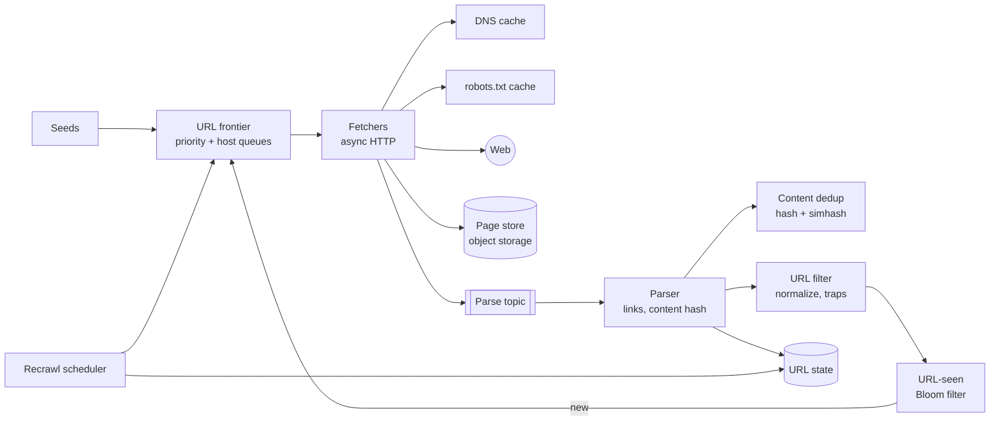
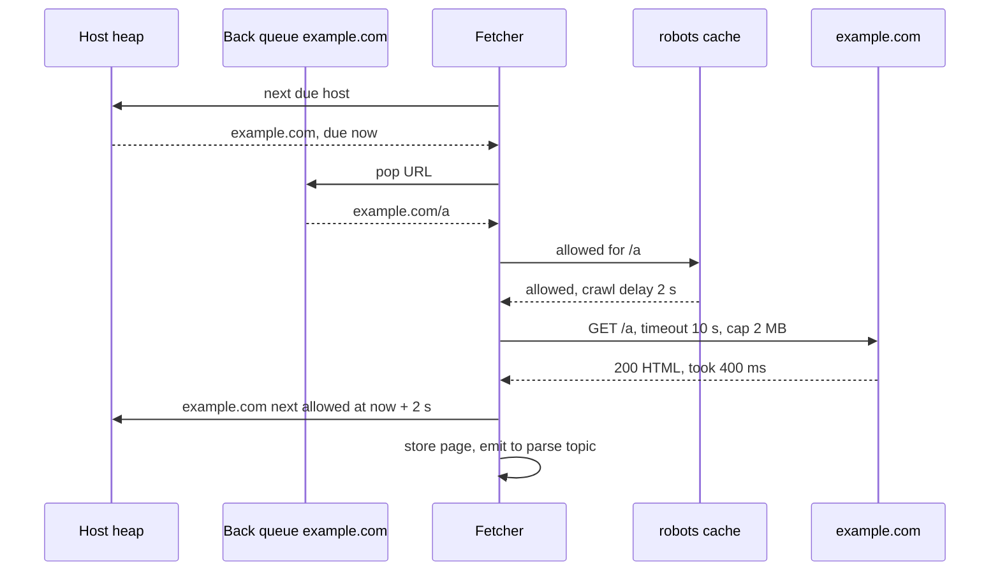

# Design a Web Crawler

| | |
|---|---|
| **Asked at** | Common at search, data and large backend teams; a standard "large-scale batch pipeline" problem |
| **Difficulty** | Medium-Hard |
| **Core challenges** | URL frontier, politeness, deduplication, spider traps |
| **Related building blocks** | [`src/bloom-filter`](../src/bloom-filter/), [`src/consistent-hash-ring`](../src/consistent-hash-ring/), [`src/rate-limiter-algorithms`](../src/rate-limiter-algorithms/) |

Concepts: [Bloom filters and probabilistic structures](../fundamentals/bloom-filters-and-probabilistic.md), [batch and stream processing](../fundamentals/batch-and-stream-processing.md), [sharding and partitioning](../fundamentals/sharding-and-partitioning.md), [search and indexing](../fundamentals/search-and-indexing.md).

## 1. Requirements

### Functional
1. Start from seed URLs, fetch pages, extract links, and keep crawling new URLs.
2. Store the raw HTML and metadata (URL, fetch time, status, content hash) for downstream indexing.
3. Respect `robots.txt` and per-host politeness (at most one connection per host, a delay between requests).
4. Avoid fetching the same URL twice in a crawl cycle and avoid storing duplicate content.
5. Recrawl pages on a schedule that depends on how often they change and how important they are.

### Non-functional
- **1 B pages per month**, HTML only.
- Politeness is a hard requirement: never overload a site, whatever our throughput target.
- Scalable to 10× by adding machines; robust to malformed HTML, slow servers and traps.
- A crashed node loses at most a few minutes of work; the frontier is durable.

### Out of scope
- Rendering JavaScript (a separate, much more expensive headless-browser tier), images and video, building the search index itself, crawling behind logins.

## 2. Estimation

| Quantity | Estimate | Implication |
|---|---|---|
| Fetch rate | 1 B / 2.6 M s ≈ **400 pages/s** avg, plan for ~1,000/s | A few dozen fetcher machines; throughput is bounded by politeness and slow servers, not CPU |
| Page size | ~100 KB average HTML | 400/s × 100 KB = **40 MB/s ≈ 320 Mbit/s** inbound; plan ~1 Gbit/s for peaks |
| Raw storage | 1 B × 100 KB = **100 TB/month**; ~25 TB compressed (HTML compresses ~4×) | Object storage, ~300 TB/year compressed; keep only the latest few versions |
| Concurrency | ~1 s average fetch time × 1,000 pages/s ≈ **1,000 in-flight fetches** (more for slow hosts) | Async I/O: tens of thousands of open connections across fetchers |
| URLs discovered | ~50 links/page × 400/s ≈ **20k URLs/s** before dedup | URL-seen check must be in memory; a DB lookup per link is too slow |
| URL-seen Bloom filter | 10 B URLs × ~9.6 bits (1 % false positives) ≈ **12 GB** | Fits in memory, sharded by host across frontier nodes |
| Frontier size | ~5 B pending URLs × ~100 B ≈ **500 GB** | Disk-backed queues with an in-memory head per queue |
| Hosts | ~100 M distinct hosts; ~1 s delay per host | Parallelism comes from many hosts at once; a single big site caps at ~86k pages/day per connection |
| DNS | ~400 lookups/s uncached | Local caching resolver; system resolvers are often blocking and slow |

## 3. API

The crawler is an internal pipeline; its interfaces are a control API and the output it writes.

```
POST /v1/seeds          { urls: [...], priority }                      (operator)
POST /v1/crawl-policies { hostPattern, maxQps, recrawlInterval, enabled }
GET  /v1/hosts/{host}   -> { robotsFetchedAt, crawlDelayMs, queued, fetched24h, errorRate }
GET  /v1/stats          -> { fetchRate, frontierSize, errorRates, dedupRate }

Internal:
frontier.enqueue(url, priority, discoveredFrom)
frontier.next(fetcherId) -> { url, host, notBefore }      (blocks until a host is due)
fetcher -> content store:  PUT pages/{yyyy-mm}/{url_hash}  body: gzip(html), metadata
fetcher -> parse topic:    { url, urlHash, contentHash, status, fetchedAt, storeKey }
```

Idempotency: the page store key is the URL hash plus crawl cycle, so a re-fetch after a crash overwrites the same object. Enqueue is idempotent through the URL-seen check. The crawler identifies itself with a descriptive `User-Agent` and a contact URL, so site owners can reach us.

## 4. Data model

```
url_state (KV store, sharded by host hash)          -- the durable record per URL
  url_hash       BYTES(8) PRIMARY KEY               -- hash of the normalized URL
  url            TEXT
  host           TEXT
  last_fetched   TIMESTAMP
  last_status    INT
  content_hash   BYTES(8)                           -- exact-duplicate check
  simhash        BYTES(8)                           -- near-duplicate check
  change_rate    FLOAT                              -- estimated changes per day
  priority       FLOAT                              -- link-based importance
  next_fetch_at  TIMESTAMP

host_state (per host, on the frontier node that owns it)
  host, robots_rules, robots_fetched_at, crawl_delay_ms, next_allowed_at, ip, error_count

content_hashes (KV)     content_hash -> canonical url_hash
pages (object storage)  pages/{cycle}/{url_hash}.html.gz  + metadata
```

Keys: shard everything by host (consistent hashing on the host name), so one frontier node owns all URLs, politeness state and robots rules of a host; no cross-node coordination is needed for politeness. Store choice: a wide-column or KV store (Bigtable, Cassandra, RocksDB per node) for `url_state` because access is by key at high write rates and the data is billions of small rows; object storage for page bodies because they are large, write-once and read in bulk by indexers.

## 5. High-level design



**One page**: the frontier hands a fetcher a URL whose host is due → the fetcher resolves the host through the DNS cache, checks the cached robots rules → fetches with timeouts and a size cap → writes the compressed HTML to the page store and a message to the parse topic → the parser extracts links and computes the content hash and simhash → content dedup marks duplicates → each extracted link is normalized, filtered for traps, and checked against the URL-seen filter → new URLs go to the frontier node that owns their host.

**Recrawl**: the recrawl scheduler scans `url_state` for `next_fetch_at <= now` and re-enqueues those URLs with their priority, bypassing the URL-seen filter for this cycle.

## 6. Deep dives

### 6.1 The URL frontier: priority and politeness

Problem: we want to fetch important pages first, but never hit one host faster than its allowed rate. A single FIFO queue fails both: important pages wait behind junk, and pages from one site arrive in bursts (a page links mostly to its own site).

Options:
1. **One FIFO queue** with a per-host rate limiter that puts back URLs whose host is busy. Workers spin on requeues; hot hosts block the queue head.
2. **Per-host queues only.** Politeness is easy, but there is no global priority.
3. **Two-level frontier (Mercator design).** Front queues by priority; back queues, one per host, each served by at most one fetcher at a time; a min-heap keyed by each back queue's `next_allowed_at`.

**Choice:** the two-level frontier. A prioritizer assigns each URL to one of F front queues (e.g. by PageRank-like score and freshness need). A router moves URLs from front queues, biased toward high priority, into the back queue for their host. A fetcher asks the heap for the host with the smallest `next_allowed_at`, waits until then, fetches one URL, and sets `next_allowed_at = now + max(crawl_delay, k × last_fetch_duration)`, so slow sites automatically get a slower rate. Each frontier node holds the queues for its hosts; queue tails live on disk, heads in memory.



### 6.2 robots.txt, DNS and fetching

- **robots.txt** (standardized as RFC 9309): fetched per host before the first page, cached for up to 24 h (the RFC says crawlers should not use a cached copy for longer than 24 h unless it is unreachable). A 4xx means no restrictions; a 5xx or timeout means treat the whole site as disallowed for now. `Crawl-delay` is not part of the standard, but honouring it is the polite choice. Rules live in `host_state` on the owning frontier node.
- **DNS**: a local caching resolver per fetcher pool, respecting TTLs; lookups are asynchronous so one slow nameserver does not stall a thread. Resolving once per host also lets us apply politeness per IP, since many small hosts share one server.
- **Fetching**: async HTTP with connect and read timeouts, a maximum body size (e.g. 2 MB), a limit on redirects (5), only `text/html` content types, and compressed transfer encoding. Follow redirects as new URLs through the frontier so politeness and dedup apply to the target too.

### 6.3 Deduplication: URLs and content

**URL dedup**: first normalize (lowercase scheme and host, remove default ports and fragments, sort or strip tracking query parameters, resolve relative paths). Then check a URL-seen set.

| Option | Memory for 10 B URLs | False results | Notes |
|---|---|---|---|
| Hash set of 8 B URL hashes | ~80 GB + overhead | None (ignoring hash collisions) | Needs disk or many nodes |
| Bloom filter, 1 % FP | ~12 GB | 1 % of new URLs wrongly treated as seen, never the reverse | Lost URLs are usually reachable via other links |
| Disk-backed sorted set with batched merge | Small memory | None | Higher latency; good as the durable record behind the filter |

**Choice:** a [Bloom filter](../src/bloom-filter/) sharded by host on frontier nodes, backed by the durable `url_state` table. A false positive skips a URL in this cycle, which is acceptable; a false negative cannot happen, so we never crawl a URL twice by mistake. Rebuild the filter each cycle from `url_state`.

**Content dedup**: a large share of the web (often estimated at a quarter or more of pages) is duplicate or near-duplicate content (mirrors, printer versions, session ids in URLs). Exact duplicates are caught by a hash of the normalized page text looked up in `content_hashes`. Near-duplicates (same article, different ads or dates) are caught by **simhash**: a 64-bit fingerprint where similar documents differ in few bits. Google's crawler work (Manku et al., 2007) used 64-bit simhash with a Hamming distance of 3 or less as "near-duplicate", with tables of permuted fingerprints to find candidates quickly. Duplicates are stored as a pointer to the canonical page and their links are not re-extracted.

### 6.4 Spider traps and bad content

Problem: some URL spaces are infinite: calendars with "next month" links forever, session ids in every link, `/a/b/a/b/a/b/...` relative-path loops, and sites that generate pages on demand.

Defenses, all applied in the URL filter:
- Maximum URL length (e.g. 2,000 characters) and maximum path depth.
- Detect repeating path segments and strip known session parameters.
- Per-host page budget per cycle, scaled by the host's importance; a small site cannot consume millions of fetches.
- Per-host "new URL ratio": if a host keeps producing new URLs whose content is near-duplicate, lower its priority and budget.
- Blocklists for known trap and spam domains, and content-type and size limits on fetch.

**Choice:** budgets and duplicate-ratio signals as the main defence, because they catch traps nobody has seen before; pattern rules handle the common cases cheaply.

### 6.5 Recrawl scheduling

Problem: with a fixed 1 B pages/month budget, how often should each page be refetched?

Options: (a) **uniform**, refetch everything every cycle: simple, wastes budget on pages that never change; (b) **change-rate based**: estimate each page's change rate from history (did the content hash change since the last fetch?) and refetch more often when it changes more; (c) **change rate weighted by importance**, so a frequently changing but unimportant page does not crowd out a homepage. **Choice:** (c). Set `next_fetch_at` from the estimated change interval, bounded between hours (news front pages) and months (static docs), and use `If-Modified-Since` / `ETag` conditional requests so unchanged pages cost a 304 and little bandwidth. Sitemaps with `lastmod` give extra hints.

## 7. Scaling and operations

- **Partitioning**: consistent hashing of host names across frontier nodes; fetchers are stateless workers that pull from frontier nodes. Parser and dedup scale independently behind the parse topic.
- **Replication and durability**: frontier queues are disk-backed and checkpointed; `url_state` is replicated by its store; the parse topic retains messages so a parser outage only delays link extraction.
- **Geography**: fetchers in several regions crawl hosts close to them, which cuts latency and lets per-host politeness be enforced by the single region that owns the host.
- **Failure modes**: fetcher crash → in-flight URLs time out on the frontier and are reissued; frontier node crash → reload from checkpoint, hosts move to another node via the ring; target site slow or erroring → back off exponentially per host, then pause it; storage outage → fetchers stop pulling from the frontier (back-pressure) rather than dropping pages.
- **Monitoring**: pages/s, fetch status mix (2xx, 3xx, 4xx, 5xx, timeouts), bytes/s, frontier size and age of oldest high-priority URL, per-host error rate, duplicate rate, robots fetch failures, DNS latency.
- **Being a good citizen**: honour robots rules and crawl delays, identify the crawler in the `User-Agent`, publish an opt-out page, cap per-IP concurrency (shared hosting), and respond to abuse complaints by pausing a host quickly.

## 8. Trade-offs summary

| Decision | Chosen | Alternative | Why |
|---|---|---|---|
| Frontier | Priority front queues + per-host back queues + heap | Single FIFO with rate limiter | Priority and politeness together, no spinning |
| Sharding | By host | By URL hash | Politeness and robots state stay on one node |
| URL dedup | Bloom filter backed by URL state | Exact hash set in memory | 12 GB vs 80+ GB; missed URLs are acceptable |
| Content dedup | Exact hash + 64-bit simhash | Exact hash only | Catches near-duplicates that make up a large share of pages |
| Trap defence | Per-host budgets + duplicate ratio | Regex rules only | Works on traps nobody has seen yet |
| Recrawl | Change rate × importance, conditional GET | Uniform cycle | Spends the fixed budget where pages change |
| JS rendering | Out of the main path | Render every page | Rendering costs many times more CPU per page |

## 9. Follow-up questions interviewers ask

- *"How would you crawl 10× faster?"* Add fetchers and frontier nodes; the throughput limit is the number of hosts we can crawl in parallel, so widen the seed set and host coverage rather than hitting the same hosts harder.
- *"How do you handle a site with 100 M pages?"* Politeness caps it at roughly one fetch per crawl delay per connection; ask the owner for a higher limit or a sitemap feed, and prioritise its pages carefully within its budget.
- *"Why is the Bloom filter's false positive acceptable here?"* It only means a new URL is skipped this cycle; important pages are usually linked from many places and get rediscovered, and the recrawl scheduler fetches known URLs from `url_state` without the filter.
- *"How would you render JavaScript-heavy sites?"* A separate tier of headless browsers fed by a classifier that flags pages whose HTML lacks content; it is far more expensive per page, so only a small share goes there.
- *"How do you detect that a page changed in a meaningful way?"* Compare simhash of the main content, not the raw bytes, so rotating ads or timestamps do not count as changes.
- *"How do you stop the crawler being used against a site (or our own network)?"* Block private IP ranges and internal hostnames after DNS resolution, and cap per-IP request rates regardless of host name.
