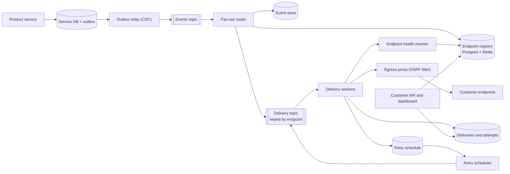
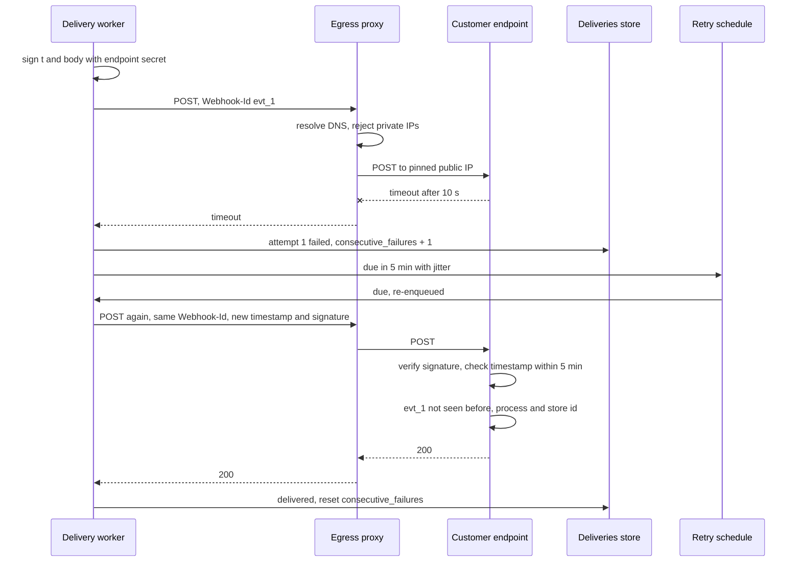

# Design a Webhook Delivery System (Stripe, GitHub outbound webhooks)

| | |
|---|---|
| **Asked at** | API platform, payments and developer-tools companies; often a follow-up to a payment or billing design |
| **Difficulty** | Medium |
| **Core challenges** | at-least-once delivery, slow endpoints, signatures, SSRF |
| **Related building blocks** | [`src/idempotency-store`](../src/idempotency-store/), [`src/timing-wheel`](../src/timing-wheel/), [`src/rate-limiter-algorithms`](../src/rate-limiter-algorithms/) |

## 1. Requirements

### Functional
1. Product services emit events (`invoice.paid`, `payment.failed`); no event committed by a service is ever lost.
2. Customers register HTTPS endpoints and choose which event types each receives.
3. Each matching event is POSTed to each endpoint with a signature the receiver can verify.
4. A non-2xx response or timeout is retried with exponential backoff for about three days.
5. Endpoints that keep failing are marked unhealthy and eventually disabled, with notice to the customer.
6. Customers can see an event log with every attempt (status, latency, response snippet) and redeliver any event.

### Non-functional
- 500 M events per day, ~2 matching endpoints per event, peaks of 5× average.
- Delivery latency for healthy endpoints: p99 under 5 s from event commit to first attempt.
- At-least-once delivery; receivers deduplicate by event id. No ordering guarantee by default.
- One slow or failing customer must not delay anyone else's deliveries.
- The system must never be usable to reach our internal network (SSRF).

### Out of scope
- Inbound webhooks from third parties (a different problem: verify, enqueue, ack), customer-hosted queues (EventBridge-style push), payload transformation.

## 2. Estimation

| Quantity | Estimate | Implication |
|---|---|---|
| Events | 500 M/day ≈ **5,800/s**, peak ~29k/s | Kafka for the event stream; partition by account |
| Deliveries | 2 per event = 1 B/day ≈ **11.6k/s**, peak ~58k/s | Horizontally scaled stateless delivery workers |
| Concurrent HTTP requests | 11.6k/s × 0.3 s avg response ≈ **3,500**; with slow endpoints at a 10 s timeout, far more | Non-blocking HTTP client; per-endpoint concurrency caps so slow endpoints cannot consume all connections |
| Retries | ~2 % of first attempts fail ≈ **20 M/day** entering the retry schedule | A durable delayed-retry store, not in-memory timers |
| Event payload | 500 M × 2 KB = **1 TB/day**; 30-day retention ≈ 30 TB | Payloads in object storage or a wide-column store, keyed by event id |
| Attempt log | 1.1 B attempts × 300 B = **330 GB/day** | Wide-column store partitioned by endpoint and day, TTL 30 days |
| Endpoints | 2 M registered | Subscription registry fits in Postgres with a Redis cache |

## 3. API

```
POST   /v1/webhook-endpoints            { url, enabledEvents: ["invoice.*", "payment.failed"], description }
  201: { id, url, secret: "whsec_..." }  (secret shown once; rotate with a grace period)
PATCH  /v1/webhook-endpoints/{id}       { enabledEvents?, disabled? }
POST   /v1/webhook-endpoints/{id}/rotate-secret   { expireOldAfterSeconds: 86400 }
GET    /v1/events?type=...&cursor=...&limit=100
GET    /v1/events/{id}/deliveries        attempts per endpoint
POST   /v1/events/{id}/redeliver         { endpointId }   headers: Idempotency-Key

Outbound request to the customer:
POST https://customer.example.com/hooks
  Content-Type: application/json
  Webhook-Id: evt_01HF...                       (stable across retries)
  Webhook-Signature: t=1731000000,v1=<hex HMAC-SHA256(secret, t + "." + body)>
  body: { id: "evt_01HF...", type: "invoice.paid", apiVersion: "2026-10-01", created, data: { object: {...} } }
```

- **Idempotency**: the event id is stable across retries and redeliveries; receivers store processed ids. Redelivery requests take an `Idempotency-Key` so a double click does not queue two redeliveries.
- **Pagination**: cursor on `(created_at, id)` for the event log.
- **Auth**: customer API keys for management; the shared endpoint secret authenticates our requests to them.

## 4. Data model

```
endpoints (id, account_id, url, secret_ciphertext, prev_secret_ciphertext NULL, prev_secret_expires_at NULL,
           enabled_events TEXT[], status TEXT,            -- ENABLED | DEGRADED | DISABLED
           api_version TEXT, ordering TEXT DEFAULT 'none', -- 'none' | 'per_key'
           consecutive_failures INT, failing_since TIMESTAMPTZ NULL, created_at)
INDEX endpoints(account_id)

outbox (id, account_id, event_type, payload JSONB, created_at, published_at NULL)   -- in each producer's DB

events (event_id, account_id, type, api_version, created_at, payload_ref)  -- wide-column, partition (account_id, day)
deliveries (endpoint_id, event_id, status, attempt_count, next_attempt_at, last_status_code, updated_at,
            PRIMARY KEY (endpoint_id, event_id))
attempts (endpoint_id, day, event_id, attempt_no, at, status_code, latency_ms, error, response_snippet)
retry_schedule (due_bucket_minute, shard, endpoint_id, event_id)   -- time-bucketed due list
```

Store choice: **Postgres** for endpoints (small, relational, edited by customers) cached in Redis. **Cassandra or DynamoDB** for events, deliveries and attempts: high write rate, simple key access, TTL-based expiry. Payload bodies over a size threshold go to object storage, referenced by `payload_ref`.

## 5. High-level design



**Emit**: a product service writes its state change and an outbox row in one transaction; a relay publishes the row to Kafka. This is the only way to avoid "committed but no event" and "event but rolled back". See [transactional outbox and CDC](../fundamentals/transactional-outbox-and-cdc.md).

**Fan out**: the router stores the event, looks up the account's enabled endpoints whose filters match the type (cached), and produces one delivery message per endpoint onto the delivery topic keyed by `endpoint_id`.

**Deliver**: a worker signs the body, POSTs through the egress proxy with a 10 s timeout, records the attempt, and on success marks the delivery done. On failure it computes the next attempt time and writes the delivery into the retry schedule; the retry scheduler re-enqueues due deliveries.

## 6. Deep dives

### 6.1 Retries, backoff and isolating slow endpoints

Problem: some endpoints are down for hours, some respond in 9 s, and a naive shared queue lets them block healthy deliveries (head-of-line blocking).

Retry storage options:
1. **Re-enqueue with a delay** in the broker. SQS supports at most 15 minutes of delay; longer waits need re-delaying, and Kafka has no per-message delay.
2. **In-memory timers** in workers. Lost on restart.
3. **Durable time-bucketed schedule**: write `(due_minute, shard, endpoint_id, event_id)`; the retry scheduler scans the current minute's buckets and re-enqueues (a timing wheel over durable storage; see [`src/timing-wheel`](../src/timing-wheel/)).

**Choice: 3.** Schedule (attempt → delay after previous): 1 min, 5 min, 30 min, 2 h, 6 h, then 12 h five times. Total ≈ 1 + 5 + 30 + 120 + 360 + 3,600 min ≈ **68.6 h, about 3 days** over 11 attempts. Add ±10 % jitter so retries from a recovered endpoint do not arrive in one spike. Retry on timeouts, connection errors, 408, 429 and 5xx; also retry other 4xx, because a misconfigured receiver that fixes itself should still get the event. Honour `Retry-After` on 429 within our cap. See [retry with backoff](https://github.com/hardyalsinghdeora/design-patterns/tree/main/src/modern/retry-with-backoff).

Isolation: each worker enforces a per-endpoint concurrency cap (for example 10 in flight) and a per-endpoint rate limit. Endpoints classified as slow (p50 over 2 s) or failing are routed to a separate worker pool ([bulkhead](https://github.com/hardyalsinghdeora/design-patterns/tree/main/src/modern/bulkhead)), so healthy endpoints keep a short queue. A per-endpoint [circuit breaker](https://github.com/hardyalsinghdeora/design-patterns/tree/main/src/modern/circuit-breaker) stops hammering a dead endpoint: while open, new deliveries go straight to the retry schedule.



### 6.2 Signatures and replay protection

Options:
1. **HMAC-SHA256 of the body only** (GitHub's `X-Hub-Signature-256` style). Proves origin and integrity, but a captured request can be replayed later.
2. **HMAC-SHA256 over `timestamp + "." + body`**, sending the timestamp and signature in a header (the scheme Stripe documents). The receiver rejects requests whose timestamp is more than a tolerance (for example 5 minutes) from its clock, which bounds replay to that window; event id deduplication covers the rest.
3. **Asymmetric signatures** (Ed25519). Receivers verify with a public key, so a leaked receiver config does not let anyone forge events. More work for receivers.

**Choice: 2**, with 3 offered as an option for customers who want it. Each attempt is re-signed with a fresh timestamp. Receivers must compare signatures in constant time and verify against the raw body bytes before parsing. Secret rotation: during a grace period we sign with both old and new secrets (two `v1=` values in the header) so receivers can switch without dropped events. Secrets are stored encrypted with a KMS key. See [security basics](../fundamentals/security-basics.md).

### 6.3 Ordering and versioning

Problem: `invoice.paid` may arrive before `invoice.finalized` because of retries and parallel workers.

Options:
1. **No ordering guarantee** plus `created` timestamps, event versions and "fetch the latest object" guidance. Receivers that care call the API for current state.
2. **Per-key ordering**: deliveries for the same `(endpoint, object_id)` go through one partition in order; a failing event blocks later events for that key until it succeeds or exhausts retries.
3. **Global per-endpoint ordering**: one failure stalls everything for that endpoint for up to three days.

**Choice: 1 by default, 2 as an opt-in per endpoint.** Head-of-line blocking is the real cost of ordering; scoping it to one object keeps it small. Every payload carries `apiVersion` (the endpoint's pinned version) so payload shapes never change under a receiver; new fields arrive only with a version upgrade the customer chooses. Payloads also carry the object's own version or `updated` counter so receivers can drop stale updates.

### 6.4 SSRF protection

Problem: customers choose the URL. Without controls, `http://169.254.169.254/` (cloud metadata), `http://10.0.0.5/admin` or a hostname that resolves to an internal address turns our workers into a proxy into our network.

Defences, all needed:
1. Allow only `https` and ports 443 (optionally 8443) in production.
2. Resolve DNS in the egress proxy, reject any address in private or special ranges: `10.0.0.0/8`, `172.16.0.0/12`, `192.168.0.0/16`, `127.0.0.0/8`, `169.254.0.0/16`, `100.64.0.0/10`, `0.0.0.0/8`, and IPv6 `::1`, `fc00::/7`, `fe80::/10`, plus IPv4-mapped IPv6 forms.
3. **Connect to the IP that was validated** (pin it, send the hostname for TLS SNI). Validating and then letting the HTTP client resolve again is open to DNS rebinding.
4. Do not follow redirects (or re-validate each hop).
5. Run the egress proxy in an isolated network segment with no route to internal services, as a backstop if the checks have a bug.

Validation at registration time is a convenience for users; the check at send time is the one that matters.

### 6.5 Endpoint health and automatic disabling

The health monitor tracks per endpoint: consecutive failures, `failing_since`, success rate over the last hour. Policy: `DEGRADED` after 20 consecutive failures (moved to the slow pool, email to the account), `DISABLED` after all deliveries have failed continuously for 3 days (email and dashboard banner). A disabled endpoint stops receiving new deliveries; the event log still records the events so the customer can redeliver after fixing it. Re-enabling sends a test event first. This bounds wasted work: a long-dead endpoint costs us nothing after the third day.

## 7. Scaling and operations

- **Partitioning**: events topic by `account_id`; delivery topic by `endpoint_id` so per-endpoint limits are enforced in one place; wide-column tables by `(endpoint_id, day)`.
- **Replication**: Kafka replication factor 3 with `acks=all`; Cassandra RF 3 with quorum writes for deliveries; Postgres standby for the registry.
- **Caching**: endpoint registry and filters in Redis and in worker memory with short TTLs; invalidated by registry change events.
- **Failure modes**: delivery workers crash → Kafka redelivers uncommitted messages, producing a duplicate send that receivers deduplicate; event store slow → fan-out applies back-pressure, events wait in Kafka; retry scheduler down → due retries pile up and are sent late, not lost; a large customer outage → their deliveries move to the slow pool and the retry schedule absorbs millions of entries.
- **Monitoring**: commit-to-first-attempt latency p99, delivery success rate overall and per endpoint, retry schedule size, slow-pool queue depth, endpoints disabled per day, egress proxy blocks (an SSRF attempt or a misconfiguration).
- **Abuse**: per-account limits on endpoints and redeliveries, response bodies truncated to a few KB before storage, no forwarding of response headers to the dashboard beyond a safe list.

## 8. Trade-offs summary

| Decision | Chosen | Alternative | Why |
|---|---|---|---|
| Event capture | Transactional outbox | Publish from application code | No lost or phantom events |
| Delivery semantics | At-least-once + event id | Exactly-once | Exactly-once across an HTTP boundary is not achievable; dedup is cheap for receivers |
| Retry store | Durable time-bucketed schedule | Broker delay, in-memory timers | Delays of hours, survives restarts |
| Backoff | ~11 attempts over ~3 days with jitter | Fixed interval | Covers long outages without thundering herds |
| Signature | HMAC-SHA256 over timestamp and body | Body-only HMAC | Bounds replay to a 5-minute window |
| Ordering | None by default, per-key opt-in | Per-endpoint FIFO | Limits head-of-line blocking to one object |
| Isolation | Per-endpoint caps, slow pool, breaker | One shared pool | One bad endpoint cannot delay everyone |
| SSRF | Resolve, validate, pin IP in isolated egress | Validate URL at registration | Defeats DNS rebinding and redirects |

## 9. Follow-up questions interviewers ask

- *"Why not guarantee exactly-once delivery?"* We cannot know whether a receiver that timed out processed the request. At-least-once with a stable event id moves deduplication to the one place that knows: the receiver's own database.
- *"How should the receiver handle a webhook?"* Verify the signature on the raw body, check the timestamp, insert the event id into a processed-events table (unique), enqueue the work, return 2xx quickly. Heavy work in the request leads to timeouts and retries.
- *"A customer was down for a week. How do they recover?"* The event log lists every event; they redeliver in bulk by time range, or page through `GET /events` and reconcile against the API.
- *"How do you send 50 M events for one customer after a bulk import without hurting others?"* Per-account and per-endpoint rate limits; the excess waits in the delivery topic partition for that endpoint, and fan-out for other accounts is unaffected.
- *"How do you test that an endpoint works?"* A test event type sent on registration and on demand, shown with the full attempt record in the dashboard.
- *"Where would you store the idempotency of redelivery requests?"* The same pattern as [`src/idempotency-store`](../src/idempotency-store/): key, request hash and stored response, with a TTL.
